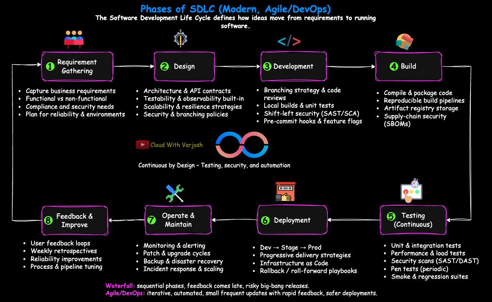

# 02 · The SDLC and Delivery Models

> **Level:** ★ foundation · **Status:** ✅ rewritten from your notes
>
> **You will learn:** the 8 phases every piece of software goes through, what "production notes" a DevOps/SRE engineer cares about in each one, and why the industry moved from Waterfall to Agile/DevOps.
>
> **You need:** topic 01.
>
> **From your original notes:** Day 01 › *The Software Development Life Cycle (SDLC)*, *Phases of SDLC*, *Waterfall vs Agile/DevOps*, *Key Differences*, *Role of Git in Modern SDLC*.
>
> 🎥 Original video: [Modern SDLC Explained](https://youtu.be/imEHsgvJbYo)

---

## What it is

The **SDLC (Software Development Life Cycle)** is the journey every piece of software takes, from "we need X" to "X is running and we're improving it". A simple website and a big banking system both go through it.

In modern Agile/DevOps teams this journey is **iterative** (it loops, in small pieces), **automated**, and **feedback-driven**. It is not a one-way trip done once.

---

## Why it exists

Without an agreed set of phases, teams skip important work: nobody writes down that the app needs 99.9% uptime, nobody plans how it will be tested, nobody plans how it will be patched. The SDLC is a checklist of **everything that must happen** for software to be useful and safe. CI/CD (topic 01) automates big parts of it.

---

## Analogy

Building and running a **restaurant**:
1. Decide the menu and how many guests (requirements).
2. Design the kitchen layout (design).
3. Cook the dishes (development).
4. Plate them consistently (build).
5. Taste-test (testing).
6. Serve them (deployment).
7. Keep the kitchen clean, fix the oven (operate & maintain).
8. Read reviews and change the menu (feedback).

And a modern restaurant does all eight **every week**, a dish at a time, not once a year.

---

## How it works inside: the 8 phases

Terms used in this section (explained fully later):
- **Branch** = a separate line of work in Git; **PR (Pull Request)** = a request to merge one branch into another, with review (topic 05).
- **Environment** = a separate copy of the system: **dev** (for developers), **staging** (a production rehearsal), **prod** (real users).

### 1. Requirement gathering: define what the system must achieve

*Example:* a bank wants a mobile loan app. Analysts capture user workflows, **SLAs** (Service Level Agreements = promised levels of service, e.g. "available 99.9% of the time"), audit requirements and data-privacy rules.

*Production note:* strong requirements include:
- **Functional requirements:** what the system *does* (apply for a loan, approve/reject requests, send notifications).
- **Non-functional requirements:** how the system *behaves*. E.g. 99.9% availability; **RPO = 15 min** (Recovery Point Objective = the most data you can afford to lose, measured in time); response time < 200 ms; **GDPR** (EU data-protection law) compliance.
- **Security & compliance needs:** name the standards up front, e.g. **PCI DSS** (card payments), GDPR, **ISO 27001** (information security), **RBI/MAS** (Indian/Singapore central-bank) guidelines, so the architecture matches the rules.
- **Environments & workflow expectations:** state that there will be dev, staging and production, and that teams will follow a **branching strategy** in source control (the specific approach is chosen in the next phase; topic 08).

Capturing these up front avoids rework and lets DevOps/SRE plan for **reliability, compliance and scalability** from day one. (**SRE** = Site Reliability Engineering, the discipline of keeping production reliable.)

### 2. Design: decide how the system works and interacts

*Example:* the team picks **microservices** (the app split into small independent services) for authentication, loan processing and payments. They define **APIs** (the interfaces services use to talk to each other) and data models, plus retry and failure-handling strategies.

*Production note:* good design covers functional and non-functional aspects:
- **Source control strategy:** choose a branching model (trunk-based, GitFlow, release branches; topic 08) early, so teams merge consistently.
- **Branching policies:** require peer reviews, approvals and CI checks before merges; decide rules for hotfix branches and release stabilization.
- **Testability & observability:** design services with health endpoints, structured logs, metrics and distributed tracing (topic 06).
- **Environment strategy:** plan dev/staging/prod **parity** (they should be as alike as possible) to avoid "works on my machine".
- **Scalability & resilience:** build for horizontal scaling (more copies, not bigger machines), graceful degradation and fallbacks.
- **Security boundaries:** access controls, encryption standards, compliance zones (e.g. PCI, **HIPAA** = US health-data law).

### 3. Development: implement the features

*Example:* developers work on **short-lived Git branches**, raise PRs for **peer code reviews**, run **local unit tests**, and fix **lint** errors (style/quality warnings from a code checker) before merging.

*Production note:* practices that cut risk and speed delivery:
- **Shift-left security:** catch problems *early* (to the "left" of the timeline) during development instead of after deployment. This includes **SAST (Static Application Security Testing)**, which reads your source code for insecure patterns, and **SCA (Software Composition Analysis)**, which checks the open-source libraries you use for known vulnerabilities. (Topic 06.)
- **Trunk-based workflows:** commit small, frequent changes to the main branch ("trunk") instead of long-lived feature branches. Fewer merge conflicts, fast integration.
- **Feature flags/toggles:** ship new code behind a runtime on/off switch, so unfinished or risky features can be deployed but stay hidden. You can turn them on for a small group first (**canary**) or switch them off instantly if there's a problem.
- **Automated checks:** enforce style, quality and security rules with **pre-commit hooks** (scripts Git runs before accepting a commit) and CI jobs.

### 4. Build: compile, resolve dependencies, create artifacts

*Example:* Java apps are built with **Maven/Gradle** into JAR/WAR files; Node.js uses `npm`/`yarn`; Python pins dependencies with `pip` and lockfiles. Teams often also package apps into **Docker images** for portability. (Topics 03–04.)

*Production note:* reliable builds are the backbone of CI/CD:
- **Reproducibility:** lockfiles, pinned versions and deterministic build scripts, so the same input always gives the same output.
- **Artifact storage:** publish outputs to registries (**Nexus, Artifactory**, container registries) for traceability and rollbacks.
- **Immutability:** once built, an artifact is never modified; the *same* artifact goes to dev, staging and prod (topic 07).
- **Supply-chain security:** generate **SBOMs** (Software Bill of Materials = a list of every component inside your artifact), sign artifacts, and scan images, so compromised dependencies don't reach production.

### 5. Testing (continuous): validation happens throughout, not once

- **Unit tests:** the smallest logic checks (e.g. the loan interest calculation).
- **Integration tests:** modules/services together (e.g. loan ↔ payment).
- **Functional / end-to-end (e2e):** the full workflow (apply for loan → approve → notify).

*Production note:* testing extends into staging and production-like environments:
- **Smoke tests:** quick "is it alive?" checks after a deploy (homepage loads, APIs return HTTP 200).
- **Contract tests:** microservices agree on request/response formats.
- **Performance/load tests:** simulate peak traffic and check SLAs under stress.
- **Security testing** (topic 06 has the full map):
  - **SAST:** scans source code for insecure patterns. *Tools:* SonarQube, Checkmarx, Bandit.
  - **SCA:** finds vulnerable open-source libraries and base-image packages. *Tools:* Snyk, Anchore, Clair, JFrog Xray, **Trivy** (image layer scanning).
  - **DAST (Dynamic Application Security Testing):** attacks the *running* app from outside to find runtime flaws (e.g. XSS, SQL injection, auth bypass). *Tools:* OWASP ZAP, Burp Suite, Nikto.
  - **Runtime/container security:** detects malicious behaviour or misconfigurations in live containers. *Tools:* Falco, Aqua Security, Prisma Cloud, Sysdig Secure.
  - **Pen tests (periodic):** human-driven attack simulations, often before major releases.

> ⚠️ **Corrected:** was "SAST: scan source code, compiled artifacts, or even Dockerfile/image layers for insecure patterns and CVEs (tools include Trivy image layer scanning)" and "Runtime/container security (DAST extended)". Now image/dependency scanning is listed under **SCA**, and runtime security is its own category, because SAST means analysing *your own source code*. Scanning images for known **CVEs** (Common Vulnerabilities and Exposures, public IDs for known security bugs) in third-party packages is composition analysis, and watching live containers is neither static nor a DAST probe.

### 6. Deployment: promote software safely across environments

*Example:* code flows **Dev → Staging → Prod**. Staging mirrors production for realistic testing; promotion needs automated checks or manual approvals, depending on company policy.

*Production note:* modern deployments are safe, fast and reversible:
- **Progressive delivery:** **blue-green** (run old and new side by side, switch traffic at once) or **canary** (send a small % of users to the new version first) to limit the **blast radius** (how many users a bad change can hurt). Topic 09.
- **Infrastructure as Code (IaC):** describe servers, networks and deployments in files, managed with tools like **Terraform, Helm, Ansible**, for consistency and repeatability.
- **Configuration promotion:** config moves together with the build, so there are no "works in staging, fails in prod" surprises.
- **Rollback & roll-forward playbooks:** automate going back to the last good version, or quickly forward to a fix.
- **Post-deploy validations:** smoke tests, monitoring hooks and health checks right after a release.

### 7. Operate & maintain: keep it reliable, secure and efficient after go-live

*Example:* patch a loan-calculation bug, scale out during festive traffic spikes, rotate secrets and renew **TLS certificates** (what makes HTTPS work).

*Production note:* daily operations are more than bug fixes:
- **Monitoring & alerting:** metrics, logs and traces; define **SLOs/SLIs** (topic 06); connect to on-call systems.
- **Backups & DR (Disaster Recovery):** make data recoverable, run restore drills, check **RPO/RTO** (RTO = Recovery Time Objective = how fast you must be back up).
- **Patch & upgrade cycles:** OS/runtime updates, library upgrades, key rotation, retiring insecure versions.
- **Capacity & cost optimization:** right-size infrastructure, autoscale, watch cloud spend.
- **Incident response:** follow playbooks, run **blameless postmortems** (incident reviews that look for causes, not culprits), feed improvements back into pipelines.

### 8. Feedback & improve (continuous): learn and evolve

*Example:* collect user feedback (surveys, analytics), watch feature adoption, review weekly **error budgets** (how much unreliability your SLO allows), run blameless postmortems, and turn the results into backlog items.

*Production note:* continuous evolution, not just "keeping the lights on":
- **User feedback loops:** prioritise features and UX fixes from real usage.
- **Weekly/iterative improvement cycles:** retrospectives, incident reviews, agreed reliability work.
- **Reliability improvements:** repeated issues and SLO breaches go straight into the engineering backlog.
- **Security learnings:** scan results, pen tests and incident reports set stronger baselines.
- **Pipeline and process tuning:** refine CI/CD flows, alerts and test coverage to cut noise and raise confidence.

### Two things that run through every phase

> **Backbone: Source Control (Git).** All code lives in a Git repository (GitHub/GitLab/Bitbucket). Teams collaborate through branches, PRs and reviews; only authorised collaborators can push or merge. CI pipelines are triggered automatically by repo events (push/PR). Version control gives traceability, auditability and rollback.

> **Continuous by design.** Testing, security and automation are built into every stage: unit tests run locally, CI validates every push/PR, integration tests run in staging, smoke tests after deploy, monitoring in production. Security is shift-left (SAST/SCA during development, image scans and DAST during build/deploy), so the pipeline is resilient end to end.

### Role of Git in the modern SDLC

In Agile/DevOps teams, **source code always lives in a Git repository**:
- Developers are added as **collaborators** and push code into branches.
- Changes are reviewed (pull/merge requests) and merged into the main branch.
- Automation tools (like Jenkins) then **pull the code**, run builds/tests, and promote it across environments.

So Git is the **single source of truth**: every change is tracked, versioned and linked to the build and release process. Topic 05 covers Git properly.

---

## Waterfall vs Agile/DevOps

- **Waterfall:** a traditional, **linear** approach where work flows downward like a waterfall.
  - Each phase (Requirements → Design → Development → Testing → Deployment) must finish **before the next one starts**.
  - Feedback is **delayed**: bugs and design gaps are often found only at the end, when they're expensive and slow to fix.
  - *Example:* a bank builds a new system over 12 months; testers (and customers) see the first working product only at the end of the year.

- **Agile + DevOps:** a **modern, iterative** approach where work is split into small increments.
  - Developers push **small, frequent changes** instead of big releases.
  - Testing, security and deployment are **automated**, so feedback comes in minutes or hours, not months.
  - *Example:* Netflix and Amazon push **hundreds of updates a day**, usually invisible to users, which makes delivery faster, safer and more resilient.

| Aspect | Waterfall | Agile/DevOps |
|---|---|---|
| **Process flow** | Linear, sequential (phase after phase) | Iterative, continuous, overlapping activities |
| **Delivery** | Big-bang release at the end | Small, frequent, incremental releases |
| **Feedback** | Late (after testing/deployment) | Continuous (tests, automation, monitoring) |
| **Flexibility** | Rigid; hard to change once requirements are set | Adaptive; requirements and priorities can change |
| **Risk** | High: issues found late are costly | Lower: early detection through automation |
| **Team collaboration** | Siloed (hand-offs between teams) | Cross-functional (dev + ops + QA together) |
| **Examples** | A year-long banking system project | Netflix/Amazon deploying daily |

---

## Config / Jenkinsfile / commands

This topic is conceptual. Here is how SDLC phases map to things you'll configure later:

| SDLC phase | What Jenkins does about it | Topic |
|---|---|---|
| Development | Runs CI on every branch/PR | 43–47 |
| Build | Compiles and packages (`mvn package`, `docker build`) | 19, 28, 36 |
| Testing | Runs unit tests, publishes reports, runs SAST/SCA scans | 41, 59, 62 |
| Deployment | Promotes artifacts, waits for approvals (`input`) | 38, 63 |
| Operate | Nightly jobs, cleanup, notifications | 22, 71 |
| Feedback | Build history, trends, failure alerts | 41, 69 |

---

## Hands-on lab

Pick an app you use daily (e.g. a food-delivery app). For each of the 8 phases, write one concrete thing that team must do. For phase 1, write one functional and one non-functional requirement. For phase 6, decide: would you use canary or blue-green, and why? Keep the page; you'll compare it with your pipeline designs in Part 10.

---

## Where you'll use it

- **Interviews:** "walk me through the SDLC" and "Waterfall vs Agile" are standard warm-ups. Mentioning *non-functional requirements*, *shift-left* and *build once, promote many* signals real experience.
- **Design reviews:** as a DevOps/SRE, you're the person asking "what's the RPO? how do we roll back? where are the health endpoints?"
- **Pipeline design:** each phase's production notes become pipeline stages and gates.

---

## When it breaks

| Symptom | Which phase was skipped |
|---|---|
| Outage because nobody knew the expected load | Phase 1: non-functional requirements missing |
| Every team merges differently, constant conflicts | Phase 2: no branching strategy |
| A vulnerable library found in production | Phase 3/5: no SCA, security not shifted left |
| "Staging was fine, prod broke" | Phase 4/6: artifact rebuilt per environment, or config not promoted with it |
| Data lost after a disk failure | Phase 7: backups/DR never tested |
| The same incident keeps recurring | Phase 8: no postmortem feedback loop |

---

## Quick recap

- The SDLC has 8 phases: requirements, design, development, build, testing, deployment, operate & maintain, feedback.
- Modern SDLC is **iterative, automated and feedback-driven**, with Git as its backbone.
- **Shift-left** = find problems (especially security ones) as early as possible.
- Waterfall finds problems late; Agile/DevOps ships small changes often and gets feedback in minutes.

**Interview questions**

1. **Q: What are non-functional requirements? Give examples.**
   A: How the system must behave rather than what it does: availability (99.9%), latency (<200 ms), RPO/RTO, compliance (GDPR, PCI DSS).

2. **Q: What does "shift-left" mean?**
   A: Moving checks, especially security and testing, earlier in the lifecycle (towards development) so problems are found when they are cheap to fix.

3. **Q: Why did teams move away from Waterfall?**
   A: Feedback came only at the end, so bugs and design mistakes were found late and were expensive. Agile/DevOps delivers small increments with automated feedback, which lowers risk.

---

## References (from your original Day 01 notes)

* [Agile Manifesto](https://agilemanifesto.org/): foundational principles of Agile.
* [What is DevOps? – AWS](https://aws.amazon.com/devops/what-is-devops/)
* [Jenkins Official Documentation](https://www.jenkins.io/doc/)
* [12-Factor App Methodology](https://12factor.net/): best practices for building modern, portable applications.
* [Martin Fowler on Continuous Integration](https://martinfowler.com/articles/continuousIntegration.html)
* [Docker Official Docs](https://docs.docker.com/): containerized build and runtime practices.
