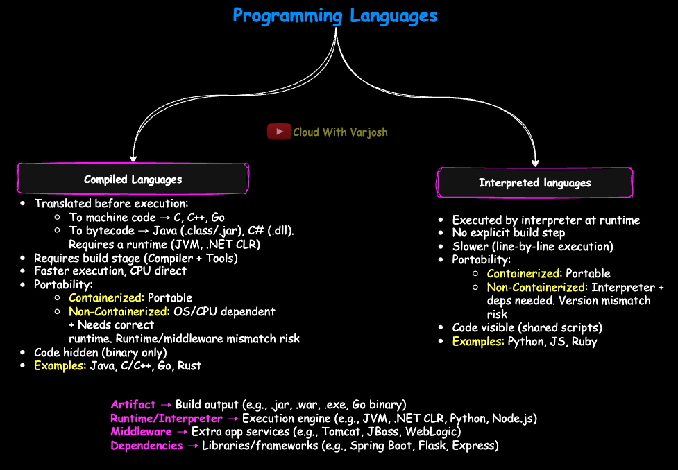
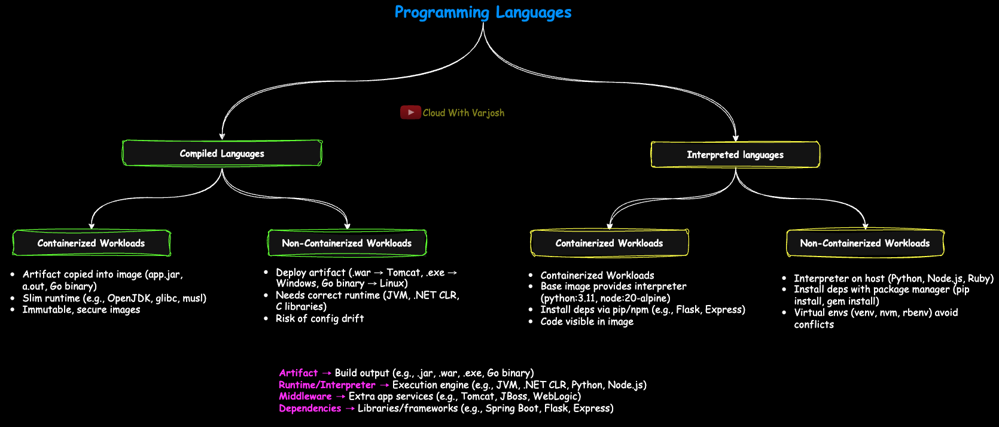

# 03 · How Code Becomes Runnable Software

> **Level:** ★ foundation · **Status:** ✅➕ rewritten and expanded
>
> **You will learn:** why a "build" step exists at all; compiled vs interpreted languages; what artifact, runtime, middleware and dependencies mean; the Java artifact formats (`.class`, `.jar`, `.war`, `.ear`); and which build tool goes with which language.
>
> **You need:** topics 01–02.
>
> **From your original notes:** Day 01 › *From SDLC to Build Automation*, *Compiled vs. Interpreted Languages*, *Java Artifact Formats*, *Build Processes in the Real World* (key terms), *Note on End-User Installations*, and the compiler/build-tool table.

---

## What it is

In the SDLC (topic 02), **Build** is a key phase. But why do we need a build at all?

The answer depends on the kind of programming language:

- **Compiled languages** are translated *before* they run, into machine code or bytecode. The build produces a file you ship.
- **Interpreted languages** are read and executed *while* they run, by an interpreter. There's no compile step, but you still have to "build" the **environment** the code needs.



---

## Why it exists

Computers' CPUs only understand **machine code**: raw binary instructions for a specific CPU type (e.g. x86-64 or ARM64). People write **source code** in readable languages. *Something* must bridge that gap, and that's either a **compiler** (ahead of time) or an **interpreter** (at run time). CI pipelines exist largely to run that bridging step the same way every time.

---

## Analogy

Translating a book for a reader who only speaks French:
- **Compiled:** you translate the whole book once, print the French edition, and hand it over. Fast to read; the reader never sees your English draft. But you need a separate edition per language (per CPU/OS).
- **Interpreted:** you hire an interpreter who reads your English book aloud in French, line by line, every time. Works anywhere an interpreter is available, but it's slower, and you have to hand over your original English book.

---

## How it works inside

### Compiled languages

- **Source code is translated before execution.** A compiler converts it into either:
  - **Machine code** (C, C++, Go, Rust → an `.exe` on Windows or an **ELF binary** on Linux; ELF = Executable and Linkable Format, Linux's file format for programs), or
  - **Bytecode** (Java → `.class`/`.jar`; C# → `.dll`): an in-between format that needs a **runtime** to run it, the **JVM** (Java Virtual Machine) or the **.NET CLR** (Common Language Runtime).
- **Needs a build stage (compiler + build tools).** Compilers (`gcc`, `g++`, `javac`, `go build`) do the translation. **Build tools** (Maven, Gradle, Make, Bazel) orchestrate it: download dependencies, compile in the right order, run tests, package the result.
- **Faster execution.** No translation is needed at run time, so compiled programs suit performance-sensitive work (databases, operating systems, trading platforms).

  > ⚠️ **Corrected:** was "compiled code runs directly on the CPU" for all compiled languages including Java. Now: true for machine-code languages (C/C++/Go/Rust). Java **bytecode** does not run directly on the CPU. The JVM first interprets it and then **JIT-compiles** (Just-In-Time, compiles hot code to machine code while the program runs) the busy parts. So Java is fast, but it does need the JVM.

- **Portability:**
  - **Non-containerized:** less portable. Binaries are tied to an OS and CPU architecture (a Linux x86-64 binary won't run on Windows ARM without recompiling). You also need the right runtime/middleware installed (JVM, .NET CLR).
  - **Containerized:** more portable. Once the artifact (`.jar`, binary) is baked into a **container image** with its runtime and dependencies, that image runs the same anywhere a compatible container runtime exists (and the CPU architecture matches; topic 62 shows `--platform`).
- **Code is hidden.** When you install an app or use a container image, you usually only get the compiled binary. The source isn't shipped, which protects intellectual property.
- **Examples:** Java (compiled to bytecode, run on the JVM), C/C++, Go, Rust.

### Interpreted languages

- **Source code is executed by an interpreter at run time.** The interpreter (Python, Node.js, PHP runtime) reads the code and executes it.
- **Generally no explicit build step.** You can write and run scripts directly, but packaging and dependency management are still needed for production.
- **Slower execution.** Translation happens while running, so there's usually a performance cost compared with compiled languages.

  > ⚠️ **Corrected:** was "no binary is generated beforehand; the interpreter reads and executes line by line". Now: that's the mental model, and it's close enough for builds. In reality CPython compiles `.py` files to **bytecode** (`.pyc` in `__pycache__/`, which is why your `.dockerignore` excludes it) and runs that on its virtual machine. Nothing is produced *ahead of time that you ship*, so for CI purposes "no compile artifact" is still the right takeaway.

- **Portability:**
  - **Non-containerized:** portable *only if* the right interpreter and dependencies are installed on the host. A Python script runs on Linux, Windows or macOS only if the right Python version and libraries (`pip install`) are present.
  - **Containerized:** highly portable. The base image (e.g. `python:3.11-slim`, `node:20-alpine`) contains the interpreter and dependencies, so the same image runs the same in dev, staging and prod.
- **Code is visible.** Distributing a Python/JavaScript/Ruby program usually means sharing the raw `.py`/`.js`/`.rb` files. Anyone with access can read or change them unless you obfuscate or package them. Container images for interpreted languages usually **embed the source code inside the image**, visible to anyone who can pull it, unless you take extra steps (obfuscation, bytecode compilation, packaging).
- **Examples:** Python, JavaScript (Node.js), PHP, Ruby, Perl.

> ⚡ *Note:* modern engines like **V8** (the JavaScript engine in Node.js and Chrome) use JIT compilation to speed things up. That blurs the line, but the **source code is still required at run time**, so JavaScript is still treated as interpreted.

### The four key words in every build

As DevOps/SRE engineers you'll mostly deploy **containerized workloads**, built from apps in compiled or interpreted languages. To understand what gets packaged, know these four words:



- **Artifact:** the actual file a build step produces.
  *Examples:* `.jar`, `.war` (Java), `.exe` (Windows apps), `a.out` (C's default output name), a Go binary.
- **Runtime:** the environment needed to *run* your app.
  - Compiled languages: **JVM** (Java), **.NET CLR** (C#), **libc/glibc** (the C standard library that C/C++ programs call into).
  - Interpreted languages: the **interpreter itself** (Python, Node.js, Ruby).
  - 👉 Think of the runtime as the "engine". It provides the instructions or **system calls** (requests to the operating system kernel, e.g. "open this file") your program needs.
- **Middleware:** an extra layer between the runtime/OS and your app that provides services your code relies on.
  - Examples: **Tomcat, JBoss, WebLogic** (for Java `.war`/`.ear` apps).
  - Why "middleware"? It sits *in the middle*. Your app doesn't implement HTTP request handling, connection pooling or transactions; the middleware does.
- **Dependencies:** external libraries, frameworks or modules your code uses.
  *Examples:* Spring Boot (Java), Flask/Django (Python), Express (Node.js).

👉 Together, **artifact, runtime and dependencies** (plus middleware when needed) are the backbone of any workload. How they're prepared and combined differs between compiled and interpreted languages, and between containerized and non-containerized environments (topic 04).

### Java artifact formats

You'll meet these all the time. As a DevOps/SRE you need them at a high level, because they decide **how the app is deployed and what runtime/middleware it needs**.

The common formats are **`.jar`**, **`.war`** and **`.ear`**. There's also the raw **`.class`** file (bytecode produced by `javac`), which is an **intermediate step**, used only in advanced cases and not something you normally deploy.

| Artifact | What it contains | Needs runtime? | Needs middleware? | Where it runs | Real-world example |
|---|---|---|---|---|---|
| **`.jar`** (Java ARchive) | Compiled `.class` files + metadata + libraries | ✅ JVM | ❌ Not required | Directly with `java -jar app.jar`, or as a library | Spring Boot microservice |
| **`.war`** (Web Application Archive) | Web components (servlets, JSPs, HTML, static files, configs) | ✅ JVM | ✅ Yes (servlet container) | App servers like Tomcat, JBoss, WebLogic | Legacy HR portal on Tomcat |
| **`.ear`** (Enterprise Archive) | Several modules: `.war` + `.jar` (EJBs, services) | ✅ JVM | ✅ Yes (full Jakarta EE app server) | WebLogic, JBoss EAP, WebSphere, GlassFish | Banking/insurance enterprise suite |

Terms in that table: a **servlet** is a Java class that handles HTTP requests; a **servlet container** (Tomcat) runs servlets; **JSP** = JavaServer Pages (HTML with Java inside); **EJB** = Enterprise JavaBeans (server-side business components).

> ⚠️ **Corrected:** was "Full Java EE app server". Now **Jakarta EE**, because Oracle handed Java EE to the Eclipse Foundation in 2017–2019 and it was renamed. Package names changed from `javax.*` to `jakarta.*` (Tomcat 10+). You'll hear both names, and migrations between them are a real-world pain point.

### Compilers and build tools by language

| Language | Compiler | Common build tools | Artifact format |
|---|---|---|---|
| **Java** | `javac` | Maven, Gradle | `.class`, `.jar`, `.war` |
| **C** | `gcc`, `clang` | make, CMake | Executable (`a.out`, `.exe`) |
| **C++** | `g++`, `clang++` | CMake, Bazel | Executable / `.so`, `.dll` (shared libraries) |
| **Go** | `go build` (built in) | Go modules (built in), Bazel | Single binary executable |

### Note on end-user installations

When end users install apps on laptops or servers, the **installer package** usually includes everything needed (binaries, runtimes and dependencies), so the app works out of the box. When dependencies would conflict or can't be bundled (licensing, system-level requirements), the app owner **documents the prerequisites**.

- *Example:* "This application requires Java 17 or above". The installer assumes a suitable JVM is already on the system.

👉 Either the installer bundles the full runtime stack, or the owner states **exact versions** you must install first. (Jenkins itself is an example of the second kind: it needs Java 21 or newer. Topic 12.)

---

## Config / Jenkinsfile / commands

The same "build" means very different commands per language. Sample (shape of) output:

```bash
# Java with Maven: compile + test + package → target/*.jar
mvn -B clean package
```
```
[INFO] Building cwvj-devsecops-demo 1.0.0-SNAPSHOT
[INFO] --- maven-compiler-plugin:3.11.0:compile ---
[INFO] --- maven-surefire-plugin:3.1.2:test ---
Tests run: 2, Failures: 0, Errors: 0, Skipped: 0
[INFO] --- maven-shade-plugin:3.5.0:shade ---
[INFO] BUILD SUCCESS
```
- `-B` = batch mode (no interactive prompts, no coloured progress bars). Always use it in CI.
- `clean` deletes the old `target/` folder; `package` runs the lifecycle up to packaging (compile → test → package). Topic 59 explains the Maven lifecycle.

```bash
# Go: one command, one static binary
go build -o app ./cmd/app && file app
```
```
app: ELF 64-bit LSB executable, x86-64, statically linked
```

```bash
# Python: no compile; "build" = install exact dependencies
python -m venv .venv && . .venv/bin/activate && pip install -r requirements.txt
```
```
Successfully installed Flask-3.0.3 Werkzeug-3.0.3 ...
```

---

## Hands-on lab

Use Docker (your Docker notes, topic 04 there) so you don't install anything:

```bash
# 1) Compile and run Java in a throwaway JDK container
mkdir -p ~/lab03 && cd ~/lab03
cat > Hello.java <<'EOF'
public class Hello { public static void main(String[] a){ System.out.println("hello from bytecode"); } }
EOF
docker run --rm -v "$PWD":/w -w /w eclipse-temurin:21 sh -c 'javac Hello.java && ls -l Hello.class && java Hello'
```
Expected: you see `Hello.class` (the bytecode artifact) and the message. Now try running `Hello.class` without a JVM:
```bash
docker run --rm -v "$PWD":/w -w /w alpine ./Hello.class
```
It fails (`exec format error` or `permission denied`): bytecode needs the JVM **runtime**.

```bash
# 2) Interpreted: no artifact, just source + interpreter
echo 'print("hello from source")' > hello.py
docker run --rm -v "$PWD":/w -w /w python:3.12-slim python hello.py
```

---

## Where you'll use it

- **Writing pipelines:** knowing whether a "build" stage means `mvn package`, `go build`, or just `pip install` + `docker build`.
- **Choosing base images:** a `.jar` needs a JRE image (`eclipse-temurin:21-jre`); a Go binary can run on `scratch`/distroless; a `.war` needs a Tomcat image.
- **Debugging "works on my machine":** a wrong JVM or Python version on a server is a runtime mismatch.
- **Legacy migrations:** `.war`/`.ear` apps tied to app servers are common in banks; containerizing them means bundling the middleware too.

---

## When it breaks

| Error | Meaning | Fix |
|---|---|---|
| `java: command not found` | No JVM runtime on the machine | Install a JDK/JRE, or use a JDK image |
| `UnsupportedClassVersionError: … class file version 65.0` | Code compiled for Java 21 (class version 65) is run on an older JVM | Run on a JVM at least as new as the compiler target |
| `exec format error` | Binary built for another CPU architecture (ARM vs x86) | Rebuild for the target platform (`--platform linux/amd64`) |
| `ModuleNotFoundError: No module named 'flask'` | Dependency not installed for this interpreter | `pip install -r requirements.txt` in the right venv/image |
| `.war` deploys but 404s | No/old servlet container, or `javax` vs `jakarta` mismatch | Match Tomcat version to the app's namespace |

---

## Quick recap

- **Compiled** languages produce an **artifact** before running; **interpreted** ones run source through an interpreter.
- Java is compiled to **bytecode** and needs the **JVM** runtime (which JIT-compiles hot code).
- The four building blocks: **artifact, runtime, middleware, dependencies**.
- `.jar` runs on a JVM alone; `.war` needs a servlet container; `.ear` needs a full Jakarta EE server.

**Interview questions**

1. **Q: What's the difference between a runtime and middleware?**
   A: The runtime runs your code (JVM, Python interpreter). Middleware is an extra layer that provides services your code relies on, such as HTTP handling and connection pooling (Tomcat, JBoss).

2. **Q: Why do interpreted-language apps still need a "build" in CI?**
   A: To assemble a consistent execution environment: pinned interpreter version, installed dependencies, packaged into an image. That's what makes it reproducible.

3. **Q: `.jar` vs `.war`?**
   A: A `.jar` (especially a Spring Boot fat jar) runs on its own with `java -jar`. A `.war` contains web components and must be deployed into a servlet container like Tomcat.
