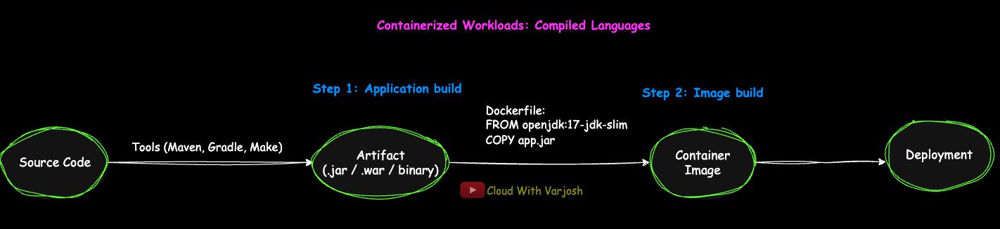
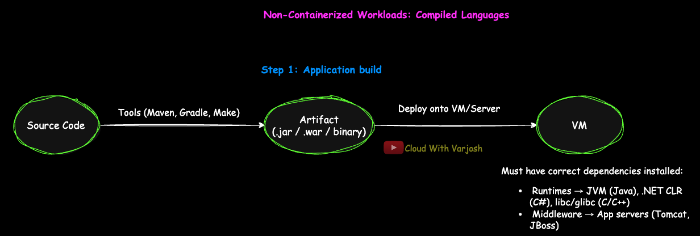
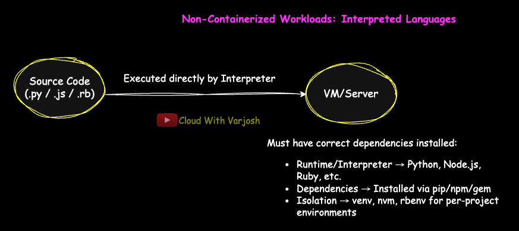
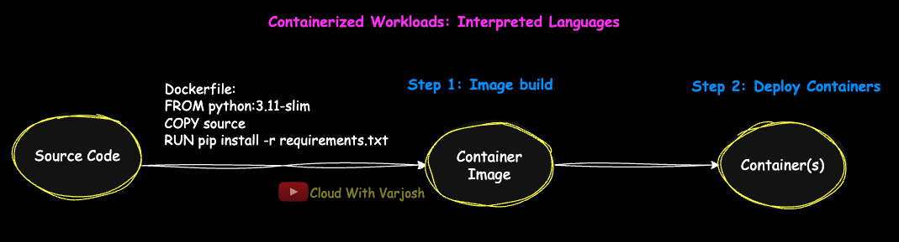

# 04 · Build Processes: Containerized vs Not

> **Level:** ★ foundation · **Status:** ✅ rewritten from your notes
>
> **You will learn:** the "two-step" build for compiled languages and the "one-step" build for interpreted ones, how each looks on a plain VM vs in a container image, and why containers removed so much **configuration drift**.
>
> **You need:** topic 03. A little Docker helps; there's a recap below, and your [Docker notes](../../Docker/INDEX.md) topics 14 and 17 go deeper.
>
> **From your original notes:** Day 01 › *Compiled Languages – Two-Step Build* (containerized and non-containerized), *Key Takeaway*, *Interpreted Languages – One-Step Build* (non-containerized and containerized), *Key Takeaways*, *Conclusion*.

---

## What it is

A **build process** is the exact list of things done to turn source code into something that can run in production. Two big factors shape it:

1. **Compiled or interpreted language** (topic 03): is there a compile step that produces an artifact?
2. **Containerized or not**: does the app ship as a **container image**, or is it copied onto a **VM** (Virtual Machine) or physical server that already has the runtime installed?

### Docker recap (just enough for this topic)

- A **container image** is a read-only package: a filesystem (your app + its runtime + libraries) plus settings like "which command to run".
- A **Dockerfile** is the recipe for building an image. Each instruction adds a layer:
  - `FROM` = start from a **base image** (e.g. one that already has Java or Python).
  - `COPY` = copy files from your build folder into the image.
  - `RUN` = run a command while building (e.g. install libraries).
  - `CMD`/`ENTRYPOINT` = the command the container runs when it starts.
- A **container** is a running instance of an image. Topic 25 recaps how Jenkins talks to Docker.

---

## Why it exists

Different languages and targets need different build steps. If you don't understand which step produces what, you can't design a pipeline, and you'll get the classic failure: the artifact built fine, but the **server it lands on** has a different Java or Python version. Containers exist largely to fix that.

---

## Analogy

Shipping a **meal**:
- **Non-containerized** = you send only the cooked dish (the artifact) to a restaurant and *trust* that their kitchen has the right plates, oven and sauce (runtime, middleware). If their oven is different, the dish comes out wrong. That's **drift**.
- **Containerized** = you ship a sealed meal kit with the dish, the plate, the sauce and a tiny oven, all in one box (the image). Any kitchen that can open the box (a container runtime) serves it exactly the same.

---

## How it works inside

### Compiled languages: a two-step build

Compiled languages always need a **compile step before deployment**. Source becomes an artifact (`.jar`, `.war`, `.exe`, binary), which is then deployed either onto **VMs/servers** or into **container images**.

#### Containerized workloads (compiled)



- **Step 1: application build**
  - Compilers (`javac`, `gcc`, `go build`), orchestrated by build tools (Maven, Gradle, Make), turn source into an artifact.
  - Output: `.jar`, `.war`, `.exe` or a single binary. (The language → compiler → tool → artifact table is in topic 03.)
- **Step 2: container image build**
  - A Dockerfile copies the artifact into a base **runtime** image:

    ```dockerfile
    FROM eclipse-temurin:17-jre
    COPY target/app.jar /app/app.jar
    ENTRYPOINT ["java", "-jar", "/app/app.jar"]
    ```

    > ⚠️ **Corrected:** was
    > ```dockerfile
    > FROM openjdk:17-jdk-slim
    > COPY app.jar
    > ```
    > Now as above, for two reasons. (1) The `openjdk` images on Docker Hub are **deprecated** and haven't been updated since 2022, so they collect unpatched vulnerabilities. Use a maintained build such as **Eclipse Temurin** (`eclipse-temurin`), and a **JRE** image (runtime only) rather than a full JDK when you only *run* the jar. (2) `COPY app.jar` has no destination, so Docker rejects it (`COPY requires at least two arguments`).

  - The resulting image is **slim, immutable and production-ready**: only what's needed to run (artifact + minimal runtime).
  - Benefits: smaller **attack surface** (fewer things an attacker could exploit), secure and reproducible deployments.
  - Extra enterprise practices: **artifact signing, SBOMs, image scanning** (topics 07 and 62).
  - A common refinement is a **multi-stage build**: stage 1 uses a JDK image to compile, stage 2 copies only the `.jar` into a JRE image. One Dockerfile does both steps. (Docker notes topic 17.)

#### Non-containerized workloads (compiled)



- **Step 1: application build**: same as above; compilers + build tools produce an artifact.
- **Step 2: deployment onto a VM/server**
  - The artifact is copied directly to a host or application server.
  - **Its dependencies must already be there** on the VM:
    - **Runtimes:** JVM (Java), .NET CLR (C#), libc/glibc (C/C++).
    - **Middleware:** app servers like Tomcat or JBoss (for `.war` files).
  - Risk: **configuration drift**, meaning environments slowly become different over time (staging has Java 17.0.9, prod has 17.0.2; someone hot-patched Tomcat on one server).
  - Ops teams standardize runtimes and use **configuration management** tools (**Ansible, Puppet, Chef**: tools that enforce a declared server state) to keep servers consistent.

#### Key takeaway (compiled)

- **Compiled languages → a 2-step process:** **build the artifact → deploy the artifact** (into an image, or directly onto a VM).
- **Containerized builds** give slim, immutable images with predictable behaviour.
- **Non-containerized builds** depend heavily on the target VM's runtime/middleware setup, which drifts unless carefully managed.

### Interpreted languages: a one-step build

Interpreted languages have no separate "compile → artifact" stage. The **source code itself is run by the interpreter (which is the runtime)**. But a build step *still exists*: not for compiling, but for **assembling a consistent execution environment** (runtime + dependencies + code).

#### Non-containerized workloads (interpreted)



- **Source code runs directly on the host** through the interpreter: `python script.py`, `node app.js`, `ruby server.rb`.
- The **runtime/interpreter must already be installed** on the VM/server.
- **Dependencies** are installed and version-locked with package managers:
  - Python → `pip install -r requirements.txt`
  - Node.js → `npm install` (in CI prefer `npm ci`, which installs exactly what `package-lock.json` says)
  - Ruby → `gem install` (or `bundle install` with a `Gemfile.lock`)
- To stop projects clashing on one machine, **per-project isolation tools** are used:
  - **venv (Python Virtual Environment):** a project folder with its own Python and libraries. *Example:* project A on Django 3.2 and project B on Django 4.0 live side by side safely.
  - **nvm (Node Version Manager):** several Node.js versions on one machine. *Example:* one app on Node 14, another on Node 20; switch per project.
  - **rbenv (Ruby Environment):** several Ruby versions side by side (e.g. 2.7 vs 3.2).

⚠️ Without isolation, apps break between laptops, QA servers and production because of mismatched runtimes or dependency versions.

#### Containerized workloads (interpreted)



- The **runtime comes from a base image**: `python:3.11-slim`, `node:20-alpine`, `ruby:3.2`.
- A **Dockerfile** defines the build:

  ```dockerfile
  FROM python:3.11-slim
  COPY source .
  RUN pip install -r requirements.txt
  ```
  (Your real project Dockerfile in topic 28 improves this: it copies `requirements.txt` first so Docker can **cache** the install layer, and copies the code after.)
- **Step 1: image build** packages source + dependencies + runtime into a container image.
- **Step 2: deploy containers.** That image runs the same in dev, staging and production.
- This guarantees **consistency** (no "works on my machine"), but note:
  - The code is visible inside the image.
  - Enterprises may use **obfuscation, packaging or runtime controls** to reduce source exposure.

#### Key takeaways (interpreted)

- **Build ≠ compilation** for interpreted languages.
- Build = **preparing the execution environment** (runtime + dependencies + code).
- **Non-containerized:** relies on interpreters + package managers + isolation tools.
- **Containerized:** wraps runtime, dependencies and code into one immutable image.
- Trade-off: containers make things reproducible but still expose the source code.

### Summary table

| | Non-containerized | Containerized |
|---|---|---|
| **Compiled** | build artifact → copy to VM that already has runtime/middleware (drift risk) | build artifact → `COPY` into a runtime image → run image |
| **Interpreted** | copy source → install deps into venv/nvm on the VM | `FROM` interpreter image → copy source → install deps → run image |
| **What CI produces** | `.jar`/binary (compiled) or nothing but a tested source tree (interpreted) | always an **image** (plus maybe a `.jar` on the way) |

---

## Config / Jenkinsfile / commands

A preview of how these become pipeline stages (you'll write real ones from topic 31):

```groovy
// Compiled + containerized: two steps
stage('Build artifact') { steps { sh 'mvn -B clean package' } }      // → target/app.jar
stage('Build image')    { steps { sh 'docker build -t myapp:42 .' } } // jar → image

// Interpreted + containerized: one step
stage('Build image')    { steps { sh 'docker build -t flask-app:42 .' } } // pip install happens inside
```

Sample `docker build` output (shape):
```
#5 [2/4] COPY requirements.txt .
#6 [3/4] RUN pip install --no-cache-dir -r requirements.txt
#6 0.9 Successfully installed flask-3.0.3 ...
#7 [4/4] COPY app.py .
#8 exporting to image
#8 naming to docker.io/library/flask-app:42 done
```
Each `#N [x/y]` line is one Dockerfile instruction running. `naming to …:42` shows the tag that was applied.

---

## Hands-on lab

**Warm-up: the smallest possible image.** Your original repo has a two-line Dockerfile (`project-files/day-01-02-examples/Dockerfile`):
```dockerfile
FROM alpine:3.19
CMD ["echo", "hello-from-image"]
```
```bash
cd project-files/day-01-02-examples && docker build -t hello-from-image . && docker run --rm hello-from-image
```
```
hello-from-image
```
No compile step and no dependencies: just a base image and the command to run. Every image in this course is this plus the build steps above.

Now build the same tiny Java app two ways and compare.

```bash
mkdir -p ~/lab04 && cd ~/lab04
cat > Hello.java <<'EOF'
public class Hello { public static void main(String[] a){ System.out.println("v1"); } }
EOF

# Two-step, containerized, as a multi-stage Dockerfile
cat > Dockerfile <<'EOF'
FROM eclipse-temurin:21-jdk AS build
WORKDIR /src
COPY Hello.java .
RUN javac Hello.java

FROM eclipse-temurin:21-jre
WORKDIR /app
COPY --from=build /src/Hello.class .
CMD ["java", "Hello"]
EOF
docker build -t hello-java:1 . && docker run --rm hello-java:1
docker images hello-java     # note the size: only a JRE + one class file
```

Now "deploy to a VM" by hand: run the class in an image that has **no** Java:
```bash
docker run --rm -v "$PWD":/w -w /w ubuntu:24.04 sh -c 'ls; java Hello'
```
`java: not found`: that's what a VM without the right runtime looks like.

---

## Where you'll use it

- Designing the **stages** of every pipeline: does this repo need a compile stage before `docker build`?
- Explaining in reviews why prod differs from staging (drift on VMs).
- Migrating legacy VM apps into containers: you must bundle the runtime *and* middleware.
- Choosing between `npm ci`/lockfiles and loose installs (reproducibility).

---

## When it breaks

| Symptom | Cause | Fix |
|---|---|---|
| `COPY failed: file not found in build context: target/app.jar` | Image built before the compile step, or in the wrong folder | Run `mvn package` first, or use a multi-stage build |
| Works in staging VM, fails in prod VM | Runtime/middleware drift | Pin versions with config management, or containerize |
| Image is 800 MB | Full JDK + build tools shipped to production | Multi-stage build, JRE/slim base |
| Different library versions on each build | No lockfile / unpinned dependencies | Pin versions, use lockfiles (`requirements.txt` with `==`, `npm ci`) |

---

## Quick recap

- **Compiled:** build artifact → deploy artifact (2 steps). **Interpreted:** assemble environment (1 step).
- **Non-containerized** deployments depend on what's already on the server, so they drift.
- **Containerized** deployments bundle the runtime, so they're consistent and immutable.
- Use maintained base images (`eclipse-temurin`, not the deprecated `openjdk`).

**Interview questions**

1. **Q: What is configuration drift?**
   A: Environments that should be identical slowly become different (versions, patches, settings) through manual changes. Config management tools or immutable images prevent it.

2. **Q: Do Python apps have a build step?**
   A: Not a compile step, but yes: installing pinned dependencies and packaging them with the interpreter into an image is the build.

3. **Q: Why use a multi-stage Dockerfile for Java?**
   A: Stage 1 has the JDK and build tools to compile; stage 2 copies only the artifact into a small JRE image. Production gets a smaller, safer image.

---

*Day 01 introduction and conclusion (kept).* Before diving into Jenkins itself, Day 01 set out to explore the phases of the **SDLC** from requirements to feedback; contrast **Waterfall vs Agile/DevOps** and why iterative, automated delivery is now standard; learn the difference between **compiled and interpreted languages** and what artifacts, runtimes and dependencies really mean; break down how builds work for **containerized and non-containerized workloads**; and understand **why build automation matters** and how it prevents "works on my machine".

In summary, we shifted focus from just *writing code* to what it takes to **deliver software reliably in production**:
- **Waterfall** created late feedback loops, while **Agile + DevOps** enable fast, iterative delivery.
- **Compiled languages** produce artifacts (`.jar`, `.exe`, binaries), while **interpreted languages** rely on interpreters/runtimes but still need environment setup.
- These differences affect **non-containerized deployments** (directly to VMs/servers) versus **containerized workloads** (Docker images).
- **Automation is critical**, so builds are consistent, reproducible and environment-agnostic.

That sets the stage for the next topics: **Continuous Integration, Testing, Delivery, Deployment and Monitoring** (05–09), and **how Jenkins brings it all together** (10 onwards).
