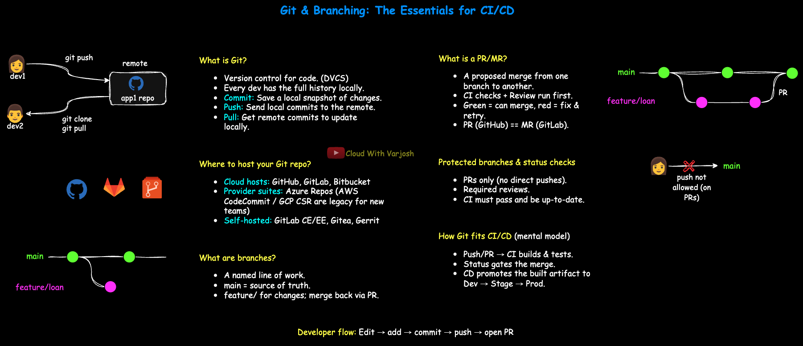

# 05 · Git Essentials for CI/CD

> **Level:** ★ foundation · **Status:** ✅➕ rewritten and expanded
>
> **You will learn:** the Git ideas every pipeline depends on: commits and SHAs, push/pull, remotes and hosts, branches, pull requests, protected branches, status checks, tags, merge vs rebase, forks, and **webhooks** (how Git tells Jenkins "something changed").
>
> **You need:** topics 01–02.
>
> **From your original notes:** Day 02 › *Introduction*, *Git & Branching: The Essentials for CI/CD* (What is Git, Where to host, Branches, PR/MR, Protected branches & status checks, How Git fits CI/CD, Quick glossary), *CI* note on PR vs MR.
>
> 🎥 Original video: [CI/CD Explained | How Pipelines Work & Branching Strategies](https://www.youtube.com/watch?v=szPE1NKc614&ab_channel=CloudWithVarJosh)

---

## What it is

**Git** is a **distributed version control system (DVCS)**. It lets many people work on the same code, keeps every change ever made, and lets you move safely back and forth in history.

"Distributed" means every developer's laptop has the **full history** of the repository, so you can branch, compare and commit offline, then sync with a shared **remote** later.



The core words:

- **Repository (repo):** a project folder tracked by Git, including its full history (stored in the hidden `.git/` folder).
- **Commit:** a saved snapshot of your changes, with a message, an author and a unique ID called a **SHA** (e.g. `9f3c2e7`). SHA here means the commit ID is a **SHA-1 hash** (a fingerprint computed from the commit's content), usually shown shortened to 7 characters. Same content → same SHA; any change → a different SHA.
- **Push:** send your local commits to the remote so others can see and review them.
- **Pull:** bring new commits from the remote down to your laptop (it's a **fetch**, which downloads them, plus a **merge** into your branch).
- **Clone:** make a full local copy of a remote repo.

---

## Why it exists

Without version control, teams email zip files, overwrite each other's work, and can't answer "what changed, who changed it, and when?". For CI/CD, Git gives three things nothing else does:

1. A **trigger**: every push or pull request is an event that can start a pipeline.
2. An **exact identity** for the code being built (the commit SHA), so builds are traceable.
3. A **gate**: protected branches refuse merges unless the pipeline says ✅.

---

## Analogy

A shared **Google Doc with perfect version history**, except everyone has a full copy of the doc and its history on their own laptop:
- A **commit** is a named save point.
- A **branch** is your own draft copy where you can try changes without touching the main doc.
- A **pull request** is "please review my draft and merge it into the main doc".
- A **protected branch** is the main doc locked so only reviewed, tested drafts can be merged in.

---

## How it works inside

### Where Git repos are hosted (remotes)

You use `git` locally, then push to a **hosting service** for collaboration, reviews and CI/CD:

- **Cloud hosts:** **GitHub**, **GitLab**, **Bitbucket**
- **Provider suites:** **Azure Repos**, **AWS CodeCommit**
- **Self-hosted:** **GitLab CE/EE** (Community/Enterprise Edition), **Gitea**, **Gerrit**, **SourceHut**

These add PR/MR reviews, permissions, issue tracking, their own CI runners, and integrations with tools like Jenkins.

> ⚠️ **Corrected:** was "(some teams also use AWS CodeCommit / the former GCP CSR; most new teams standardize on the hosts above)". Now: **AWS CodeCommit** stopped taking new customers in July 2024, but AWS **reversed that and returned it to general availability on 24 November 2025**, so it's a live option again. **Google Cloud Source Repositories (CSR)** has been closed to new customers since June 2024; Google points people to GitHub/GitLab/Bitbucket or its own Secure Source Manager.

### Branches

A **branch** is a lightweight **pointer**, a moving label that points at a commit. When you commit on a branch, the label moves forward to the new commit. Creating a branch costs almost nothing.

- **`main`** (older repos: `master`): the **trunk**, the source of truth.
- **Feature branches:** short-lived work, e.g. `feature/topup-loan`.
- **Environment/release branches (GitFlow):** `dev`, `stage`, `prod` (or `release/x.y`). Topic 08.

You commit on your branch, then propose merging it into a **protected** branch.

### Pull Requests (PR) / Merge Requests (MR)

A **PR/MR** is a **proposed change** from one branch into another, with **review + automated checks**.

- Open PR → reviewers comment/approve → CI runs (build/tests/scans) → a **status** is posted (green/red).
- **Green** enables the merge; **red** blocks it until you fix it and push again.
- Names differ: GitHub, Azure Repos and Bitbucket say **PR**; GitLab says **MR**. Same idea. These notes say **PR**.

An important detail for CI: a feature branch holds **only your work**, not everything else that landed on `main` since you branched. To test "my change + everyone else's", CI builds the **merge result** (a temporary commit of `main + feature`). That's why CI runs on the PR, not just on the branch. Topic 44 shows how Jenkins builds "Head" vs "Merge".

### Protected branches and status checks

Protect important branches (`main`, `stage`, `prod`) so they stay clean and deployable. A **protected branch** is a rule set on the Git host that **blocks direct pushes and force-pushes** and **allows merges only through PRs** that meet guardrails:

- **PRs only + required reviews:** you can't push straight to `main`/`prod`; you open a PR and get **approvals** (e.g. **1** for `main`, **2** for `prod`).
  *Example:* Varun opens a PR → Seema approves → only then can it merge.
- **CI must pass (green checks):** the PR won't merge unless **build**, **unit tests** and a **quick security scan** are green.
  *Example:* "build", "tests", "sec-scan" all show ✅; if any is ❌, fix and push again.
- **Up to date with base:** the PR must include the **latest `main`/`prod`** before merging.
  *Example:* `main` moved while your PR was open → click **Update branch** (or rebase), CI re-runs, then merge.
- Often also: signed commits, linear history (no merge commits), and "dismiss stale approvals when new commits are pushed".

A **status check** is a small record the CI system attaches to a commit through the Git host's API: a name (e.g. `continuous-integration/jenkins/pr-merge`), a state (`pending`/`success`/`failure`), and a link to the build. Branch protection lists which check names are **required**.

### Webhooks: how Git tells Jenkins something happened

A **webhook** is an **HTTP POST request** that the Git host sends to a URL you register, every time a chosen event happens (push, PR opened, tag created). The body is **JSON** (a text data format) describing the event: repo, branch, commit SHAs, author.

```
You: git push ───▶ GitHub stores commit 9f3c2e7 on feature/x
                   GitHub: "push event on repo acme/loans" ──HTTP POST──▶ https://jenkins.example.com/github-webhook/
                                                                          Jenkins: "which jobs watch acme/loans?" → schedules them
```

Two consequences you'll meet again:
- The Git host must be able to **reach** your Jenkins URL over the network. A laptop Jenkins behind home Wi-Fi can't receive GitHub webhooks without a tunnel (topic 21).
- If webhooks can't be used, Jenkins can **poll** instead: ask Git "anything new?" on a schedule (topic 21).

A **webhook secret** is a shared password used to sign each payload (an HMAC signature header), so Jenkins can verify the request really came from GitHub (topic 46).

### How Git fits CI/CD (quick mental model)

- **Git** stores changes (commits/branches).
- **CI** runs on pushes/PRs to **build and test automatically**, and posts a status that **gates merging**.
- **CD** promotes the **built artifact** through **Dev → Staging → Prod**, with approvals/rollouts depending on your branching strategy (GitFlow vs trunk-based, topic 08).

### Quick glossary

- **Commit:** snapshot + message, identified by a **SHA** (e.g. `9f3c2e7`).
- **Tag / Release:** a human label for a commit (e.g. `v1.4.3`), used for packaging and changelogs. Unlike a branch, a tag doesn't move.
- **Merge vs Rebase:** both integrate history. *Merge* creates a merge commit joining two lines. *Rebase* rewrites your branch so it starts from a new base, giving a cleaner, linear history. Use it carefully: never rebase commits others have already pulled.
- **Clone / Pull / Push:** copy a remote repo; fetch and merge updates; publish your commits.
- **Fork:** your own server-side copy of someone else's repo (common in open source) → you PR back to the original. Forks matter for CI security (topic 44): code from a fork is untrusted.
- **HEAD:** a pointer to the commit you currently have checked out.

---

## Config / Jenkinsfile / commands

```bash
git clone https://github.com/acme/loans.git && cd loans
git switch -c feature/topup-loan       # create + switch to a new branch
echo "rate = 0.08" >> config.txt
git add config.txt
git commit -m "feat: top-up loan rate"
git log --oneline -n 3
```
```
9f3c2e7 (HEAD -> feature/topup-loan) feat: top-up loan rate
4b1a0d2 (origin/main, main) fix: rounding
1c9e8aa chore: bump flask
```
- `9f3c2e7`: the new commit's short SHA. `HEAD -> feature/topup-loan` means you're on that branch.
- `origin/main`: where `main` was on the remote (`origin`) when you last fetched.

```bash
git push -u origin feature/topup-loan
```
```
remote: Create a pull request for 'feature/topup-loan' on GitHub by visiting:
remote:      https://github.com/acme/loans/pull/new/feature/topup-loan
 * [new branch]      feature/topup-loan -> feature/topup-loan
```
`-u` sets the upstream, so later `git push`/`git pull` know which remote branch to use.

```bash
git tag -a v1.4.3 -m "release 1.4.3" && git push origin v1.4.3   # an annotated, immovable label
git rev-parse HEAD                                              # full 40-char SHA, what CI records
```

In a Jenkinsfile, the commit being built is available as `GIT_COMMIT` (topic 34), and the step that fetches it is `checkout scm` (topic 31).

---

## Hands-on lab

1. Create a free **private** repo on GitHub named `jenkins-lab` (you'll reuse it all course).
2. Clone it, create `feature/hello`, add a `README` line, commit, push.
3. Open a PR into `main`. Look at the PR page: there are no checks yet. In Part 7 Jenkins will post them here.
4. In **Settings → Branches** (or **Rules → Rulesets**), protect `main`: require a pull request before merging. Try `git push origin main` from your laptop after a local commit on `main` and read the rejection:
   ```
   remote: error: GH006: Protected branch update failed for refs/heads/main.
   ```
5. **Settings → Webhooks → Add webhook**: point it at `https://example.com/test` and look at **Recent Deliveries** after a push. You'll see the JSON payload GitHub sends. That's exactly what Jenkins will receive in topic 21.

---

## Where you'll use it

- Every pipeline starts from a Git event and builds an exact SHA.
- Branch protection + required Jenkins checks is *the* mechanism that keeps `main` releasable.
- Tags drive release pipelines (`v1.4.3` → build/publish that version).
- Webhook delivery logs are the first place to look when "Jenkins didn't start".

---

## When it breaks

| Error | Meaning | Fix |
|---|---|---|
| `GH006: Protected branch update failed` | Pushing directly to a protected branch | Open a PR |
| `Updates were rejected because the tip of your current branch is behind` | Remote has commits you don't | `git pull --rebase`, then push |
| PR shows "This branch is out-of-date with the base branch" | "Up to date with base" rule is on | Click **Update branch** / rebase; CI re-runs |
| Webhook delivery shows ❌ `timed out` / `connection refused` | Git host can't reach Jenkins | Public URL/tunnel, firewall, correct path (topic 21) |
| `fatal: Authentication failed` on a private repo | Wrong/expired token | New PAT or GitHub App credential (topic 23) |

---

## Quick recap

- A **commit** is a snapshot with a unique **SHA**; CI always builds an exact SHA.
- A **branch** is a moving pointer; a **tag** is a fixed label.
- A **PR** proposes a merge; CI tests the **merge result** and posts a **status check**.
- **Protected branches** require PRs, reviews and green checks.
- A **webhook** is an HTTP POST from the Git host to Jenkins on every event.

**Interview questions**

1. **Q: Why does CI run on the PR rather than only on the feature branch?**
   A: A feature branch doesn't include changes merged into `main` since it was created. Testing the PR's merge result shows whether the code will still work after merging.

2. **Q: What's a webhook, and what's the alternative?**
   A: An HTTP callback the Git host sends on events (push/PR) so builds start immediately. The alternative is polling: Jenkins periodically asks the repo for new commits.

3. **Q: Merge vs rebase?**
   A: Merge keeps both histories and adds a merge commit. Rebase replays your commits on a new base for a linear history, but it rewrites commit SHAs, so don't rebase shared commits.
