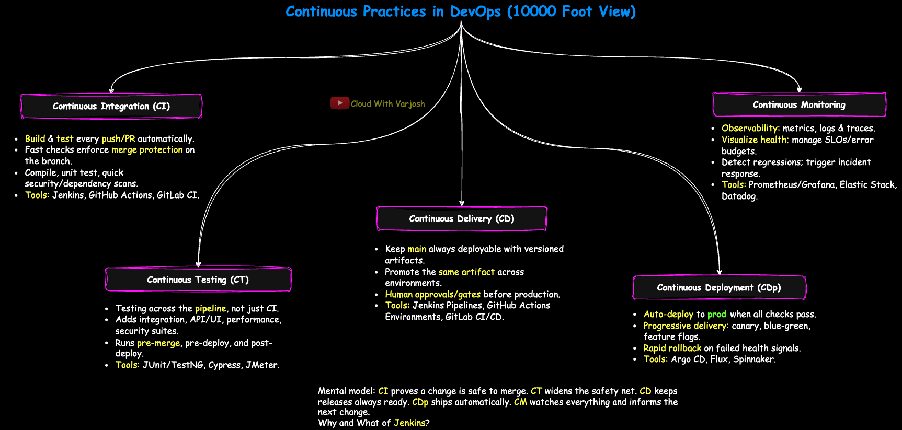

# 06 · The Continuous Practices

> **Level:** ★★ intermediate · **Status:** 🔀➕ merged and expanded
>
> **You will learn:** the five "continuous" practices (CI, CT, CD, CDp, CM) in depth; the types of tests and *where* in a pipeline each one runs; the security-testing family (SAST, SCA, DAST, image and runtime scanning); and the monitoring words (metrics, logs, traces, SLI, SLO, SLA, error budget).
>
> **You need:** topics 01–05.
>
> **From your original notes:** Day 02 › *Continuous Practices in DevOps*, *What is CI/CD?*, *The core "continuous" practices* (CI, CT, CD, CDp, CM), both *Mental model* notes, *Continuous Integration (CI)* section · Day 01 › *Testing (Continuous)* list.

---

## What it is

Modern DevOps isn't only about writing code. It's about moving changes **from laptop → production → monitoring** in a **continuous loop**: learn from what's running, then repeat. Five practices make up that loop:



| Short | Full name | One line |
|---|---|---|
| **CI** | Continuous Integration | Build and test every push/PR automatically; gate the merge |
| **CT** | Continuous Testing | Testing across the whole pipeline, not only in CI |
| **CD** | Continuous Delivery | Always have a tested, versioned artifact ready; promote with gates and a human OK for prod |
| **CDp** | Continuous Deployment | Same as CD, but prod is updated automatically when checks pass |
| **CM** | Continuous Monitoring | Watch production with telemetry and rules, and feed findings back |

---

## Why it exists

Each practice closes a gap the previous one leaves open. CI proves code *compiles and passes quick tests*. That doesn't prove it works with other services (CT), that it can be released any time (CD), that releasing is cheap (CDp), or that it behaves well for real users (CM). Together they turn "release day" from a scary project into a routine non-event.

---

## Analogy

An **airline**:
- **CI** = checking each new part as it's fitted to the plane.
- **CT** = ground tests, test flights, and checks before every departure.
- **CD** = the plane fuelled and at the gate, ready; the captain decides when to leave.
- **CDp** = an automatic departure the moment all checklists pass.
- **CM** = air-traffic control and the plane's instruments during the flight, with every incident fed back into maintenance.

---

## How it works inside

### 1. Continuous Integration (CI)

**CI means every code change is automatically built and tested as soon as it's pushed to Git.** A CI server (e.g. Jenkins) checks out the exact commit, installs dependencies, compiles/packages the app, and runs **fast** automated checks (unit tests + basic static scans). It then **posts a status back to the Git platform** (green = pass, red = fail). With **branch protection** on (topic 05), **red blocks** and **green allows** the merge, keeping `main`/`dev` clean and deployable. Teams integrate **small, frequent changes** through PRs into protected branches, and **CI gates the merge** so only healthy code lands.

- **Build and test every push/PR automatically.** Each commit/PR starts a pipeline that checks out code, installs deps and runs scripted steps with no human action.
- **Fast checks enforce merge protection on the branch.** CI posts green/red on the PR; branch protection enables Merge only when CI is green.
- **Compile, unit test, quick security/dependency scans.** Keep it lean, about **10–15 minutes**: compile/package, unit tests, **lint** (automatic style/quality checks), and quick SAST/SCA or dependency checks to catch obvious breakage early.
- **Tools:** Jenkins, GitHub Actions, GitLab CI.

> **Pipeline** (reminder from topic 01): an automated, repeatable sequence of steps (checkout → build → test → package → publish/deploy), triggered by a push/PR, that validates and delivers changes.

### 2. Continuous Testing (CT)

- **Testing across the pipeline, not just in CI.** CT is the umbrella: CI's quick checks *plus* broader tests before and after deploying.
- **Adds integration, API/UI, performance and security suites.** Contract/API tests, UI end-to-end flows, load/performance and security (DAST) tests check behaviour beyond what unit tests can.
- **Runs pre-merge, pre-deploy and post-deploy.** Gate releases with deeper suites, and check live systems with smoke tests and **synthetic monitors** (scripts that act like a user and run every few minutes against production).
- **Tools:** JUnit/TestNG (Java unit tests), Cypress/Playwright (browser UI tests), Postman/Newman (API tests), JMeter/k6 (load tests), OWASP ZAP (DAST).

### 3. Continuous Delivery (CD)

- **Keep `main` always deployable with versioned artifacts.** Every green build is a shippable artifact, tagged and traceable (build once, run everywhere).
- **Promote the same artifact across environments.** The exact image/JAR moves Dev → Staging with only config changing. No rebuilds, fewer surprises (topic 07).
- **Human approvals/gates before production.** A release becomes a *decision*, not a project, with checks, sign-offs and change records.
- **Tools:** Jenkins Pipelines, GitHub Actions Environments, GitLab CI/CD.

> Note: some teams add "release metadata" during CD (tagging, signing, attaching an SBOM), but they still **don't rebuild**. The artifact's digest stays the same (topic 07).

### 4. Continuous Deployment (CDp)

- **Auto-deploy to production when all checks pass.** No manual approval; pipelines push straight to prod after green signals.
- **Use progressive delivery for safety.** Canary/blue-green rollouts and feature flags (topic 09) reduce the **blast radius** and allow quick enable/disable.
- **Roll back fast on bad signals.** Health checks and **KPIs** (Key Performance Indicators, business/tech metrics like error rate or checkout success) and SLOs trigger an automatic rollback or flag-off.
- **Tools:** Argo CD, Flux, Spinnaker (feature flags: LaunchDarkly/Flagsmith, optional).

### 5. Continuous Monitoring (CM)

- **Observability** = how well you can understand what a system is doing from the outside. Its three pillars are your raw **telemetry** (signals):
  - **Metrics:** numbers over time (requests/second, error %, CPU, latency).
  - **Logs:** timestamped text events ("payment 123 failed: timeout").
  - **Traces:** the path of one request across many services, with timing per hop.
- Telemetry is only useful when you **apply rules** to it (alerts, SLOs, dashboards) that turn signals into action. Instrument apps/infra to see behaviour in real time.
- **Visualise health and manage SLOs/error budgets.** Dashboards + alerting highlight regressions and user impact early.
- **Close the loop:** findings feed back into CI/CT. Incidents and trends become new tests, rules and guardrails.
- **Tools:** Prometheus/Grafana, Elastic Stack (ELK = Elasticsearch, Logstash, Kibana), Datadog, New Relic.

The reliability words, in plain terms:
- **SLI (Service Level Indicator):** a measured number. *"99.95% of requests in the last 30 days returned 2xx in < 300 ms."*
- **SLO (Service Level Objective):** your internal target for an SLI. *"99.9% of requests succeed."*
- **SLA (Service Level Agreement):** a promise to customers, usually with penalties. Usually looser than the SLO.
- **Error budget:** what the SLO *allows* to fail. 99.9% over 30 days ≈ **43 minutes** of failure. While budget remains, ship fast; when it's spent, slow down and fix reliability.

> **Mental model:** CI proves a change is **safe to merge**. CT **widens the safety net**. CD keeps releases **always ready**. CDp **ships automatically**. CM **watches everything** and informs the next change. CI runs the **fast, merge-gating subset** of tests/scans; CT is the **lifecycle umbrella** for all testing.

### The test types and where they run

| Test | What it checks | Speed | Typical place in the pipeline |
|---|---|---|---|
| **Unit** | One function/class (e.g. interest calculation) | seconds | CI on every push/PR |
| **Lint / format** | Style and obvious mistakes | seconds | CI |
| **Integration** | Modules/services together (loan ↔ payment) | minutes | CI (light) / staging (full) |
| **Contract** | Services agree on request/response formats | minutes | CI or pre-deploy |
| **Functional / E2E** | Full user workflow (apply → approve → notify) | slow | Staging / preview environment |
| **Smoke** | "Is it alive?" (homepage loads, API returns 200) | seconds | Right after every deploy |
| **Performance / load** | Behaviour under peak traffic vs SLAs | slow | Staging, scheduled/nightly |
| **Synthetics** | Scripted user journeys against live prod | continuous | Production monitoring |

### The security-testing family

| Name | Full form | What it looks at | When | Example tools |
|---|---|---|---|---|
| **SAST** | Static Application Security Testing | **Your source code**, without running it: injection patterns, hard-coded secrets, unsafe APIs | CI on every PR | SonarQube, Checkmarx, Semgrep, Bandit |
| **SCA** | Software Composition Analysis | **Third-party libraries** (from `pom.xml`, `requirements.txt`, lockfiles) against known **CVEs** | CI on every PR | Trivy (`fs`), Snyk, OWASP Dependency-Check, JFrog Xray |
| **Image scanning** | (a form of SCA) | OS packages + libraries **inside the built image** | After `docker build`, before push | Trivy (`image`), Grype, Clair, Anchore |
| **Secret scanning** | n/a | API keys/passwords accidentally committed | CI / pre-commit | Trivy, gitleaks, GitHub secret scanning |
| **IaC / config scanning** | n/a | Dockerfiles, Kubernetes YAML, Terraform misconfigurations | CI | Trivy (`config`), Checkov, Conftest |
| **DAST** | Dynamic Application Security Testing | The **running app**, attacked from outside (XSS, SQLi, auth bypass) | Against staging/preview | OWASP ZAP, Burp Suite, Nikto |
| **Runtime security** | n/a | Suspicious behaviour in live containers | Production | Falco, Aqua, Prisma Cloud, Sysdig |
| **Pen test** | Penetration test | Humans simulating attackers | Periodic / before big releases | n/a |

**CVE** = Common Vulnerabilities and Exposures: a public ID (e.g. `CVE-2021-44228`, "Log4Shell") for a known security bug. Scanners match your component versions against CVE databases.

---

## Config / Jenkinsfile / commands

A CI pipeline usually has the *fast* checks, and a separate later stage or pipeline runs the slow ones. Preview (all explained in Part 6):

```groovy
pipeline {
  agent any
  stages {
    stage('Lint')      { steps { sh 'ruff check .' } }                 // seconds
    stage('Unit test') { steps { sh 'pytest -q --junitxml=report.xml' } }
    stage('SCA')       { steps { sh 'trivy fs --exit-code 1 --severity HIGH,CRITICAL .' } }
    stage('Image scan'){ steps { sh 'trivy image --exit-code 1 --severity HIGH,CRITICAL app:$BUILD_NUMBER' } }
  }
  post { always { junit 'report.xml' } }   // publish test results to Jenkins (topic 41)
}
```

Sample console (shape) for a failing SCA gate:
```
+ trivy fs --exit-code 1 --severity HIGH,CRITICAL .
pom.xml (pom)
Total: 1 (HIGH: 0, CRITICAL: 1)
│ org.apache.logging.log4j:log4j-core │ CVE-2021-44228 │ CRITICAL │ 2.14.0 │ 2.15.0 │
script returned exit code 1
Finished: FAILURE
```
`--exit-code 1` makes Trivy return non-zero when it finds HIGH/CRITICAL issues, and *any* non-zero exit code from an `sh` step fails the build. That's how a scanner becomes a **gate**.

---

## Hands-on lab

Run a real SCA scan locally with Docker (no install needed):

```bash
mkdir -p ~/lab06 && cd ~/lab06
echo "flask==0.12" > requirements.txt        # a very old, vulnerable version
docker run --rm -v "$PWD":/src aquasec/trivy:latest fs --severity HIGH,CRITICAL /src
echo "exit code: $?"
```
You'll see CVEs for the old Flask. Re-run with `--exit-code 1` and check `$?` is `1`. Change to `flask==3.0.3`, run again, and see it pass. You've just built the core of a security gate.

---

## Where you'll use it

- Designing which checks block a merge (fast) vs which run nightly or in staging (slow).
- Explaining delivery vs deployment and why regulated teams keep a manual prod gate.
- Choosing scanners: SAST for your code, SCA/image scanning for dependencies, DAST for the running app.
- Writing SLOs and alerts, and using error budgets to decide when to freeze releases.

---

## When it breaks

| Symptom | Likely cause | Fix |
|---|---|---|
| CI takes 40+ minutes | E2E/perf tests in the merge gate | Move them to staging or nightly; parallelise (topic 39) |
| Scanner fails every build on unfixable CVEs | No triage/ignore policy | Allow-list with expiry (`.trivyignore`), update the base image |
| Prod incident not caught by tests | No smoke tests or synthetics after deploy | Add post-deploy smoke + SLO-based alerts |
| Alerts fire constantly, people ignore them | Alerting on raw signals, not SLOs | Alert on SLO burn rate, delete noisy alerts |

---

## Quick recap

- **CI** = fast merge gate; **CT** = testing everywhere; **CD** = always releasable with a prod approval; **CDp** = automatic prod; **CM** = observe and feed back.
- Put fast tests early and slow tests later; smoke-test after every deploy.
- **SAST** = your code; **SCA** = your dependencies (and images); **DAST** = the running app.
- SLI = measurement, SLO = target, SLA = promise, error budget = allowed failure.

**Interview questions**

1. **Q: What's the difference between SAST, SCA and DAST?**
   A: SAST reads your own source code without running it. SCA checks third-party libraries and image packages for known CVEs. DAST attacks the running application from outside.

2. **Q: What's an error budget and how does it affect releases?**
   A: The amount of failure the SLO allows (e.g. 43 min/month at 99.9%). While budget remains you can ship fast; when it's exhausted, you prioritise reliability work over features.

3. **Q: Which tests belong in CI and which don't?**
   A: CI gets fast, deterministic checks: lint, unit tests, quick SAST/SCA. Slow suites (E2E, load, full DAST) run against staging or on a schedule so the merge gate stays around 10–15 minutes.
