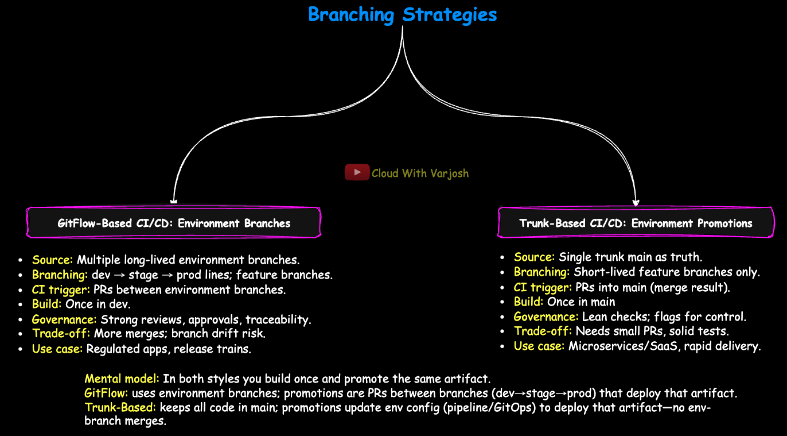

# 08 · Branching Strategies

> **Level:** ★★ intermediate · **Status:** ✅ rewritten from your notes
>
> **You will learn:** what a branching strategy is, how GitFlow-style environment branches and trunk-based development work, other models you'll meet (GitHub Flow, release trains, forking, monorepos), and where CI and CD plug into each one.
>
> **You need:** topics 05–07.
>
> **From your original notes:** Day 02 › *Where CI fits in your branching strategy* (GitFlow-Based, Trunk-Based, mental model, Also seen in the wild, What you'll likely see in practice).

---

## What it is

A **branching strategy** is a team's agreed way of **using Git branches** to integrate code and ship releases: which branches exist, how long they live, and how code moves between them.

**GitFlow-based** and **trunk-based** are the two big families. CI (build → test → status) works in both. What changes is **where CI triggers** and **how code/artifacts move between environments**.



---

## Why it exists

Without an agreed strategy, every developer branches and merges differently: long-lived branches drift, merges explode in conflicts, and nobody knows which branch is in production. A strategy also decides your **pipeline design**: which branches trigger CI, which trigger deploys, and where approvals go.

---

## Analogy

Planning **roads into a city centre** (`main`/prod):
- **GitFlow with environment branches** = a series of toll gates (dev → stage → prod), each with an inspector. Very controlled, but traffic queues at every gate.
- **Trunk-based** = one main road everyone joins often by short slip roads (short feature branches), with speed cameras (CI) everywhere. Fast flow, but every driver must be disciplined.

---

## How it works inside

### 1. GitFlow-based CI/CD: environment branches

- **Model:** several long-lived branches that mirror environments: **`dev` → `stage` → `prod`**.
- **Flow:** developers merge feature branches into `dev`, then raise **promotion PRs** `dev → stage` and `stage → prod`.
- **CI:** runs on **every PR** (feature → dev and env → env) to gate merges with green/red checks.
- **Build:** build **once** when the change is approved into `dev`; publish the image + digest (topic 07).
- **Promotion:** PRs `dev → stage` and `stage → prod` **deploy the same digest**; CI on those PRs gates the merge.
- **Governance:** strong branch protection, required reviews/approvals, a clear audit trail at each hop.
- **Trade-offs / fit:** more merges and coordination; risk of **branch drift** (environment branches slowly differing). Common in **regulated/enterprise** and **release-train** setups.

> Note: the original *GitFlow* model (Vincent Driessen, 2010) uses `develop`, `main`, `feature/*`, `release/*`, `hotfix/*` branches. What these notes call "GitFlow-based CI/CD" is the common enterprise variant where long-lived branches map **one-to-one to environments**. You'll hear both called "GitFlow"; say "environment branches" in interviews to be precise.

### 2. Trunk-based CI/CD: environment promotions

- **Model:** one long-lived **trunk (`main`)** as the source of truth; **short-lived feature branches** (hours to a couple of days).
- **Flow:** small PRs → **CI on the PR into `main`** (tests the merge result) → **build once after merge** → **promote the same artifact** through **Dev → Staging → Prod** (no environment branches).
- **Build:** build once on merge to `main`; publish image + **immutable digest**.
- **Promotion:** update the **same digest** in Dev → Staging → Prod through pipeline stages, **or** through **GitOps** PRs in a separate environment-config repo (GitOps = the desired state of each environment lives in Git, and a tool syncs the cluster to it; topics 09 and 72). **No rebuild; config only.**
  > Key point: **both strategies should "build once, promote many".** Trunk-based differs in *branching* (a single `main`, no environment branches in the app repo), not in the artifact policy.
- **Governance:** lean process: protected `main`, required checks; prod uses approvals, progressive rollout and rollback.
- **Trade-offs / fit:** needs discipline (small PRs, solid tests, **feature flags** to hide unfinished work); rewards you with **fewer merges and faster feedback**. Ideal for **microservices/SaaS**.

> **Mental model:** in **both** styles you **build once and promote the same artifact**.
> **GitFlow (environment branches):** promotions are **PRs between branches** (dev → stage → prod) that deploy that artifact.
> **Trunk-based:** all code stays in **`main`**; promotions **update environment config** (pipeline/GitOps) to deploy that artifact, with **no environment-branch merges**.

Topic 09 walks through both flows step by step.

### Also seen in the wild

- **GitHub Flow (lightweight):** `main` + short feature branches; frequent deploys straight from `main` (common in SaaS/web).
- **Release branching / release trains:** cut `release/x.y` to stabilise a release while `main` moves on; **cherry-pick** (copy individual commits) hotfixes into it. Common for mobile/desktop apps and SDKs, where users install specific versions.
- **Forking workflow:** contributors work in personal forks → PR back (open source).
- **Monorepo variants:** many services in one repo, trunk-based, with **CODEOWNERS** (a file that says which team must review which folder) and environment promotions (often GitOps). CI uses **path filters** to build only what changed.

### What you'll likely see in practice

- **Microservices (cloud/SaaS):** mostly **trunk-based CI/CD** with **feature flags** and **environment promotions** (sometimes GitOps).
- **Standalone web/app tiers, or regulated/legacy systems:** more often **GitFlow-style environment branches** (dev → stage → prod) for auditability and gated promotions.

### Comparison at a glance

| | Environment branches (GitFlow-style) | Trunk-based |
|---|---|---|
| Long-lived branches | `dev`, `stage`, `prod` | only `main` |
| How a release moves | PR between branches | Pipeline stage / GitOps config change |
| CI triggers | every PR into each env branch | every PR into `main` + post-merge on `main` |
| Merge overhead | high | low |
| Audit trail | branch history | pipeline + config-repo history |
| Best for | regulated, release windows | microservices, many deploys a day |

---

## Config / Jenkinsfile / commands

How the strategy shows up in a Jenkinsfile (the `when` directive is taught in topic 38):

```groovy
// Trunk-based: build on every branch/PR, deploy only from main
stage('Deploy to dev') {
  when { branch 'main' }
  steps { sh './deploy.sh dev "$DIGEST"' }
}

// Environment branches: deploy target follows the branch name
stage('Deploy') {
  when { anyOf { branch 'dev'; branch 'stage'; branch 'prod' } }
  steps { sh "./deploy.sh ${env.BRANCH_NAME} \"\$DIGEST\"" }
}
```
`BRANCH_NAME` is set automatically by multibranch pipelines (topic 43). Note the escaped `\$DIGEST`: inside a Groovy double-quoted string, `$` is Groovy's, so you escape it to leave it for the shell (topic 30).

Git commands for each style:
```bash
# trunk-based: short branch off main, merge back quickly
git switch main && git pull && git switch -c feature/ui-font
# environment branches: promote by PR dev -> stage (via the Git host UI or CLI)
gh pr create --base stage --head dev --title "Promote v1.4.3 to stage"
```

---

## Hands-on lab

In your `jenkins-lab` repo:
1. Create `dev` and `stage` branches from `main` and push them.
2. Make a change on `feature/a`, PR it into `dev`, merge. Then PR `dev → stage`, merge. Count the merges (two hops for one change).
3. Now do trunk-based: `feature/b` → PR into `main`, merge. One hop.
4. Write down how *deployment* to stage would be triggered in each case (a PR merge vs a pipeline stage). You'll implement the trunk-based version in topic 47.

---

## Where you'll use it

- Joining a team: the first question is "what's the branching model?" It tells you how CI and releases work.
- Designing Jenkins multibranch jobs and `when` conditions (Part 7).
- Interviews: "GitFlow vs trunk-based, which and why?"

---

## When it breaks

| Symptom | Cause | Fix |
|---|---|---|
| Huge, painful merges from `dev` to `stage` | Environment branches drifted; hotfixes applied only to `prod` | Back-merge hotfixes; or move to trunk-based with promotions |
| `main` constantly broken | Trunk-based without required checks or tests | Branch protection + required CI; feature flags |
| Each environment runs a different build | Rebuilt on every branch merge | Build once on `dev`/`main`; promote the digest |
| Feature branches live for weeks | Big-bang features | Split work, use feature flags |

---

## Quick recap

- A branching strategy defines branches, their lifetimes and how code moves.
- **Environment branches:** `dev → stage → prod` via PRs, strong audit, more merges.
- **Trunk-based:** one `main`, short branches, promotions via pipeline/GitOps.
- Either way: **build once, promote the same digest**.

**Interview questions**

1. **Q: GitFlow vs trunk-based, when would you pick each?**
   A: Environment branches suit regulated teams with release windows that want a branch-level audit trail. Trunk-based suits microservices and frequent deploys; it needs strong tests and feature flags.

2. **Q: In trunk-based development, how do you release half-finished work safely?**
   A: Merge it behind a feature flag that's off by default, then enable it gradually when it's ready.

3. **Q: Does trunk-based mean you never use branches?**
   A: No. You use very short-lived feature branches and PRs; you just don't keep long-lived environment or release branches in the app repo.
