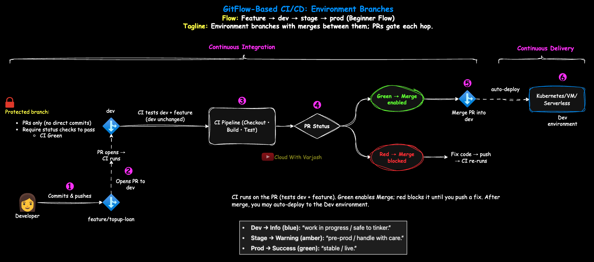
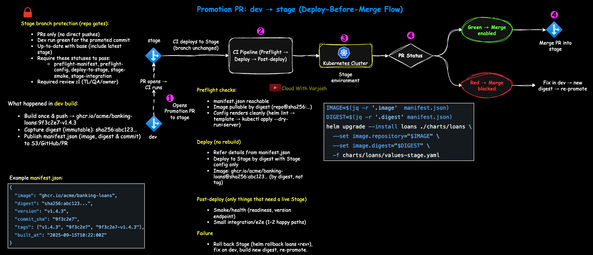
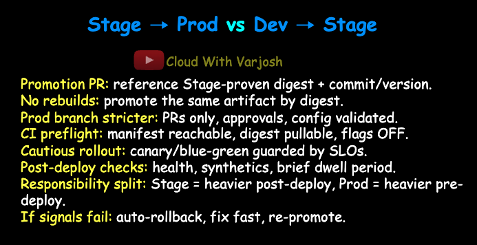
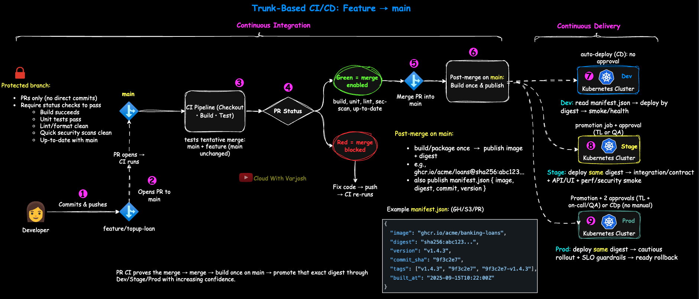

# 09 · Promotion Flows End to End

> **Level:** ★★ intermediate · **Status:** ✅➕ rewritten and expanded
>
> **You will learn:** exactly how one change travels to production in both branching models: feature → `dev`, the "deploy-before-merge" promotion PRs `dev → stage` and `stage → prod`, and the trunk-based flow. Plus the deployment strategies they use (rolling, blue-green, canary, feature flags, rollback), and Kubernetes, Helm and GitOps in one paragraph each so the commands make sense.
>
> **You need:** topics 05–08.
>
> **From your original notes:** Day 02 › *GitFlow-Based CI/CD: Environment Branches* (step-by-step 1–6, key ideas), *Promotion PR: dev → stage* (input, Stage PR gates, steps 1–4), *Why the strategies differ: speed vs. safety*, *Analogy*, *Promotion PR: stage → prod*, *Trunk-Based CI/CD: Environment Promotions* (overview, diagram, guardrails, end-to-end flow 1–9), *Conclusion*.

> **Day 02 learning goals (kept from your notes).** Day 02 connects "why reliable builds matter" to the bigger picture: **how code travels from a laptop to production** using **Git, CI/CD and environment promotions**, and **where Jenkins fits**. By the end of topics 05–10 you should be able to:
> - explain the core "continuous" terms **CI, CT, CD, CDp, CM** and how they differ (topic 06);
> - compare **GitFlow** vs **trunk-based** workflows and know when each is used (topic 08);
> - read the **promotion diagrams** and narrate the steps Feature → Dev → Stage → Prod (this topic);
> - defend the principle **"build once, promote the same digest"** (topic 07);
> - describe **branch protection** and **PR status checks** that gate merges (topic 05);
> - place **Jenkins** in the flow: what it triggers, builds, publishes and promotes (topic 10).

---

## What it is

A **promotion flow** is the path and the rules an artifact follows from "merged" to "running in production". It defines **what triggers** each environment's deploy, **what checks** must pass, **who approves**, and **how to roll back**.

---

## Why it exists

"Merge and hope" doesn't scale. Each environment is a safety net with a different job: **Dev** catches integration breakage fast, **Stage** is a full dress rehearsal, **Prod** must be changed cautiously and reversibly. The flow encodes those jobs so humans don't have to remember them.

---

## Analogy

From your notes:
- **Feature → dev = the daily stand-up.** A quick sync: share progress, integrate fast, deal with issues without holding up the team.
- **dev → Stage/Prod = the dress rehearsal.** You perform the whole show first; only when everyone's satisfied do you sign off and publish.

---

## Background in one paragraph each

These appear in the commands below. They get full topics later.

- **Kubernetes:** a system that runs containers across a cluster of machines and keeps them in the state you declare in YAML files (e.g. "3 copies of image X"). `kubectl` is its command-line tool. (Your [Kubernetes notes](../../CKA-Certification-Course-2025/INDEX.md); topic 61 here.)
- **Helm:** a package manager for Kubernetes. A **chart** is a folder of templated YAML; a **values file** (`values-stage.yaml`) fills in the per-environment settings. `helm upgrade --install` creates or updates a **release** (an installed copy of a chart); `helm rollback` returns to an earlier revision.
- **Server-side dry run:** `kubectl apply --dry-run=server` sends the YAML to the cluster's API, which validates it fully but **saves nothing**. It's a safe preflight check.
- **GitOps:** each environment's desired state lives in a Git repo; a controller in the cluster (Argo CD, Flux) **pulls** and applies it. Deploying = changing a file in Git (often via a PR). Topic 72.

### Deployment strategies

| Strategy | How it works | Good for |
|---|---|---|
| **Recreate** | Stop old, start new | Dev; apps that can't run two versions at once |
| **Rolling update** | Replace instances a few at a time (Kubernetes' default) | Most stateless services |
| **Blue-green** | Run the new version (green) beside the old (blue); switch all traffic at once; switch back to roll back | Instant cut-over and instant rollback |
| **Canary** | Send a small % of traffic to the new version (5% → 20% → 50% → 100%), watching metrics at each step | Limiting blast radius in prod |
| **Feature flags** | Deploy code "off"; turn features on for users gradually, at runtime | Decoupling *deploy* from *release* |

**Rollback** = return to the last good version (the previous **digest**). **Roll forward** = fix fast with a new version instead.

---

## How it works inside, flow A: environment branches (GitFlow-style)

**Why the name:** branches represent **environments** (`dev`, `stage`, `prod`). Code **moves by merging between branches**, and each hop is guarded by PR checks and approvals. Easy to visualise and audit, which is why it's common in beginner and regulated setups.
**Flow:** **Feature → `dev` → `stage` → `prod`** · **Tagline:** *environment branches with merges between them; PRs gate each hop.* · **Notes:** clear release windows and change records; more merge overhead and longer-lived branches.

### A1. Feature → `dev` (deploy *after* merge)



The diagram shows one change travelling from a **feature branch** to the protected **`dev`** branch through a PR.

> A **protected branch** (topic 05) is a rule set that **blocks direct pushes/force-pushes** and **allows merges only through PRs** meeting guardrails: **green CI status checks** and **required reviews** (often also "up to date with base", signed commits, linear history).

1. **Commit & push (feature branch).** You work on `feature/topup-loan`, commit locally and **push**, publishing the change for review and testing. *Output:* a feature branch with new commits.
2. **Open a PR to `dev` (protected).** The developer **opens a PR** from feature → `dev`. Because `dev` is protected: **no direct commits**, **PRs only**, **passing checks + required reviews**. The dotted arrow means a PR **proposes** a merge; `dev` hasn't changed yet.
   > *Note:* a feature branch contains **only your feature work**, not the full, up-to-date app. To test your change against everything else, you **must raise a PR** so CI can test the **merge result (`dev + feature`)** before it lands. *Output:* an open PR.
3. **CI pipeline (checkout • build • test).** Opening the PR **triggers CI**. CI builds the **merge result** of `dev + feature` in a clean workspace (so `dev` itself stays unchanged), then runs quick scripted steps: checkout, build/compile, unit tests, basic lint/security checks. Target: **≈10–15 min**. *Output:* pass/fail.
4. **PR status (green/red).** CI posts the status back to the PR:
   - **Green → merge enabled.** All checks passed; the Merge button unlocks.
   - **Red → merge blocked.** Something failed; you **push a fix**, CI **re-runs**, the status updates. *Output:* merge or iterate.
5. **Merge the PR into `dev`.** With green checks (and reviews), the PR merges. `dev` moves to a **known-good merge SHA**. Many teams tie the built artifact (image/JAR) to that SHA for traceability. *Output:* `dev` pointing at the merge commit.
6. **Auto-deploy to Dev (CD).** After the merge, the pipeline may **automatically deploy** the new `dev` to the Dev environment (Kubernetes/VM/serverless) for quick smoke checks. This is **Continuous Delivery**: an automated **non-prod** deploy.
   > *Clarifier:* **automatically deploying to Production with no human approval** is **Continuous Deployment (CDp)**. If production still needs a manual approval/gate, it remains **CD**. *Output:* the change running in Dev, ready for more testing.

> **Key idea:** CI runs **on the PR** to test the **merge result (`dev + feature`)** *before* anything lands in `dev`. **Green enables merge; red blocks it** until you push a fix. After the merge, a pipeline can **optionally auto-deploy the updated `dev`** to the Dev environment. That's **CD**, not CDp, since we're not auto-deploying production here.

### A2. Promotion PR: `dev → stage` (deploy *before* merge)

This flow promotes a **release candidate** from `dev` to **Stage**. The promotion happens **during the PR**: CI does **Preflight → Deploy → Post-deploy**. The PR turns **green only if Stage is healthy**, and **then** you merge. That keeps `stage`'s history clean and auditable.

**Input from earlier on `dev`** (topic 07 explains each): CI **built one image once** and attached human tags (`:v1.4.3`, `:9f3c2e7`, `:9f3c2e7-v1.4.3`), all pointing at **one immutable digest**; it **recorded the digest** (`sha256:abc123…`); it **published `manifest.json`** to a read-only location; and every environment **deploys by digest**, with no rebuilds.

**Stage PR gates (repo rules).** Configure these on the `stage` branch so a PR **can't merge** until the right things are true:
- **PRs only** (block direct/force pushes).
- **Up to date with base** (PR includes the latest `stage` tip; use *Update branch*).
- **A recent green Dev run** for the promoted `commit_sha` (a status like `dev-build-publish`).
- **These statuses must pass** (produced by the pipeline below): `preflight-manifest`, `preflight-config`, `deploy-to-stage`, `stage-smoke`, `stage-integration`.
- **Required review (≥ 1)** (tech lead / QA / owner).

> These are *repo gates*: cheap checks and required statuses. If any are red, the PR **can't merge**.



**1) Open PR `dev → stage`.** Open a **promotion PR** that names the **exact release candidate** by its **immutable digest** (tags are optional, for humans). Stage CI reads the manifest and **deploys by digest**, with **no rebuilds**.

A good PR description template:
```
Promote to Stage

image: ghcr.io/acme/banking-loans
digest: sha256:abc123…          # deployments use this (immutable)
version: v1.4.3                 # optional, human-friendly
commit_sha: 9f3c2e7             # source traceability
tags: [v1.4.3, 9f3c2e7, 9f3c2e7-v1.4.3]  # optional, for discoverability
manifest: <read-only link>      # where Stage reads image+digest
```
*Output:* the PR is open; the **`stage` branch is unchanged**. The promotion pipeline validates and deploys **by digest** during this PR; merge only when everything is green.

**2) Stage promotion pipeline (runs on the PR).**

*2.1 Preflight (fails fast, in seconds).* Prove the release *can* deploy before touching Stage:
- **Fetch `manifest.json`** (S3 / repo / PR attachment) and validate its **schema** (the required fields: image, **digest**, commit).
- **Resolve and verify the digest can be pulled** (`repo@sha256:…`).
- **Render and validate the Stage config:** `helm lint` → `helm template | kubectl apply --dry-run=server -f -`.

*2.2 Deploy (no rebuild; by digest, with Stage config only).*
```bash
IMAGE=$(jq -r '.image'  manifest.json)
DIGEST=$(jq -r '.digest' manifest.json)

helm upgrade --install loans ./charts/loans \
  --set image.repository="$IMAGE" \
  --set image.digest="$DIGEST" \
  -f charts/loans/values-stage.yaml
# Chart should build: image: {{ .Values.image.repository }}@{{ .Values.image.digest }}
```
- `jq -r '.image'` reads one field from the JSON (`-r` = raw text, no quotes).
- `--set` overrides chart values on the command line; `-f` adds the Stage values file.
- *Deployed image:* `ghcr.io/acme/banking-loans@sha256:abc123…` (immutable, **not** a tag).

*2.3 Post-deploy (only what needs a live Stage).*
- **Smoke/health:** readiness/liveness probes pass; `/version` shows `v1.4.3 (9f3c2e7)`.
- **Small integration/E2E:** 1–2 happy paths (e.g. *create loan → fetch*).

*Output:* CI posts the required commit statuses back to the PR: `preflight-manifest`, `preflight-config`, `deploy-to-stage`, `stage-smoke`, `stage-integration`.

> If every status is green and the review is approved, the PR can merge. If any fails, the PR stays red: fix it on `dev`, produce a new digest, re-promote.

**3) Stage environment (what's running).** The **exact digest** from the manifest now runs in Stage, configured with Stage values/secrets. The **`stage` branch is still unchanged**. This is the release's dress rehearsal.

**4) PR status and the merge decision.**
- **Green → merge enabled.** All required checks passed and ≥ 1 reviewer approved. Merging **records** the promotion in `stage`. No new deploy is needed; Stage is already on that digest.
- **Red → merge blocked.** **Roll back Stage** (e.g. `helm rollback loans <rev>`), **fix on `dev`**, produce a new digest, and **re-promote** with a fresh or updated PR.

> **Required checks to configure:** `preflight-manifest`, `preflight-config`, `deploy-to-stage`, `stage-smoke`, `stage-integration`, plus "Up to date with base" and "Required review".

### Why the two hops use different strategies: speed vs safety

**1) Feature → `dev` = deploy *after* merge (speed).**
- **Goal:** fast, frequent integration. Dev should always equal **`dev@HEAD`** (the latest `dev` commit).
- **Why not deploy before merge?** Many PRs are open at once; pre-merge deploys would overwrite each other and Dev would no longer match the branch.
- **Failure model:** if a Dev deploy fails (even because of infrastructure), fix fast or roll back; don't block everyone's PRs. Dev is low-risk and shared.

**2) `dev` → Stage/Prod = merge *after* deploy (safety).**
- **Goal:** controlled promotion. Stage/Prod are gates.
- **How:** deploy the **exact artifact** during the PR, run the Stage/Prod checks, **merge only if green**, so the branch history contains only **proven** promotions.
- **Benefit:** a clean audit trail and high confidence that what ran in Stage is exactly what you ship.

### A3. Promotion PR: `stage → prod` (the production gate)



This mirrors **dev → stage**: you **promote the same artifact by digest**, run checks **during the PR**, and **merge only when the environment is healthy**. The differences at Production: (1) **stricter pre-deploy gates** (approvals/change windows, prod config validation, flags default OFF) and (2) **focused post-deploy verification** (SLO guardrails + short synthetics, not Stage's heavy suites).

- **Open a promotion PR naming the exact Stage-proven artifact.** Include the **image**, its immutable **digest**, the **commit/version**, and a link to the manifest. Prod's branch rules are stricter: **PRs only**, **up to date with base**, **manifest reachable**, **config renders cleanly**, **Stage run green for this digest**, and **more reviewers** (e.g. tech lead + on-call/QA, or a change approver / maintenance window if required).
- **CI runs the prod preflight and promotes the same artifact, with no rebuild.** It re-validates the manifest and digest, renders **prod config**, checks that **feature flags default OFF**, confirms any **change window/approval**, and only then starts rolling out that **same digest**.
- **Deploy with a cautious rollout and instant rollback ready.** Use the **same mechanism** in Stage and Prod but a **different policy**: Stage can run a quick canary (**10% → 100%**) to rehearse the flow; Prod uses a stricter canary (**5% → 20% → 50% → 100%**) or blue-green with **SLO guardrails** (automatic checks on error rate, latency, saturation), **flags OFF** during the ramp, and **auto-rollback** to the last good digest. *"Flags OFF" = new code paths are **disabled by default** for users; you **enable them gradually** once health looks good.*
- **Post-deploy verification in Prod is focused (lighter than Stage).** Don't re-run Stage's heavy suites. Rely on **health/SLO guardrails** (error rate, latency, **saturation** = how full a resource is), short **synthetic/smoke tests** of critical journeys, and a brief **dwell period** (waiting time) with alerts quiet.
- **Merge only when Production is green, then record the release.** Approvals + green checks enable the merge; merging **records** the promotion (prod is already on that digest). Add a **release tag** (e.g. `v1.4.3`) annotated with the **digest/commit**, and update the changelog/ticket.
- **If anything fails, roll back and re-promote.** Auto-**rollback** (or **flag-off**), keep the PR **unmerged/red**, fix on `dev`, build a new digest, and repeat **dev → stage → prod**.

**Key idea:** promotions **deploy during the PR** and merge **only when the environment is healthy**. Prod prioritises **strict pre-deploy checks**; Stage carries the **heavier post-deploy testing**.

---

## How it works inside, flow B: trunk-based promotions

**Overview (why / how):**
- A **single trunk** (`main`) is the source of truth; developers branch off it and send **PR → `main`**.
- **CI** tests the **tentative merge** on the PR; when **green**, you merge.
- A **single immutable artifact** is **built once on `main`** and then **promoted, not rebuilt**, through **Dev → Staging → Prod**.
- **Heavier checks** happen in Staging; Production ships via **CD (manual approval)** or **CDp (automatic)** with a guarded rollout.
- This cuts merge pain and speeds feedback; it works best with **small PRs**, strong tests and **feature flags**.



One **source of truth (`main`)**; **Feature → `main` → Dev → Staging → Prod**. CI validates the PR's **merge result**; the **post-merge pipeline builds once** and publishes **image + digest + `manifest.json`**. Promotions read the manifest and **deploy by digest** to each environment.

**Guardrails on `main` (protected branch):**
- **PRs only**: no direct pushes to `main`.
- **Required status checks** gate the Merge button: **build**, **unit tests**, **lint/format**, **quick security scans**, and **"up to date with `main`"**.
- *(Many teams also require ≥ 1 review.)* Keep reviews **lightweight**: **1 CODEOWNERS approval** and **auto-merge** through a **merge queue** (the Git host merges PRs one at a time, re-testing each against the latest `main`) when checks pass. Let **trivial/docs-only** PRs auto-merge on green CI, and treat **pair/mob programming** as the approval, to keep speed.

**End-to-end flow (numbers match the diagram):**

1. **Commit & push (feature branch).** Work on `feature/topup-loan`, commit locally, **push**.
2. **Open PR → `main`.** Protection rules require passing checks; opening the PR **triggers CI**.
3. **PR CI (checkout • build • test).** CI tests a **tentative merge** `main + feature` (**`main` unchanged**). Keep it fast (~10–15 min): **checkout & build/package** (Maven/Gradle/npm); **fast tests** (unit + a couple of light integration tests); **lint/format** + **quick static scans** (SAST/SCA).
4. **PR status gates the merge.** **Green → merge enabled. Red → merge blocked**; push a fix and CI re-runs.
5. **Merge the PR into `main`.** `main` now points at a **known-good merge commit**.
6. **Post-merge on `main`: build once & publish.** The trunk pipeline creates the **release candidate**: **build/package once**, **push the image**, capture the **immutable digest** (`ghcr.io/acme/loans@sha256:abc123…`), and publish a small **`manifest.json`** (GitHub Release / S3) with `image`, **`digest`**, `commit_sha`, `version`, `built_at`. *(Add human tags like `:v1.4.3`, `:9f3c2e7`, `:9f3c2e7-v1.4.3` for discoverability, but **deploy by digest**.)*
7. **Dev: auto-deploy (CD), same digest, no rebuild.** A Dev job reads `manifest.json`, **verifies** the digest can be pulled, **renders** Dev config (Helm/Kustomize; **Kustomize** = Kubernetes' built-in way to patch YAML per environment), **deploys by digest**, runs **smoke/health checks**. **If red:** roll Dev back to the last good digest; fix with a new PR and repeat.
8. **Stage: promotion job with approval, same digest.** When Dev is healthy, promote with an approval gate (often tech lead or QA): **deploy the same digest** with Stage values/secrets (no rebuild); run **heavier checks** (integration/contract, **API/UI E2E** of 1–2 key flows, **performance/security smoke**). **If anything fails:** roll Stage back; fix on `main` with a new PR (which produces a new digest at step 6) and re-promote.
9. **Prod: approval or CDp, same digest.** With Stage green, promote to Prod: a **cautious rollout** (**canary** 5% → 20% → 50% → 100%, or **blue-green**); **SLO guardrails** (error rate, latency, saturation) + quick synthetics; a **ready rollback** to the last good digest if guardrails trip. Optionally **tag the release** (`v1.4.3`) annotated with the **digest + commit**.

---

## Config / Jenkinsfile / commands

The trunk-based flow as a Jenkinsfile skeleton (you'll be able to write every line by the end of Part 6):

```groovy
pipeline {
  agent any
  stages {
    stage('CI') { steps { sh 'make lint test' } }                     // every branch/PR
    stage('Build & publish') {
      when { branch 'main' }
      steps { sh './build_push_and_write_manifest.sh' }               // build ONCE
    }
    stage('Deploy dev')   { when { branch 'main' } steps { sh './deploy.sh dev' } }
    stage('Deploy stage') { when { branch 'main' }
      steps { input message: 'Promote to stage?'; sh './deploy.sh stage' } }
    stage('Deploy prod')  { when { branch 'main' }
      steps { input message: 'Promote to PROD?', submitter: 'release-managers'
              sh './deploy.sh prod' } }
  }
}
```
`input` pauses the pipeline until an authorised person clicks **Proceed** (topic 38). Each `deploy.sh` reads the same `manifest.json` and deploys the same digest.

Rollback with Helm:
```bash
helm history loans -n stage
helm rollback loans 7 -n stage
```
```
REVISION  STATUS      CHART        APP VERSION  DESCRIPTION
7         superseded  loans-1.2.0  v1.4.2       Upgrade complete
8         deployed    loans-1.2.0  v1.4.3       Upgrade complete
Rollback was a success! Happy Helming!
```

---

## Hands-on lab

Paper exercise now, real pipeline later (topic 47):
1. Draw both flows for your `jenkins-lab` repo.
2. For each environment, write: the trigger, the checks, the approver, and the rollback command.
3. Mark which statuses would be **required** on which branch.
4. Decide your prod rollout policy (canary percentages, which SLO trips a rollback).

---

## Where you'll use it

- Designing release processes and Jenkins pipelines for real teams.
- Explaining in interviews why you **deploy before merging** promotion PRs, and **after merging** feature PRs.
- Production incidents: knowing the rollback command for each environment *before* you need it.

---

## When it breaks

| Symptom | Cause | Fix |
|---|---|---|
| Dev environment doesn't match `dev` branch | Pre-merge deploys from many PRs overwrote each other | Deploy Dev only after merge |
| Promotion PR merged but Stage is unhealthy | Merge allowed before post-deploy checks | Make `stage-smoke` etc. *required* statuses |
| Prod rollback "rolled back" to a broken build | Rolled back by tag that had moved | Record and roll back by digest |
| Canary passed, full rollout failed | Guardrails too loose or dwell time too short | Tighten SLO thresholds; longer dwell at each step |

---

## Quick recap

- Feature → `dev`: CI on PR, **merge, then deploy** (speed).
- `dev → stage` / `stage → prod`: **deploy during the PR, merge only if healthy** (safety, audit).
- Stage does heavy post-deploy testing; Prod does strict pre-deploy gates and a guarded rollout.
- Trunk-based: build once after merging to `main`, promote the same digest through Dev → Stage → Prod via pipeline stages or GitOps.

**Interview questions**

1. **Q: Why deploy *before* merging a `dev → stage` promotion PR?**
   A: So the `stage` branch history only contains promotions that were proven healthy in Stage. If the deploy or tests fail, you roll back and the PR stays unmerged.

2. **Q: Canary vs blue-green?**
   A: Canary shifts a growing percentage of traffic to the new version while watching metrics. Blue-green runs both versions fully and switches all traffic at once, with an instant switch back to roll back.

3. **Q: How do you roll back safely?**
   A: Redeploy the previous known-good **digest** (e.g. `helm rollback` to the earlier revision), or turn the feature flag off. Then fix forward through the normal flow.

---

*Day 02 conclusion (key takeaways, kept):*
- **CI** runs on every push/PR to **build + test** and **gate the merge**; keep it fast.
- **CD/CDp** promote the **same immutable artifact (by digest)** across **Dev → Stage → Prod**, with no rebuilds.
- **Branch protection** (PRs only, required checks, up to date with base, reviews) keeps mainlines deployable.
- **GitFlow vs trunk-based:** both should *build once & promote*; they differ in how code/branches are organised and how promotions are expressed.
- **Stage vs Prod:** Stage carries **heavier post-deploy tests**; Prod enforces **stricter pre-deploy gates** and a **guarded rollout** (canary/blue-green, SLO guardrails, ready rollback).
- **Jenkins** is the **orchestrator**: pipelines as code to **test, package, publish and promote**; it posts statuses back to Git and drives the same-digest promotions.

---

## References (from your original Day 02 notes)

1. [Jenkins Pipeline (Jenkinsfile) Documentation](https://www.jenkins.io/doc/book/pipeline/): pipelines as code, stages, agents, status checks.
2. [Pro Git (free online book)](https://git-scm.com/book/en/v2): Git fundamentals, branching, rebasing, tags, workflows.
3. [Trunk-Based Development](https://trunkbaseddevelopment.com/): short-lived branches, small PRs, rapid integration practices.
4. [OCI Image Specification](https://github.com/opencontainers/image-spec): image digests (`@sha256`), immutability, content addressability.
5. [Kubernetes: Deployments](https://kubernetes.io/docs/concepts/workloads/controllers/deployment/): rolling updates, rollbacks, probes; the basis for canary/blue-green.
6. [Google SRE Book: Service Level Objectives](https://sre.google/sre-book/service-level-objectives/): SLIs/SLOs, error budgets, release guardrails.
