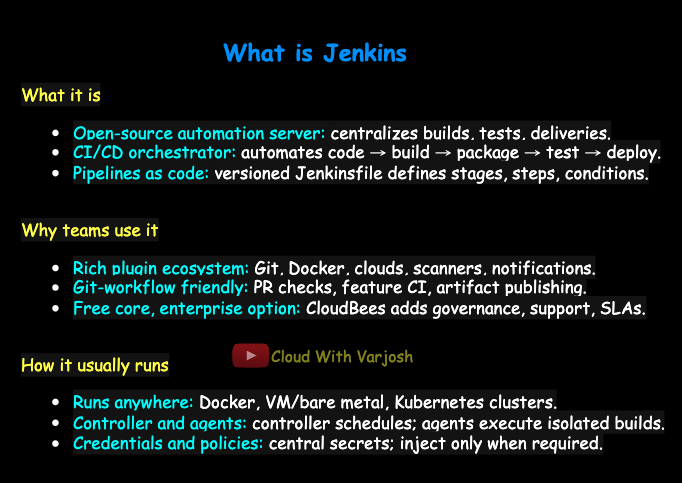
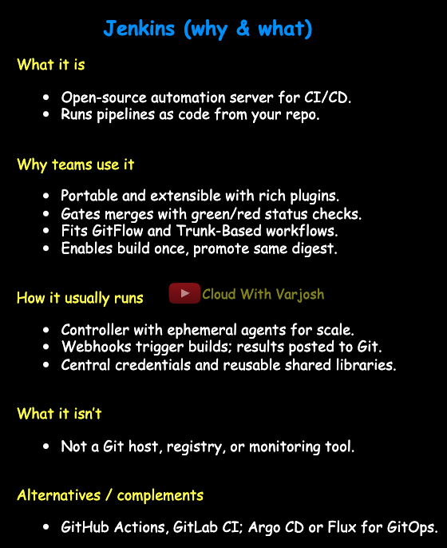

# 10 · What is Jenkins

> **Level:** ★ foundation · **Status:** 🔀 merged from several originals
>
> **You will learn:** what Jenkins is and isn't, where it came from (the Hudson fork), who governs it, why teams still choose it in 2026, how it fits both branching models, and the old "master/slave" names you may still hear.
>
> **You need:** topics 01–09.
>
> **From your original notes:** Day 02 › *Jenkins in this picture (why & what)* · Day 03 › *Introduction*, *What is Jenkins* (all paragraphs) · Day 04 › *Why you still see "hudson"*.
>
> 🎥 Original video: [What is Jenkins? Installation Options, Docker Setup & Freestyle Job](https://www.youtube.com/watch?v=woZ1fsholS4&ab_channel=CloudWithVarJosh)

---

## What it is

**Jenkins is a free, open-source automation server.** It watches Git for changes and **runs pipelines** that **build, test, package and promote** your software. It's the glue between your **Git host, build tools, scanners, registries and environments**.



In more detail:

- **Open-source automation server.** Free and community-maintained. It runs your build, test and delivery steps centrally, so teams don't depend on ad-hoc scripts on developer laptops. That gives repeatability and visibility.
- **CI/CD orchestrator.** It automates **code → build → test → package → deploy**. You define the steps; Jenkins schedules and runs them on available workers, shows the logs and results, and gates promotions with required checks. To **orchestrate** = to coordinate many tools in the right order.
- **Pipelines as code (`Jenkinsfile`).** A `Jenkinsfile` stored in your repo describes the pipeline (stages, steps, conditions). Because it lives with the code, it's versioned, code-reviewed and reproducible, and moving a repo brings its pipeline with it. (Part 6.)
- **Rich plugin ecosystem.** A **plugin** is an add-on that gives Jenkins a new ability. There are about **2,000** of them: GitHub/GitLab/Bitbucket, Docker/OCI registries, clouds, scanners (SAST/DAST), test reporters, notifications and more. You **compose** abilities instead of writing them. You can integrate any cloud service **wherever a plugin exists**:
  - **AWS (examples):** Amazon ECR, EC2 agents, Secrets Manager credentials.
  - **Azure (examples):** Azure VM agents, Key Vault credentials, Azure Container Registry.
  - **GCP (examples):** Google Compute Engine, Google Cloud Storage, Google OAuth credentials.

  > ⚠️ **Corrected:** was "1,800+ plugins". Now about **2,000** on [plugins.jenkins.io](https://plugins.jenkins.io), because the count keeps growing. The real lesson is the opposite of "more is better": install **few, well-maintained** plugins (topic 66).

- **Works with your Git workflow.** Jenkins reacts to **webhooks** from your Git host (push/PR/tag events, topic 05) by **triggering** the matching jobs (or a multibranch **scan**, topic 43). If webhooks aren't possible, it falls back to **SCM polling** (**SCM** = Source Code Management, i.e. Git). Jenkins runs CI on feature branches, sets **status checks** on PRs (which branch protection enforces), and after approval can publish artifacts/images and promote them by environment. It fits both **GitFlow** and **trunk-based** models, with path filters and auto-cancelling of superseded builds.

  Flow in one line: developer **pushes to a feature branch** → **opens a PR to `dev`** → the Git host **sends a webhook** → Jenkins **triggers the pipeline** → **green checks + reviews** → **merge to `dev`**.

  > Note: your **Git host must be able to reach your Jenkins webhook URL** (a public URL, or reachable over VPN/VPC/ingress). Otherwise use **SCM polling** as the fallback.

- **Runs almost anywhere.** On a laptop (Docker), a VM/bare-metal server, or inside Kubernetes. That's why there are several install methods (topic 13), each trading **speed, control and scale**.
- **Controller and agents (simple view).** The **controller** is the conductor: UI, scheduling, job settings, build history. **Agents** are the workers that run the jobs. In **labs**, one machine often runs both (the "control plane" and "data plane" on one box). In **enterprises** they're **separate**: the controller stays lightweight and **agents scale out** on VMs, containers or Kubernetes pods based on load, without redesigning pipelines. Topic 11 explains this properly.
- **Credentials and policies (practical basics).** Jenkins stores credentials (tokens, SSH keys, cloud credentials) centrally and injects them only when a step needs them (topics 23–24). For stronger secret hygiene, integrate external managers: **HashiCorp Vault**, **AWS Secrets Manager**, **Azure Key Vault**, **Google Secret Manager**, or **Kubernetes Secrets** (ideally via the **External Secrets Operator**, which syncs secrets from those managers into Kubernetes). Combine this with **branch protection** and **required status checks** so unreviewed or failing code can't be promoted.

### Why teams use it



*(This summary image was in your `images/` folder but wasn't referenced by any original note; it matches Day 02's "Jenkins in this picture" section.)*

- **Portable & extensible:** runs on a laptop, a VM or Kubernetes; plugins for build tools, scanners, clouds and chat.
- **Pipeline as code:** the `Jenkinsfile` lives in the repo, so CI/CD is versioned, reviewed and reproducible.
- **Fits both branching strategies** (topic 08):
  - *Environment branches (GitFlow):* **multibranch pipelines** run CI on **feature → dev** PRs, then **promotion PR** jobs (**dev → stage → prod**) deploy the **same digest**.
  - *Trunk-based:* CI runs on **PR → main**; a post-merge pipeline **builds once** and publishes the image + `manifest.json`; later stages (or GitOps PRs) **promote that digest** to **Dev → Stage → Prod**.
- **End-to-end orchestration:** one place to gate merges, sign artifacts, attach SBOMs, publish to a registry, create release notes/tags, request approvals, start canaries, and post statuses back to Git/Slack.

### How it usually runs in companies

- **Controller + ephemeral agents** (Kubernetes pods or cloud VMs, created per build and thrown away) for isolation and scale.
- **Webhooks** from the Git host trigger PR/merge builds; Jenkins posts **green/red** status checks that gate protected branches.
- **Credentials and secrets** via Jenkins Credentials, or external managers like Vault.
- **A minimal, curated set of plugins** + **shared libraries** (reusable pipeline code, Part 9) for common steps: build once, write `manifest.json`, deploy by digest, open a GitOps PR, and so on.

### What it isn't

Jenkins is **not** a Git server, a registry, or a monitoring stack. Jenkins **calls** those systems; it doesn't replace them.

### Alternatives and complements

**GitHub Actions** or **GitLab CI** do similar CI/CD, built into the Git host. **Argo CD/Flux** are best at **GitOps promotions** (Jenkins can open the PRs they sync). Jenkins stays popular when you want **maximum portability and customisation** across many tools and environments, self-hosted, with no per-minute billing. Topic 76 compares them.

### History: why you still see "hudson"

Jenkins started life as **Hudson**, written by Kohsuke Kawaguchi at **Sun Microsystems** (2004–2005). After Oracle bought Sun, a dispute over governance and the trademark led the community to **fork** (copy and continue separately) the project in **2011** under the new name **Jenkins**. Many core classes, file names and plugin APIs kept the `hudson.*` package names for **backward compatibility**. That's why `JENKINS_HOME` is full of files like `hudson.tasks.Maven.xml` (topic 16). Hudson itself was later abandoned.

### Governance: who owns Jenkins

Jenkins is a **community-governed** project under the **Continuous Delivery Foundation (CDF)**, part of the **Linux Foundation**, with public governance. **CloudBees** is the **largest corporate backer** and sells the commercial distribution **CloudBees CI** (support, governance, scale features), but it does **not own** open-source Jenkins. You'll see CloudBees content on jenkins.io next to community material, because of sponsorship and overlapping contributors. Topic 13 covers when to buy CloudBees.

### Old names: master/slave → controller/agent

Until about 2020, Jenkins called the controller "**master**" and agents "**slaves**". The project replaced these terms with **controller** and **agent** (and "built-in node" for the controller's own executors). You'll still see the old words in old blog posts, plugin names and interview questions. Use the new terms, and recognise the old ones.

---

## Why it exists

Before tools like Jenkins, builds ran on someone's machine via cron scripts, nobody could see the logs, and "the build server" was a pet nobody dared touch. Jenkins gave teams **one visible, shared, scriptable place** where every build runs the same way, with history, logs, notifications and access control.

---

## Analogy

An **orchestra conductor**. The conductor (controller) doesn't play an instrument. They hold the score (pipeline), decide who plays when, and listen to the result. The musicians (agents) do the actual playing, and you can add more musicians for a bigger piece. The sheet music lives with the composer (the Jenkinsfile lives in the repo).

---

## How it works inside

A one-paragraph preview; topic 11 is the full story. The controller receives a trigger (webhook, timer, click), puts a **build** of the job into a **queue**, waits for a free **executor** (a build slot) on a machine whose **labels** match the job, sends the work to that agent, the agent runs the steps in a folder called the **workspace**, streams the log back, and the controller stores the result, artifacts and history and reports the status back to Git.

---

## Config / Jenkinsfile / commands

You'll install Jenkins in topic 14. Two commands you can run against any Jenkins to see what it is:

```bash
curl -sI http://localhost:8080/login | grep -i x-jenkins
```
```
X-Jenkins: 2.568.2
X-Jenkins-Session: 3f2a…
```
The `X-Jenkins` response header shows the running version (`2.568.2` is an LTS release, topic 12).

```bash
curl -s http://localhost:8080/api/json?pretty=true | head
```
That returns the controller's data as JSON (topic 70); you'll need a login once security is set up.

---

## Hands-on lab

Before installing anything, explore the ecosystem:
1. Open [plugins.jenkins.io](https://plugins.jenkins.io) and look up **Git**, **Pipeline**, **Credentials Binding**, **Docker Pipeline** and **Kubernetes**. For each, note the **installs count**, the **last release date** and any **security warnings**. That's how you judge a plugin's health.
2. Open [jenkins.io/changelog-stable](https://www.jenkins.io/changelog-stable/) and note the current LTS version.
3. Write one sentence each: what Jenkins *does*, and three things it *calls* but isn't.

---

## Where you'll use it

- At most enterprises with self-hosted CI, especially banks, telcos and anyone with many legacy systems or strict network isolation.
- Alongside GitHub Actions / Argo CD in mixed setups (Jenkins for CI, Argo CD for CD).
- In DevOps/SRE interviews: Jenkins architecture, pipelines and troubleshooting are staple questions.

---

## When it breaks

At this level, the common misunderstandings:

| Misunderstanding | Reality |
|---|---|
| "Jenkins stores our code" | It checks out code from Git into a workspace; Git is the source of truth |
| "Jenkins is our artifact repository" | Archived artifacts are build records; use Nexus/Artifactory/registries for real artifacts |
| "More plugins = more powerful" | More plugins = more upgrade conflicts and security advisories |
| "Builds should run on the controller" | Only in labs. In production the controller runs **no** builds (topic 50) |

---

## Quick recap

- Jenkins = an open-source **automation server** that runs pipelines, defined as code in a `Jenkinsfile`.
- **Controller** schedules and records; **agents** do the work.
- About 2,000 plugins; pick few, well-maintained ones.
- Forked from **Hudson** in 2011; governed by the **CDF**; **CloudBees** sells a commercial edition.
- Old names: master/slave → **controller/agent**.

**Interview questions**

1. **Q: What is Jenkins, in one sentence?**
   A: An open-source automation server that runs CI/CD pipelines, defined as code, triggered by Git events, orchestrating build tools, scanners, registries and deployments.

2. **Q: Why do you still see `hudson.*` in Jenkins?**
   A: Jenkins was forked from Hudson in 2011 and kept the original package names for backward compatibility with plugins and configuration.

3. **Q: Jenkins vs GitHub Actions, why choose Jenkins?**
   A: Self-hosting and network isolation, no per-minute billing, huge plugin ecosystem, works with any Git host and any target, and deep customisation (shared libraries, custom agents). The cost is that you operate and secure it yourself.
