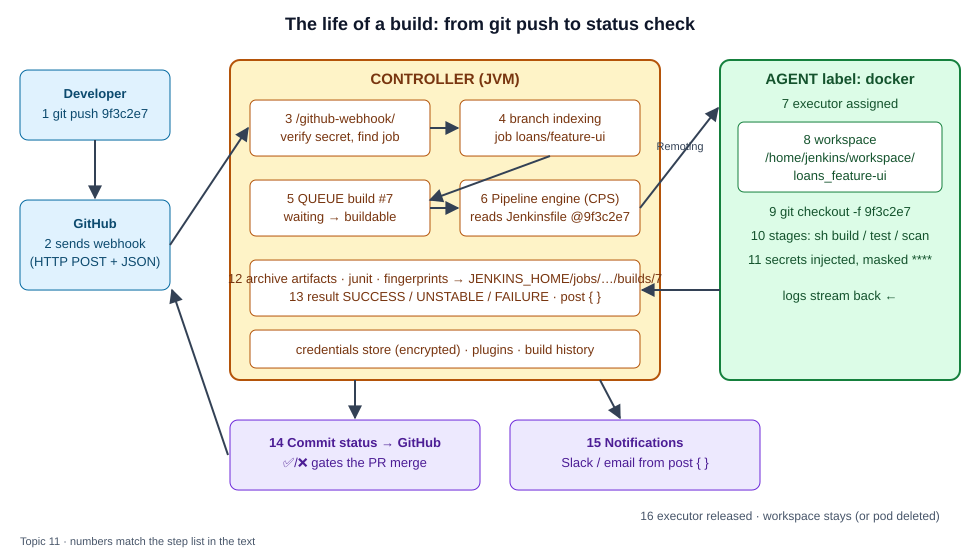
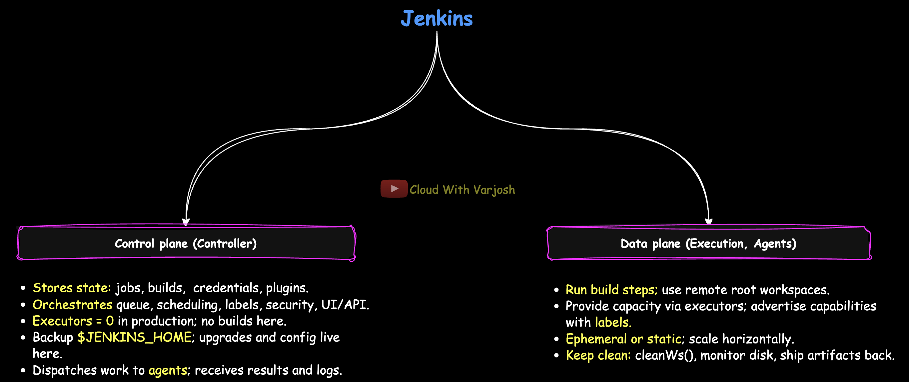

# 11 · Jenkins Architecture and the Life of a Build

> **Level:** ★★ intermediate · **Status:** 🆕 new topic (builds on short notes in Day 03 and Day 04)
>
> **You will learn:** every moving part of Jenkins (controller, nodes, agents, executors, labels, the queue, workspaces, items, builds, Remoting) and then a **full step-by-step trace** of what happens after `git push`: webhook → controller → queue → agent → workspace → stages → artifacts → status and notifications.
>
> **You need:** topics 05 (webhooks) and 10.
>
> **From your original notes:** Day 03 › *Controller and agents (simple view)* · Day 04 › *Where jobs live vs. where they run (Controller vs. Agents)*, *Workspaces & Queues*.

---

## What it is

Jenkins is a **controller + workers** system. The words you need:

| Word | Plain meaning |
|---|---|
| **Controller** | The central Jenkins server: web UI, REST API, scheduler, job configs, build history, credentials, plugins. One process (a Java program, topic 12). |
| **Node** | Any machine (or container) that can run builds. The controller itself counts as a node: the **built-in node**. |
| **Agent** | A node other than the controller. It runs a small Java program (`agent.jar`) connected to the controller. |
| **Executor** | One **build slot** on a node. A node with 2 executors can run 2 builds at once. |
| **Label** | A tag on a node (`linux`, `docker`, `maven`). Jobs ask for a label; Jenkins picks a node that has it. |
| **Item / Job / Project** | Something you configure in Jenkins: a Freestyle project, a Pipeline, a Folder, a Multibranch Pipeline. |
| **Build / Run** | One execution of a job, numbered `#1`, `#2`, … |
| **Queue** | The waiting room for builds that have been triggered but haven't got an executor yet. |
| **Workspace** | A folder **on the node running the build**, where code is checked out and commands run. |
| **Remoting** | The communication library/protocol between controller and agents. It carries commands, files and logs over one connection (a **channel**). |
| **Artifact** | A file saved from the workspace into the build record on the controller (topic 18). |

---

## Why it exists

A single machine doing everything doesn't scale and isn't safe:
- Builds are heavy (compilers, Docker, tests) and can crash or fill the disk. If they run on the controller, they take the UI and every other team down with them.
- Different builds need different tools (Java 21 here, Node 22 there, a Windows box for .NET).
- A build runs untrusted code (anyone's PR). On the controller it could read every credential in `JENKINS_HOME`.

So Jenkins **separates the brain (controller) from the hands (agents)**, and the queue + labels decide which hands do which job.

---

## Analogy

A **restaurant**:
- **Controller** = the head chef at the pass: takes orders, keeps the order book, decides which cook does what, checks every plate. Doesn't cook.
- **Agents** = cooks at their stations. **Labels** = their speciality ("grill", "pastry").
- **Executors** = how many pans a cook can handle at once.
- **Queue** = the order tickets waiting on the rail.
- **Workspace** = a cook's own chopping board, cleared between dishes.
- **Artifacts** = the finished plates photographed for the record.
- **Remoting** = the intercom between the pass and each station.

---

## How it works inside




### The controller's main parts

```
                         ┌──────────────── CONTROLLER (one JVM process) ────────────────┐
 browser / curl ──HTTP──▶│ Jetty web server ─▶ UI + REST API + webhook endpoints          │
 GitHub webhook ─HTTP──▶ │                                                               │
                         │ Triggers ─▶ Queue ─▶ Load balancer (picks node by label)      │
                         │                    │                                          │
                         │ Pipeline engine (runs Jenkinsfiles as "CPS" Groovy, topic 32)│
                         │ Credentials store · Plugin manager · Security realm           │
                         │ JENKINS_HOME on disk: jobs/, builds, logs, artifacts, config  │
                         └───────────┬─────────────────────────────┬─────────────────────┘
                     Remoting channel│ (SSH or TCP/WebSocket)      │
                         ┌───────────▼──────────┐       ┌──────────▼───────────┐
                         │ AGENT "linux-1"      │       │ AGENT "k8s-pod-xyz"  │
                         │ agent.jar (Java)     │       │ agent.jar (Java)     │
                         │ executors: 2         │       │ executors: 1         │
                         │ labels: linux docker │       │ labels: k8s maven    │
                         │ /home/jenkins/       │       │ /home/jenkins/agent/ │
                         │   workspace/<job>/   │       │   workspace/<job>/   │
                         └──────────────────────┘       └──────────────────────┘
```



- **What lives on the controller:** job configs, build records and logs, credentials, plugins, archived artifacts, all under `$JENKINS_HOME/jobs/...` (topic 16).
- **What lives on agents:** only runtime working files: `workspace/<job>` (and branch/PR variants), tool caches (Tools-installed JDK/Maven), and `agent.jar` / `remoting.jar`. **Agents don't have a `JENKINS_HOME`**; they have a **remote root directory** (e.g. `/home/jenkins`).
- **Bottom line:** **records stay on the controller; agents hold runtime working files only.**

### The queue, step by step

A triggered build passes through these queue states (you can see them by hovering over the **Build Queue** box):

1. **Waiting:** a **quiet period** is counting down (default 5 seconds), so several commits pushed close together become one build.
2. **Blocked:** it can't run yet, e.g. the job forbids concurrent builds (`disableConcurrentBuilds()`) and another build is running, or a `lock` is held.
3. **Buildable:** ready, waiting for a **free executor on a node whose labels match**. The message says *why*, e.g. `Waiting for next available executor on 'docker'` or `There are no nodes with the label 'gpu'`.
4. **Pending → Left:** an executor was assigned and the build starts.

### Label expressions

A job (or a pipeline stage) says where it may run: `agent { label 'linux && docker' }`. Label expressions support `&&` (and), `||` (or), `!` (not) and parentheses: `linux && !arm64`. If no online node matches, the build waits in the queue forever. That's a classic "why is my build stuck?" (topic 73).

### Executors: two kinds

- **Heavyweight executor:** the slot you configure on a node ("number of executors"). Freestyle builds and pipeline `node {}` / `agent` blocks use one.
- **Flyweight executor:** a lightweight thread *on the controller* that runs the Pipeline's Groovy logic itself (deciding what to do next). It doesn't count against node executors. When the pipeline reaches a `node`/`agent` block, it asks the queue for a real (heavyweight) executor. This is why a pipeline shows as "running" on the controller even when the controller has 0 executors. Topic 32 goes deeper.

### Remoting: how the controller drives an agent

- The agent runs `java -jar agent.jar`. The controller and agent keep **one long-lived connection** (the channel).
- Two ways to connect (topic 50):
  - **Outbound from the controller (SSH):** the controller SSHes into the agent, copies `remoting.jar`, and starts it. The agent needs inbound port 22 open *from the controller*.
  - **Inbound to the controller (TCP port 50000 or WebSocket over 443/8080):** the agent starts itself and dials the controller with a secret. Good when agents are behind NAT/firewalls or are Kubernetes pods.
- When a step like `sh 'make'` runs, the controller sends a "launch this process" request over the channel; the agent starts the process **in the workspace**, streams stdout/stderr back, and reports the exit code.
- File operations (`archiveArtifacts`, `stash`, reading the Jenkinsfile from the workspace) also go over the channel. That's why archiving huge files is slow (topic 18).

---

### Full trace: what happens after `git push`

Setup: a **Multibranch Pipeline** job `loans` (topic 43) for repo `acme/loans`, a GitHub webhook pointing at Jenkins, and an agent labelled `docker`.

```
git push ─▶ GitHub ─webhook─▶ Controller ─▶ branch-indexing ─▶ Queue ─▶ Agent executor
                                                                          │
     ◀──── commit status ◀──── notifications ◀── artifacts/results ◀── workspace: stages
```

1. **Developer pushes.** `git push origin feature/ui` sends commit `9f3c2e7` to GitHub.
2. **GitHub sends a webhook.** An HTTP POST with a JSON body (`ref: refs/heads/feature/ui`, `after: 9f3c2e7…`, repo name) goes to `https://jenkins.example.com/github-webhook/`, signed with the webhook secret.
3. **The controller receives it.** Jetty hands the request to the GitHub plugin's webhook endpoint. It verifies the signature, then asks: *which jobs watch `acme/loans`?*
4. **Branch indexing / SCM event.** For a multibranch job, Jenkins updates its list of branches: `feature/ui` has a `Jenkinsfile` → create (or update) the child job `loans/feature%2Fui`. For a simple pipeline with "GitHub hook trigger", Jenkins does a quick **poll** to confirm there are new commits.
5. **A build is scheduled.** Build `#7` of `loans/feature%2Fui` goes into the **queue** with a "cause" (`Push event to branch feature/ui`). After the quiet period it becomes **buildable**.
6. **The pipeline starts on a flyweight executor.** The controller checks out (or fetches via the API) **just the Jenkinsfile** for commit `9f3c2e7`, and the Pipeline engine starts interpreting it. You'll see `Obtained Jenkinsfile from 9f3c2e7`.
7. **An agent is chosen.** The Jenkinsfile says `agent { label 'docker' }`. The engine asks the queue for a heavyweight executor on a node with label `docker`. A free executor on `linux-1` is assigned. (For a Kubernetes cloud, Jenkins would now *create a pod* as a brand-new agent, topic 53.)
8. **A workspace is allocated.** On `linux-1`: `/home/jenkins/workspace/loans_feature-ui` (Jenkins shortens and sanitises names). If another build of the same job is using it, you get `…@2`.
9. **Checkout.** `checkout scm` (automatic in declarative) runs `git fetch` + `git checkout -f 9f3c2e7` **on the agent**, using the credential configured for the repo (Jenkins passes it to Git without writing it into `.git/config`). Env vars like `GIT_COMMIT` and `BRANCH_NAME` are set.
10. **Stages run.** Each `sh` step is launched on the agent through Remoting, inside the workspace, as the agent's OS user (e.g. `jenkins`). Output streams back to the controller and is written to `builds/7/log`. A non-zero exit code fails the step → the stage → the build (unless caught; topic 41).
11. **Credentials are injected only where needed.** In a `withCredentials` block, the controller decrypts the secret, sends it to the agent as an environment variable for that process, and **masks** it in the log as `****` (topic 24).
12. **Artifacts and reports.** `archiveArtifacts` copies files from the agent's workspace to the controller (`builds/7/archive/`); `junit` parses test XML and stores the results; fingerprints (MD5 hashes) record which build produced which file (topic 18).
13. **The result is decided.** SUCCESS / UNSTABLE / FAILURE / ABORTED (topic 41). `post` blocks run (cleanup, notifications; topic 35).
14. **Status goes back to Git.** The GitHub Branch Source plugin calls GitHub's API to set the commit status / Check `continuous-integration/jenkins/branch` to ✅ or ❌ with a link to the build. Branch protection uses this to allow or block the merge.
15. **Notifications.** Slack/email messages are sent from `post` (topic 71).
16. **The executor is released.** The workspace stays on the agent (unless cleaned, topic 22); an ephemeral pod agent is deleted. The build record stays on the controller until a **build discarder** removes it.

Sample (shape of) console output for that run:
```
Branch event
Obtained Jenkinsfile from 9f3c2e7a1b2c3d4e5f60718293a4b5c6d7e8f901
[Pipeline] Start of Pipeline
[Pipeline] node
Running on linux-1 in /home/jenkins/workspace/loans_feature-ui
[Pipeline] { (Declarative: Checkout SCM)
[Pipeline] checkout
 > git fetch --no-tags --force --progress -- https://github.com/acme/loans.git +refs/heads/feature/ui:refs/remotes/origin/feature/ui
 > git checkout -f 9f3c2e7a1b2c3d4e5f60718293a4b5c6d7e8f901
[Pipeline] { (Build)
[Pipeline] sh
+ docker build -t loans:7 .
...
[Pipeline] { (Declarative: Post Actions)
[Pipeline] archiveArtifacts
Archiving artifacts
[Pipeline] End of Pipeline
GitHub has been notified of this commit’s build result
Finished: SUCCESS
```

What each line tells you:
- `Branch event`: the cause; this build came from a webhook.
- `Obtained Jenkinsfile from <sha>`: the exact commit being built.
- `Running on linux-1 in …`: **which node** and **which workspace**. The first thing to check when debugging.
- `> git …`: the real Git commands Jenkins ran on the agent.
- `GitHub has been notified…`: the status check was posted.

---

## Config / Jenkinsfile / commands

See the architecture in a running Jenkins (from topic 14 onwards):

- **Manage Jenkins → Nodes**: every node, its executors, labels, free disk, clock difference and response time.
- **Build Queue** and **Build Executor Status** boxes on the dashboard.
- A build's **Console Output** first lines: cause, node, workspace.

Ask the controller for the queue through the API:
```bash
curl -s -u admin:$TOKEN http://localhost:8080/queue/api/json?pretty=true
```
```json
{ "items": [ { "id": 42, "why": "Waiting for next available executor on ‘docker’",
               "task": { "name": "loans" }, "buildable": true } ] }
```
`why` is the same message the UI shows; it's how scripts detect stuck builds. (`$TOKEN` = an API token, topic 70.)

---

## Hands-on lab

After topic 14 (Jenkins running), do this:
1. Create a Pipeline job with:
   ```groovy
   pipeline {
     agent { label 'does-not-exist' }
     stages { stage('x') { steps { echo 'hi' } } }
   }
   ```
2. Build it. Open **Build Queue** and read the reason: `There are no nodes with the label ‘does-not-exist’`. Cancel it.
3. Change the label to `built-in` (the built-in node's default label) and build again. Read the first lines of the console: node, workspace, and how fast it starts.
4. Set the built-in node's executors to **1** (**Manage Jenkins → Nodes → Built-In Node → Configure**). Start the job twice quickly and watch the second build wait in the queue for the executor.

---

## Where you'll use it

- **Debugging stuck builds** (labels, offline agents, blocked by concurrency).
- **Capacity planning:** executors × agents = maximum parallel builds.
- **Security design:** why builds must not run on the controller.
- **Interviews:** "explain Jenkins architecture" and "what happens when you push code" are near-certain questions.

---

## When it breaks

| Message / symptom | Meaning | Fix |
|---|---|---|
| `Waiting for next available executor on 'docker'` | All matching executors busy | Add executors/agents, or wait |
| `There are no nodes with the label 'x'` | Typo, or no agent has that label | Fix the label expression or add the label to a node |
| `‘linux-1’ is offline` | The agent's channel is down | Check the agent log (topic 51/73) |
| Builds start, but Jenkins UI is very slow | Builds running on the controller, or the controller is overloaded | Set controller executors to 0; move builds to agents |
| `ERROR: Connection was broken` mid-build | Remoting channel dropped (network, agent JVM killed, OOM) | Check the agent host, its memory, and the network |

---

## Quick recap

- **Controller** = brain (UI, queue, records); **agents** = hands (run steps in workspaces).
- **Executors** are build slots; **labels** route jobs to the right nodes.
- The **queue** holds builds until a matching executor is free and tells you *why* it's waiting.
- **Remoting** connects controller and agents (SSH outbound or inbound TCP/WebSocket).
- After `git push`: webhook → job/branch found → queue → executor on a labelled agent → workspace → checkout of the exact SHA → stages → artifacts → result → status to Git → notifications.

**Interview questions**

1. **Q: What's the difference between a node, an agent and an executor?**
   A: A node is any machine that can run builds (including the controller's built-in node). An agent is a non-controller node. An executor is a single build slot on a node.

2. **Q: Walk me through what happens after a developer pushes code.**
   A: The Git host sends a webhook; Jenkins finds the matching job/branch, queues a build, assigns an executor on an agent matching the label, allocates a workspace, checks out the exact commit, runs the stages via Remoting, archives artifacts/tests, sets the result, posts a status back to Git, and sends notifications.

3. **Q: Why shouldn't builds run on the controller?**
   A: Builds can exhaust CPU, memory or disk and take the whole Jenkins down, and build code running on the controller can read `JENKINS_HOME`, including encrypted credentials and their keys. Agents isolate that risk.
