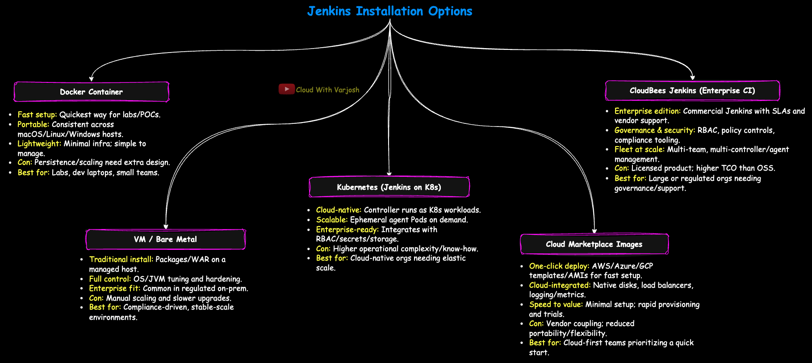

# 13 · Installation Options

> **Level:** ★ foundation · **Status:** ✅ rewritten from your notes (with corrections)
>
> **You will learn:** the five ways Jenkins is installed, from laptop labs to enterprise fleets (Docker, VM/bare metal, Kubernetes, cloud marketplace images, CloudBees CI), the trade-offs of each, and a quick chooser.
>
> **You need:** topics 10–12.
>
> **From your original notes:** Day 03 › *Jenkins Installation Options (Local to Enterprise)*: 1) Docker Container (incl. scaling note), 2) VM / Bare Metal (example + notes), 3) Kubernetes (example + notes), 4) Cloud Marketplace Images, 5) CloudBees Jenkins, *Quick chooser*.

---

## What it is

Jenkins can be set up in several ways, **from laptop labs to enterprise clusters**, depending on how much **speed, control and scale** you need. Every option runs the same thing underneath (a JVM running `jenkins.war`, topic 12). What differs is **who manages the OS, storage, scaling and upgrades**.



---

## Why it exists

A student, a 10-person startup and a 5,000-engineer bank have very different needs. The install method decides how you back up `JENKINS_HOME`, how agents scale, how upgrades happen, and who you call when it breaks.

---

## Analogy

Ways to get a **kitchen**:
- **Docker** = a camping stove: up in minutes, perfect for practice, not for a restaurant.
- **VM/bare metal** = your own built-in kitchen: full control, you maintain everything.
- **Kubernetes** = a commercial kitchen with cooks on call who appear when orders come in: elastic, but complex to run.
- **Marketplace image** = a pre-fitted rental kitchen: fast to start, tied to the landlord.
- **CloudBees CI** = a managed kitchen with a service contract.

---

## How it works inside

### 1) Docker container

- **Fast setup:** pull the official `jenkins/jenkins` LTS image and you're running in minutes. Ideal for labs, **PoCs** (Proofs of Concept) and local demos without provisioning VMs.
- **Portable:** the container runs the same on macOS, Linux and Windows hosts (Docker Desktop, or Docker Engine in WSL2), reducing "works on my machine" drift.
- **Lightweight:** minimal infrastructure. Extra tools (Git, Docker CLI) can be added via a custom Dockerfile or mounts.
- **Con:** single host by default; persistence and real scale-out need extra design (external agents, external storage).

**Scaling note:** plain Docker (and **Docker Compose**) is **single-host**: convenient, **not** a cluster. **Docker Swarm** (Docker's own simple clustering mode) can cluster, but adoption is limited and its features are basic. In practice teams either:
- keep the **controller in Docker** and add **external agents** (separate VMs/containers) over SSH or as inbound agents (topics 50–52), or
- move to **Kubernetes** for elastic, pod-based agents and proper autoscaling (topic 53).

### 2) VM / bare metal

- **Traditional install:** via `apt`/`dnf` packages (or running the WAR as a service); predictable for enterprises with locked-down hosts and **CM** (configuration management) tools like Ansible/Chef.
- **Full control:** you manage OS packages, JVM flags, **file descriptors** (the per-process limit on open files and sockets), and disk layout; helpful for compliance audits and tuning.
- **Enterprise fit:** common on-premises where security teams require hardened base images, restricted **egress** (outbound internet), and approved artifacts.
- **Con:** scaling and upgrades are manual; growing means more hosts and coordinated maintenance windows.

**Example (Debian/Ubuntu):**

```bash
# Jenkins repo & install (LTS = "debian-stable")
sudo install -d -m 0755 /etc/apt/keyrings
curl -fsSL https://pkg.jenkins.io/debian-stable/jenkins.io-2026.key | sudo tee /etc/apt/keyrings/jenkins-keyring.asc >/dev/null
echo "deb [signed-by=/etc/apt/keyrings/jenkins-keyring.asc] https://pkg.jenkins.io/debian-stable binary/" | sudo tee /etc/apt/sources.list.d/jenkins.list
sudo apt-get update && sudo apt-get install -y openjdk-21-jre-headless jenkins
sudo systemctl enable --now jenkins
```

> ⚠️ **Corrected:** was `jenkins.io-2023.key` and `openjdk-17-jre-headless`. Now `jenkins.io-2026.key` and Java 21, because (1) the 2023 signing key **expired on 26 March 2026** and LTS packages since 2.541.1 (January 2026) are signed with the 2026 key, so the old command now fails at `apt-get update` with `NO_PUBKEY 7198F4B714ABFC68` / `The following signatures were invalid`; and (2) current LTS needs Java 21 or 25 (topic 12). Use `debian-stable` for LTS; plain `debian` is the **weekly** line.

**Notes:**
- Put `JENKINS_HOME` (`/var/lib/jenkins` for packages) on resilient storage: **LVM** (Logical Volume Manager, resizable disks), **RAID** (disk mirroring), snapshots.
- Use **systemd overrides** (a drop-in file that changes a service's settings without editing the original unit) for JVM memory (`-Xms/-Xmx`) and timezone. The full VM lab is topic 49.

### 3) Kubernetes (Jenkins on K8s)

- **Cloud-native:** the controller runs as a **StatefulSet** (a Kubernetes workload type for apps that need stable storage and identity; the official Helm chart uses one). Ingress, storage and config are standard Kubernetes resources, so ops are the same as for other apps.
- **Scalable:** spin up **ephemeral agent pods** per build via the **Kubernetes plugin**; idle agents scale to zero, so you pay only for active builds.
- **Enterprise-ready:** best where clusters already exist; integrates with secrets managers, **NetworkPolicies** (Kubernetes firewall rules between pods), and cloud **StorageClasses** (types of disk Kubernetes can create on demand).
- **Con:** operationally complex; needs Kubernetes skills (storage, ingress, RBAC, autoscaling) and careful chart/values management.

> Not every organisation runs Kubernetes. If your apps deploy to **VMs or serverless** (not to Kubernetes), running Jenkins **on Kubernetes adds no value**. Prefer a **VM controller** with VM-based (or cloud) agents, and keep CD targeting the platforms you actually deploy to.

**Example (Helm, community chart):**

```bash
helm repo add jenkins https://charts.jenkins.io && helm repo update
kubectl create namespace ci
kubectl -n ci create secret generic jenkins-admin \
  --from-literal=jenkins-admin-user=admin --from-literal=jenkins-admin-password="$(openssl rand -base64 24)"
helm upgrade --install jenkins jenkins/jenkins \
  --namespace ci \
  --set controller.serviceType=ClusterIP \
  --set controller.jenkinsUriPrefix="/" \
  --set controller.resources.requests.cpu=500m \
  --set controller.resources.requests.memory=1Gi \
  --set controller.admin.existingSecret=jenkins-admin \
  --set persistence.size=20Gi
```

> ⚠️ **Corrected:** was `--set controller.jenkinsAdminPassword=admin123`. Now the admin credentials come from a Kubernetes **Secret** via `controller.admin.existingSecret` (or, for a throwaway lab only, `controller.admin.password`), because the chart's admin settings live under `controller.admin.*`, and a plain password on the command line ends up in shell history and in the Helm release values that anyone with namespace access can read. Topic 54 is the full Helm lab.

**Notes:**
- Use a **StorageClass** with snapshots; back up the **PVC** (PersistentVolumeClaim, the disk the controller uses) *and* keep the configuration as code (**JCasC**, Jenkins Configuration as Code, topic 67).
- Prefer ingress + **TLS**; lock down with NetworkPolicies; run agents as non-root.

### 4) Cloud marketplace images (AWS/Azure/GCP)

- **One-click deploy:** prebuilt VM images/templates start Jenkins quickly; good for pilots, PoCs or "lift-and-shift" (moving an existing setup to the cloud as-is).
- **Cloud-integrated:** easier wiring to managed disks, load balancers, logging/monitoring; many include hardened baselines.
- **Enterprise usage:** used where teams want **BYOL** (Bring Your Own License) or Jenkins managed by vendors/**MSPs** (Managed Service Providers), including **CloudBees CI** listings. Common as a sanctioned **starting point**, not always the long-term platform.
- **Con:** vendor coupling; less flexible than DIY VM or Kubernetes.

**Notes:**
- If you need **supported Jenkins**, **CloudBees CI** is available on cloud marketplaces (including government regions), typically **BYOL with enterprise support**; pricing is usually **quote-based / private offer**.
- Many enterprises still standardise on **VM or Kubernetes** installs for long-term governance and scale; marketplace images excel at **speed to value**, not necessarily as the final architecture.
- **Starting fresh in the cloud?** Check the marketplace to speed up provisioning, then harden and govern as you scale.

### 5) CloudBees CI (enterprise Jenkins)

- **Enterprise edition:** a **commercial distribution built on Jenkins**, with **SLAs**, curated plugin baselines and long-term maintenance.
- **Advanced features:** governance, team segmentation, **RBAC** (Role-Based Access Control) at scale, controller/agent fleet management, compliance tooling, and **Operations Center** (one console that manages many controllers).
- **Team scaling:** designed for many teams and thousands of pipelines; centralises platform ops and security.
- **Con:** licensed; higher cost than open source, plus onboarding and **TCO** (Total Cost of Ownership); pricing is typically custom/quote-based.

**Notes:**
- For **mission-critical Jenkins**, vendor support is valuable: SLAs, curated plugins and governance reduce risk compared with community support alone.
- **Already running open-source Jenkins on VMs/pods?** You can **get CloudBees enterprise support without re-platforming**; pipelines usually work **as-is**.
- When you later adopt **CloudBees CI**, Jenkinsfiles typically keep working; expect **admin-level changes** such as aligning to curated plugin baselines, connecting to Operations Center, and standardising credentials/JCasC.
- Runs on **VMs or Kubernetes** (on-prem or cloud). Plan migration of existing controllers (job import, plugin parity, credentials).
- **Rule of thumb:** labs/small teams → open source may be enough. **Regulated, multi-team, or 24×7 workloads → get enterprise support.**

### Quick chooser (when to pick what)

| Option | Pick it when | Watch out for |
|---|---|---|
| **Docker** | Labs, dev laptops, small teams | Single host; Compose ≠ cluster. Scale via external agents or move to K8s later |
| **VM / bare metal** | Regulated/on-prem, full OS control, stable scale | Manual scaling and upgrades |
| **Kubernetes** | You already run K8s and want elastic pod agents + GitOps | Unnecessary complexity if you don't already run K8s |
| **Cloud marketplace** | Fast cloud start, pilots, BYOL | Vendor coupling; often not the final platform |
| **CloudBees CI** | Large/regulated estates needing governance, RBAC at scale, SLAs | Licence cost; can add support to existing OSS now and migrate later |

---

## Config / Jenkinsfile / commands

Whatever the install, these questions decide the design. Write the answers down for any Jenkins you build:

| Question | Docker | VM | Kubernetes |
|---|---|---|---|
| Where is `JENKINS_HOME`? | named volume `jenkins_home` | `/var/lib/jenkins` | PVC |
| How do I restart? | `docker restart jenkins` | `systemctl restart jenkins` | `kubectl rollout restart sts/jenkins` |
| Where are logs? | `docker logs jenkins` | `journalctl -u jenkins` | `kubectl logs sts/jenkins -c jenkins` |
| How do I upgrade? | new image tag | `apt/dnf upgrade jenkins` | new chart/image version |
| Where do builds run? | external agents | external agents | ephemeral pods |

---

## Hands-on lab

You'll do Docker next (topic 14), a VM in topic 49, and Kubernetes in topic 54. For now:
1. Open the [Helm chart values](https://github.com/jenkinsci/helm-charts/blob/main/charts/jenkins/values.yaml) and find `controller.admin`, `persistence` and `agent`. Note how much is configurable.
2. Fill in the table above for the company you work at (or want to work at).

---

## Where you'll use it

- Choosing a platform for a new team or migrating an old Jenkins.
- Interviews: "how would you deploy Jenkins for 50 teams?" (Typical answer: Kubernetes or VMs, JCasC, ephemeral agents, LTS, backups, maybe CloudBees.)

---

## When it breaks

| Symptom | Cause | Fix |
|---|---|---|
| `NO_PUBKEY 7198F4B714ABFC68` on `apt update` | Old 2023 repo key | Install the 2026 key (above) |
| Docker Jenkins loses everything on restart | No volume for `/var/jenkins_home` | Use a named volume (topic 14) |
| Helm install: pod `Pending` | No default StorageClass, PVC unbound | Set `persistence.storageClass` or create one |
| Jenkins on K8s builds are slow to start | New pod per build pulls big images | Pre-pull/cache images, smaller agent images (topic 53) |

---

## Quick recap

- **Docker:** fastest for labs; single host.
- **VM:** full control; manual scaling; the classic enterprise install.
- **Kubernetes:** elastic pod agents; only worth it if you already run K8s.
- **Marketplace:** fast start, vendor-coupled. **CloudBees CI:** commercial support and governance at scale.
- Current installs: **2026 repo key**, **Java 21+**, secrets never on the command line.

**Interview questions**

1. **Q: When would you *not* run Jenkins on Kubernetes?**
   A: When the organisation doesn't already run Kubernetes or doesn't deploy to it. A VM controller with VM or cloud agents is simpler and does the job.

2. **Q: What's CloudBees CI and when is it worth it?**
   A: A commercial Jenkins distribution with support, curated plugins, RBAC at scale and Operations Center for many controllers. Worth it for regulated, multi-team or 24×7 environments.

3. **Q: Docker Jenkins: how do you make it survive container recreation?**
   A: Put `/var/jenkins_home` on a named volume (or persistent storage) and reuse it with the same Jenkins/plugin versions.

---

## References (from your original Day 03 notes)

* Jenkins docs and Pipeline tour: [Jenkins Documentation](https://www.jenkins.io/doc/) • [Pipeline (Jenkinsfile) Tour](https://www.jenkins.io/doc/pipeline/tour/)
* Installing and operating Jenkins: [Installing Jenkins](https://www.jenkins.io/doc/book/installing/)
* Kubernetes integration: [Kubernetes Plugin](https://plugins.jenkins.io/kubernetes/)
* Git integration and webhooks: [Git Plugin](https://plugins.jenkins.io/git/)
* Maven lifecycle (tests before package): [Maven Build Lifecycle](https://maven.apache.org/guides/introduction/introduction-to-the-lifecycle.html)
* Enterprise option: [CloudBees CI Overview](https://www.cloudbees.com/products/continuous-integration)
* Governance and community: [CDF: Jenkins Project](https://cd.foundation/projects/jenkins/)
