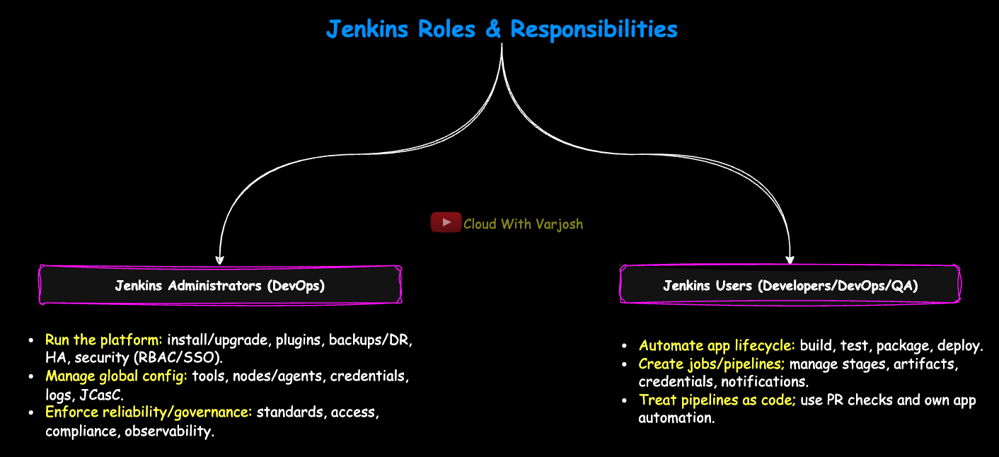

# 15 · A Tour of the UI, and Who Uses Jenkins

> **Level:** ★ foundation · **Status:** 🔀🆕 merged with new material
>
> **You will learn:** your way around the Jenkins web UI (dashboard, New Item and its job types, Manage Jenkins, the build page, Console Output, the pipeline graph, folders and views) and the two kinds of people who use Jenkins: administrators and users.
>
> **You need:** topic 14 (Jenkins running).
>
> **From your original notes:** Day 03 › *Who uses Jenkins: roles and responsibilities* · Day 03 › *First steps with Jenkins jobs* (the list of job types) · Day 06 › "Open the build → Stages tab".

---

## What it is

The Jenkins UI is a website served by the controller on port 8080. Almost everything can be done here (and also through the API, topic 70, or as code, topic 67).

---

## Why it exists

Even with pipelines as code, people need to see builds, read logs, approve deployments, re-run failures and manage the server. Knowing the UI makes every later topic faster.

---

## Analogy

An **airport**: the dashboard is the departures board (every job and its last status); a build page is one flight's record; Console Output is the black box; Manage Jenkins is the control tower, open only to staff.

---

## How it works inside

### The dashboard (`/`)

- **Left menu:** **New Item**, **Build History**, **Manage Jenkins**, **My Views**.
- **Job list:** each job's status icon (✅ success, ❌ failed, 🟡 unstable, ⚪ never built / aborted), a "weather" icon (health of the last 5 builds), last success/failure/duration, and a ▶ build button.
- **Build Queue** and **Build Executor Status** boxes (topic 11): what's waiting and what's running on which node.

### New Item: job types

When you click **New Item**, Jenkins offers several types (more appear with plugins):

| Type | What it is | Where in this course |
|---|---|---|
| **Freestyle project** | Configure steps in web forms. The simplest, oldest type. | Part 3 |
| **Pipeline** | One pipeline defined by a Jenkinsfile (inline or from Git) | Part 6 |
| **Multibranch Pipeline** | Auto-creates a pipeline per branch/PR that has a Jenkinsfile | Part 7 |
| **Organization Folder** | Scans a whole GitHub org/Bitbucket project and makes a multibranch job per repo | topic 43 |
| **Folder** | A container for jobs, with its own permissions, credentials and libraries | below |

Job names become URL paths and folder names on disk: `http://localhost:8080/job/team-a/job/loans/`.

### Manage Jenkins (admins)

| Section | What's there |
|---|---|
| **System** | Jenkins URL, admin email, global env vars, executors on the built-in node, Global Pipeline Libraries, plugin settings (GitHub servers, SonarQube servers…) |
| **Tools** | JDK, Git, Maven, Gradle installations (topic 19). *Formerly "Global Tool Configuration".* |
| **Plugins** | Installed / Available / Updates / Advanced (topic 66) |
| **Nodes** (and Clouds) | Agents and cloud templates (Part 8) |
| **Credentials** | Stores and domains (topic 23) |
| **Security** | Authentication, authorization, agent ports, CSRF (topic 65) |
| **System Log**, **System Information**, **Load Statistics**, **About Jenkins** | Troubleshooting (topic 73) |
| **Script Console** | Runs Groovy as the controller itself. Full power; admins only (topic 70) |
| **Configuration as Code** | Appears with the JCasC plugin (topic 67) |

### A job's page and a build's page

- **Job page** (`/job/loans/`): **Build Now** / **Build with Parameters**, **Configure**, **Changes**, **Workspace** (browse files on the last node used), **Pipeline Syntax** (topic 33), build history list.
- **Build page** (`/job/loans/7/`): result, cause ("Started by user admin", "Branch event"), duration, **Changes** (commits since the last build), **Artifacts**, **Test Result**, **Parameters**, and:
  - **Console Output** (`/job/loans/7/console`): the full log. Your main debugging tool.
  - **Pipeline Overview / Stages** (Pipeline Graph View plugin): a graph of stages, coloured by result; click a stage to see only its steps and logs.
  - **Replay** (pipelines): re-run with an edited Jenkinsfile, without committing (topic 32).
  - **Restart from Stage** (declarative): re-run from a chosen stage.

> ⚠️ **Corrected (added):** your notes don't mention it, but many tutorials still show **Blue Ocean**. Blue Ocean **is deprecated** (⚠️ *the exact deprecation date is unverified; check its plugin page*) and has had little maintenance for years: don't count on fixes, including security fixes. Use **Pipeline Graph View** (the "Stages" view in your Day 06 notes), which is actively maintained and has Blue Ocean's most important features. The older **Pipeline: Stage View** grid still exists but is legacy. Don't install Blue Ocean on new controllers.

### Folders and views

- **Folders** group jobs (`team-a/`, `team-b/`) and can carry **folder-scoped credentials**, **folder-level shared libraries** and **permissions**. This is how one controller serves many teams (topics 23, 58, 65).
- **Views** are saved filters of the job list (e.g. "all jobs matching `loans-*`"); they don't change permissions.

### Who uses Jenkins: roles and responsibilities



**Jenkins administrators (DevOps / platform team):**
- Own the platform: install/upgrade Jenkins, manage plugins, backups/DR, **HA** (High Availability), credential stores, security (**RBAC/SSO**: role-based permissions and **Single Sign-On** through the company login), agents and integrations.
- Use **Manage Jenkins** for global config, toolchains (JDK/Git/Docker), nodes/agents, system logs, and configuration as code.
- Usually part of the **DevOps/platform** team; responsible for reliability, governance and compliance.

**Jenkins users (developers / DevOps / QA):**
- Use the platform to **automate builds, tests, packaging and deployments**.
- Create jobs and pipelines via **New Item** (Freestyle or **Pipeline/Jenkinsfile**), manage stages, use credentials (by ID, without seeing the secret), and set post-build actions.
- Treat pipelines as code, connect status checks to PRs, and own application-level automation.

In mature setups users rarely click **New Item**: an **Organization Folder** or JCasC/Job DSL creates jobs automatically, and users only write Jenkinsfiles (topics 43, 67).

---

## Config / Jenkinsfile / commands

Most UI pages have a matching URL you can bookmark or script:

| Page | URL |
|---|---|
| Console of last build | `/job/<job>/lastBuild/console` |
| Plain-text console (great for `curl`) | `/job/<job>/lastBuild/consoleText` |
| Built-in env var reference | `/env-vars.html` |
| Pipeline syntax / Snippet Generator | `/job/<job>/pipeline-syntax/` |
| Anything as JSON | add `/api/json?pretty=true` |

```bash
curl -s -u admin:$TOKEN http://localhost:8080/job/hello/lastBuild/consoleText | tail -3
```
```
+ echo hello
hello
Finished: SUCCESS
```

---

## Hands-on lab

1. Click **New Item** and read the description of each type.
2. Create a **Folder** `lab`, then move your `hello` job into it (job → **Move**). Note the new URL `/job/lab/job/hello/`.
3. Open **Manage Jenkins → Plugins → Installed** and find *Pipeline Graph View*. Search for *Blue Ocean* under Available and read its deprecation warning.
4. Open **Manage Jenkins → System Information** and find `java.version` and `user.timezone`.
5. Build `hello` and open `consoleText` with curl (create an API token first: your user menu → **Security → API Token → Add new token**).

---

## Where you'll use it

- Daily: build pages, Console Output, Replay and Restart from Stage while debugging.
- As an admin: Manage Jenkins sections.
- Organising a multi-team controller with folders.

---

## When it breaks

| Symptom | Cause | Fix |
|---|---|---|
| No **Manage Jenkins** in the menu | You're not an admin | Ask for Overall/Administer (topic 65) |
| "Stages" tab missing on pipeline builds | Pipeline Graph View plugin not installed | Install it (it's in the suggested plugins on current LTS) |
| Job URL 404 after rename/move | URLs follow names | Update bookmarks/webhooks |
| UI very slow on the job list | Thousands of jobs/builds in one view | Folders, build discarders (topic 18), controller sizing (topic 69) |

---

## Quick recap

- Dashboard → job → build → Console Output is the core path.
- Job types: Freestyle, Pipeline, Multibranch, Organization Folder, Folder.
- **Manage Jenkins** = admin area (System, Tools, Plugins, Nodes, Credentials, Security).
- Use **Pipeline Graph View**; **Blue Ocean is deprecated**.
- Admins run the platform; users write Jenkinsfiles and use credentials by ID.

**Interview questions**

1. **Q: Blue Ocean or Pipeline Graph View?**
   A: Pipeline Graph View. Blue Ocean is deprecated and no longer gets fixes; Graph View is maintained and covers the important features.

2. **Q: How do you organise one Jenkins for many teams?**
   A: Folders per team with folder-scoped permissions, credentials and libraries, plus an authorization strategy (matrix/role-based), ideally with jobs created automatically by organization folders or JCasC/Job DSL.

3. **Q: Admin vs user responsibilities in Jenkins?**
   A: Admins own the platform (install, upgrade, plugins, security, agents, backups). Users own their pipelines (Jenkinsfiles, stages, which credentials they use).
