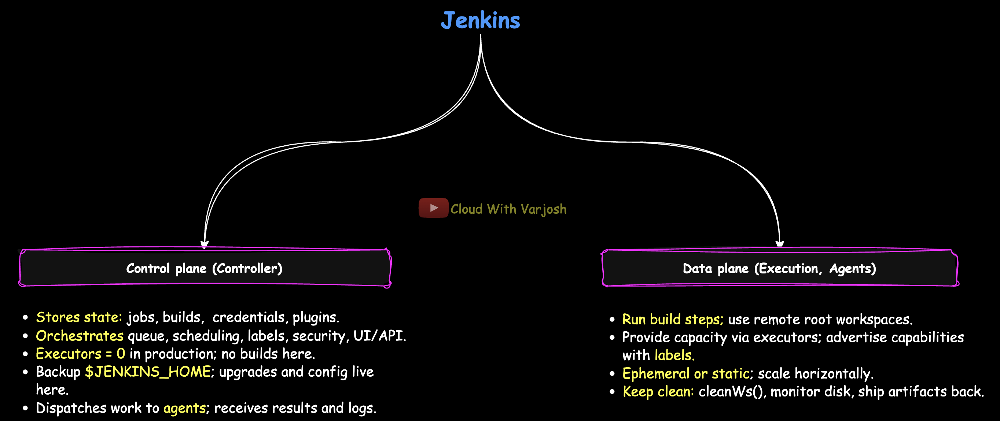

# 16 · Inside `JENKINS_HOME`

> **Level:** ★★ intermediate · **Status:** ✅➕ rewritten and expanded
>
> **You will learn:** a map of everything in Jenkins' home directory (what each file and folder is, why some are named `hudson.*`, how credentials are encrypted, what lives on the controller vs on agents) and what you must back up.
>
> **You need:** topics 11, 12, 14.
>
> **From your original notes:** Day 04 › *Introduction*, *Inside `$JENKINS_HOME`* (Top-Level Configuration, Why you still see "hudson", Security & Identity, Core Directories, Jenkins is a Java web app, Workspaces & Queues, Where jobs live vs where they run, Backup Quick-Check).
>
> 🎥 Original video: [Jenkins Freestyle Power-Ups | Build Parameters, Branch Input, Poll SCM & Cron Cleanup](https://www.youtube.com/watch?v=56iDHrLgqxw)

---

## What it is

**`JENKINS_HOME`** is the one directory that holds **all of the controller's state**. Its location depends on the install:

| Install | `JENKINS_HOME` |
|---|---|
| Docker image | `/var/jenkins_home` (on the `jenkins_home` volume) |
| Linux package | `/var/lib/jenkins` |
| Helm chart | the PVC mounted at `/var/jenkins_home` |

Nearly everything inside is plain **XML** files (Jenkins saves its Java objects as XML). That's why you *can* read and diff them, and why you should never edit them while Jenkins is running.

---

## Why it exists

One folder = one thing to back up, migrate or restore. If you understand its layout you can recover from disasters, find where disk space went, and answer "where is that build log?" in seconds.

---

## Analogy

A company's **head office archive room**: filing cabinets per project (`jobs/`), the safe with the keys (`secrets/`), the staff directory (`users/`), the toolbox (`tools/`), the shelf of installed equipment manuals (`plugins/`), and the master policy binder (`config.xml`).

---

## How it works inside

A real listing from the lab container (`docker exec jenkins ls /var/jenkins_home`):
```
config.xml                                  jobs/          secret.key
copy_reference_file.log                     logs/          secret.key.not-so-secret
credentials.xml                             nodes/         secrets/
fingerprints/                               plugins/       tools/
hudson.model.UpdateCenter.xml               queue.xml.bak  updates/
hudson.plugins.git.GitTool.xml              users/         userContent/
identity.key.enc                            war/           workspace/
jenkins.model.JenkinsLocationConfiguration.xml
jenkins.install.InstallUtil.lastExecVersion nodeMonitors.xml
```

### Top-level configuration (files)

| File | What it holds |
|---|---|
| `config.xml` | **Global Jenkins configuration**: security realm and authorization, number of built-in executors, global properties, views, clouds |
| `jenkins.model.JenkinsLocationConfiguration.xml` | **Jenkins URL** & admin email (from **Manage Jenkins → System**) |
| `hudson.tasks.*.xml`, `hudson.plugins.*.xml`, `org.jenkinsci.*.xml` | **Tool configs** (Maven/Gradle/Ant/Git, e.g. `hudson.tasks.Maven.xml`) and **plugin settings**, one file per component |
| `jenkins.mvn.GlobalMavenConfig.xml`, `nodeMonitors.xml`, `jenkins.install.*` | Global Maven settings, the **node monitors** (checks of agents' disk/clock/response time), and **install-wizard state** (`lastExecVersion` = the version that last ran, used to detect upgrades) |
| `credentials.xml` | **Global credentials**, stored **encrypted** (see below) |
| `copy_reference_file.log` | First-run log of the Docker image copying its reference files in |
| `queue.xml.bak` | A snapshot of the build **queue** saved at shutdown so queued builds survive a restart (temporary) |

> **Why you still see "hudson":** Jenkins started as **Hudson** (Sun Microsystems). After the **2011** fork (over governance and the trademark), the community carried on as **Jenkins**, but many core classes, file names and plugin APIs kept the `hudson.*` package names for **backward compatibility**. Hence `hudson.tasks.*.xml` and friends. (Full story in topic 10.)

### Security & identity

| Item | What it is |
|---|---|
| `secrets/` | **Encryption keys** and secret material: `master.key`, `hudson.util.Secret`, `initialAdminPassword`, API token and crumb keys, plugin keys (**guard these**) |
| `secret.key` | An older instance key still used by some components |
| `secret.key.not-so-secret` | An empty **marker file** saying "`secret.key` has been migrated". Not a secret |
| `identity.key.enc` | The controller's **instance identity** (an RSA key pair, encrypted). Used e.g. so inbound agents can verify they're talking to the right controller |

**How credentials are encrypted (the chain):**
```
secrets/master.key  ──encrypts──▶  secrets/hudson.util.Secret  ──encrypts──▶  {AQAAAB…} values in credentials.xml,
                                                                              jobs/*/config.xml, nodes/*/config.xml
```
- In XML, a secret looks like `<password>{AQAAABAAAAAQ…}</password>`: base64 ciphertext, not the real value.
- Anyone with **both** `credentials.xml` **and** `secrets/` can decrypt everything (the Script Console can too). That's why `JENKINS_HOME` must be protected like a password vault, and why builds must not run on the controller (topic 11).

> ⚠️ **Corrected:** was "preserve `secret.key` to decrypt credentials". Now: the files that actually decrypt credentials are **`secrets/master.key` + `secrets/hudson.util.Secret`** (the whole `secrets/` folder). Back up and restore `secrets/` **together with** `credentials.xml`/`jobs/`. If you restore XML without the matching `secrets/`, every credential silently becomes unreadable. Keep `secret.key` and `identity.key.enc` too.

### Core directories (state, code, users, logs)

| Directory | Contents |
|---|---|
| `jobs/` | **All jobs/pipelines.** Each job: `config.xml` (its configuration), `builds/<#>/` (per build: `log` = console output, `build.xml` = result/causes/params, `changelog.xml`, `archive/` = **archived artifacts**, `junitResult.xml`…), `nextBuildNumber`. Folders and multibranch jobs nest: `jobs/team-a/jobs/loans/branches/main/builds/7/`. **Critical to back up.** |
| `plugins/` | Installed plugins (`*.jpi`/`*.hpi` + their unpacked folders). A `.jpi.pinned` file = a manually pinned version; `.disabled` = disabled |
| `users/` | Local user records (`users/<id>/config.xml`: API tokens, preferences, password hash when using Jenkins' own user database) |
| `nodes/` | **Agent definitions** (`nodes/linux-1/config.xml`: launcher, labels, executors, remote root) |
| `fingerprints/` | MD5-keyed records of which build produced/used which file (topic 18) |
| `tools/` | Auto-installed tool caches on the built-in node (e.g. Maven via **Manage Jenkins → Tools**) |
| `logs/` | Controller logs (rotated), e.g. `logs/tasks/` for background tasks |
| `updates/` | Update-center metadata cache (**safe to recreate**) |
| `userContent/` | Static files Jenkins serves at `/userContent/` |
| `war/` | The unpacked web app for the running Jenkins version (recreated at start) |
| `workspace/` | Workspaces of builds that ran **on the built-in node** (see below) |

> **Jenkins is a Java web app (WAR):** it runs on the **JVM** and ships as a **`.war`**, unpacked under `$JENKINS_HOME/war/`. It boots an embedded server (Winstone/Jetty) on **HTTP 8080** by default, so you use it via a **URL**. Plugins live separately as **`.jpi/.hpi`** in `plugins/`. Jenkins can also sit behind a reverse proxy or inside an external servlet container (e.g. Tomcat). (Topic 12.)

### Workspaces & queues

- `workspace/`: **build workspaces on the node that runs the build.**
  - If the **controller has executors**, builds that run there create workspaces here.
  - With **controller executors = 0**, **no new** controller workspaces are created (old ones remain until cleaned).
  - Agent workspaces live on the **agent's filesystem** (under its *remote root directory*), **not** in `$JENKINS_HOME`.
- `queue.xml.bak`: the last saved build-queue snapshot (temporary).

### Where jobs live vs where they run (controller vs agents)



- **Control-plane state (controller):** job configs, build records/logs, credentials, plugins and archived artifacts live under `$JENKINS_HOME/jobs/...`.
- **Execution (agents):** build steps run on the **assigned node**. Each agent uses its own **workspace** (under its *remote root*) as scratch space.
- **Controller executors = 0:** the controller won't run builds, so no **new** workspaces appear under `$JENKINS_HOME/workspace` (old entries linger until cleaned).
- **Agents don't have a `$JENKINS_HOME`.** They have their own directory (e.g. `/var/jenkins` or `/home/jenkins`) containing:
  - `workspace/<job>` (and branch/PR variants): the runtime work area
  - `tools/...`: caches for Tools-installed JDK/Maven/Gradle
  - agent runtime files (e.g. the downloaded `remoting.jar`/`agent.jar`, `remoting/` logs)
- **Bottom line:** **records stay on the controller; agents hold runtime working files only.**

### Backup quick-check

- **Back up (must-have):** `jobs/`, `plugins/`, **`secrets/`**, `users/`, `nodes/`, global `*.xml` (incl. `credentials.xml`), `secret.key`, `identity.key.enc`.
- **Can exclude (recreated on boot):** `workspace/`, `updates/`, `war/`, caches like `tools/`, `logs/` (unless you need them).
- **Restore tips:** keep Jenkins and plugin versions compatible with the backup; **restore `secrets/` with the rest** so credentials decrypt.

Topic 68 turns this into a real backup and restore procedure.

---

## Config / Jenkinsfile / commands

```bash
# Which jobs use the most disk?
docker exec jenkins sh -c 'du -sh /var/jenkins_home/jobs/* | sort -h | tail -5'
```
```
12M   /var/jenkins_home/jobs/hello
1.8G  /var/jenkins_home/jobs/loans
```
Large `jobs/<name>` = too many kept builds or big archived artifacts → add a build discarder (topic 18).

```bash
# See a job's stored configuration
docker exec jenkins cat /var/jenkins_home/jobs/hello/config.xml
```
```xml
<project>
  <builders>
    <hudson.tasks.Shell>
      <command>echo hello</command>
    </hudson.tasks.Shell>
  </builders>
  ...
</project>
```
`hudson.tasks.Shell` is the "Execute shell" build step, still under its Hudson package name.

```bash
# See an encrypted credential (after you add one in topic 23)
docker exec jenkins grep -A1 '<password>' /var/jenkins_home/credentials.xml
```
```
<password>{AQAAABAAAAAQ8x2…}</password>
```

> Never edit these XML files while Jenkins runs: it holds them in memory and will overwrite your change. If you must, edit and then use **Manage Jenkins → Reload Configuration from Disk**, or better, use JCasC (topic 67).

---

## Hands-on lab

1. Create two Freestyle jobs, build each twice.
2. Explore:
   ```bash
   docker exec jenkins find /var/jenkins_home/jobs -maxdepth 3 | head -30
   docker exec jenkins cat /var/jenkins_home/jobs/hello/nextBuildNumber
   docker exec jenkins cat /var/jenkins_home/jobs/hello/builds/2/log
   ```
3. Make a *safe* lab backup with a throwaway container:
   ```bash
   docker run --rm -v jenkins_home:/src -v "$PWD":/backup alpine \
     tar czf /backup/jh-$(date +%F).tgz -C /src --exclude=./workspace --exclude=./war .
   ls -lh jh-*.tgz
   ```
   You now have a restorable archive (topic 68 does a full restore drill).

---

## Where you'll use it

- Backups, migrations and disaster recovery.
- Finding disk hogs and old builds.
- Security reviews: who can read `JENKINS_HOME`?
- Debugging odd behaviour by reading the actual stored config.

---

## When it breaks

| Symptom | Cause | Fix |
|---|---|---|
| After a restore, credentials show as empty / builds fail auth | `secrets/` not restored, or from a different instance | Restore the matching `secrets/` folder |
| Disk full on the controller | Old builds, big archives, controller workspaces | Build discarders, 0 controller executors, clean `workspace/` |
| Your manual XML edit "disappeared" | Jenkins overwrote it from memory | Reload from disk, or use JCasC |
| `Unreadable data` warning in **Manage Old Data** | Config from a removed plugin | Discard old data once you're sure the plugin is gone |

---

## Quick recap

- `JENKINS_HOME` = all controller state, mostly XML.
- `jobs/<job>/builds/<n>/log` = console output; `archive/` = artifacts.
- `secrets/master.key` → `hudson.util.Secret` → encrypted values in XML. Back up `secrets/` with everything else.
- Agents have no `JENKINS_HOME`, only a remote root with workspaces and caches.
- `hudson.*` names are leftovers from Hudson, kept for compatibility.

**Interview questions**

1. **Q: What do you need to back up to restore a Jenkins controller with working credentials?**
   A: `jobs/`, `plugins/`, `users/`, `nodes/`, the global XML files including `credentials.xml`, and the `secrets/` directory, which holds the keys that decrypt the credentials.

2. **Q: Where are a job's build logs stored?**
   A: On the controller, in `$JENKINS_HOME/jobs/<job>/builds/<number>/log`, even when the build ran on an agent.

3. **Q: Why is it dangerous to run builds on the controller?**
   A: The build process could read `JENKINS_HOME`, including `credentials.xml` and the keys in `secrets/`, and so decrypt every stored credential.

---

## References (from your original Day 04 notes)

* [Jenkins Handbook (About Jenkins)](https://www.jenkins.io/doc/book/intro/)
* [JENKINS_HOME & Backup Guidance](https://www.jenkins.io/doc/book/system-administration/backing-up/)
* [Git Plugin (SCM Checkout & Branches)](https://plugins.jenkins.io/git/)
* [Cron Syntax & `H` Hash Token](https://www.jenkins.io/doc/book/pipeline/syntax/#cron-syntax)
* [GitHub Plugin (Webhook `/github-webhook/`)](https://plugins.jenkins.io/github/)
