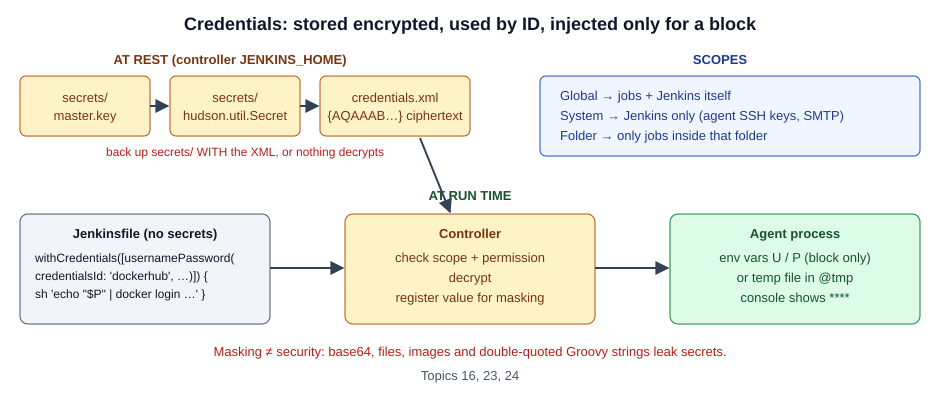

# 23 · Credentials: the Model

> **Level:** ★★ intermediate · **Status:** 🔀➕ merged and expanded
>
> **You will learn:** what a Jenkins credential is, the kinds (username/password, secret text, SSH key, secret file, certificate), where they're stored (stores, domains, System vs Global vs folder scope), how they're encrypted, credential IDs, and how to create GitHub **PATs** (classic vs fine-grained) and when to use a **GitHub App** instead.
>
> **You need:** topics 16 (encryption keys), 19.
>
> **From your original notes:** Day 05 › *1) Create a GitHub Personal Access Token (PAT)*, *2) Add credentials in Jenkins (GitHub & Docker Hub)* · shared-library › *Step 2: Create a GitHub PAT and add to Jenkins credentials* · Project 01 › *1. Create a GitHub PAT*, *2. Add the GitHub PAT into Jenkins credentials*, *5. Add Token to Jenkins Credentials* · Day 07 › prerequisites ("PAT or GitHub App").

---

## What it is

A **credential** is a secret that Jenkins stores **encrypted** and hands to a build **only when a step asks for it by ID**: a token, a password, an SSH private key, a certificate, a kubeconfig file.

The key idea: **jobs reference credentials by ID; they never contain the secret itself.** A Jenkinsfile says `credentialsId: 'dockerhub'`, not the password.

### Kinds

| Kind | Holds | Typical use |
|---|---|---|
| **Username with password** | username + password/token | GitHub PAT for HTTPS Git, Docker Hub login |
| **Secret text** | one string | API tokens (SonarQube token, Slack token) |
| **SSH Username with private key** | username + private key (+ passphrase) | SSH agents (topic 51), Git over SSH, SSH deploys |
| **Secret file** | an uploaded file | kubeconfig, a GCP service-account JSON, `.npmrc` |
| **Certificate** | a PKCS#12 keystore + password | client TLS certificates |
| **GitHub App** (GitHub Branch Source plugin) | App ID + private key | Jenkins ↔ GitHub API and checkout (preferred, topic 46) |
| Cloud kinds via plugins | AWS keys, Azure service principal, Vault tokens… | Cloud APIs (but prefer IAM roles/OIDC, topic 61) |

### Where credentials live: providers, stores, domains, scopes

- **Store:** where a credential is saved. The built-in **System** store (on the controller), **folder** stores (one per folder), and **user** stores (personal).
- **Domain:** an optional grouping inside a store (e.g. "github.com" credentials), used to limit which URLs a credential is offered for. Most setups only use **Global credentials (unrestricted)**.
- **Scope:**
  - **Global:** available to jobs **and** to Jenkins itself (e.g. connecting agents, Git checkout).
  - **System:** available **only to Jenkins itself** (e.g. the SSH key Jenkins uses to launch agents, an email server password), **not** to jobs. Use it for infrastructure secrets builds shouldn't see.
- **Folder credentials:** created inside a folder; only jobs **in that folder** can use them. This is how teams on one controller keep each other's secrets apart.
- **Providers:** plugins can supply credentials from external stores **without copying them into Jenkins**: HashiCorp Vault, AWS Secrets Manager, Azure Key Vault, Kubernetes Secrets (topic 24).

---

## Why it exists

If you type a token directly into a shell step, it ends up in the job config, in the console log, in Git history (for Jenkinsfiles), and in everyone's browser. Credentials centralise secrets, encrypt them at rest, control who can use them, mask them in logs, and let you **rotate** a token in one place.

> From your Day 05 notes: store secrets **once** in Jenkins Credentials and reference them; don't paste them into **Execute shell**. If you type a username/password or token directly in a shell step, it shows up in the **job config** and can leak in **console logs/history**, exactly what you don't want.

---

## Analogy

A **hotel's key desk**. Guests (jobs) don't carry master keys. They ask the desk for "key 204" (credential ID); the desk checks they're allowed, hands it over for the stay (the step), and takes it back. Staff-only keys (System scope) are never handed to guests. Each floor (folder) can have its own key box.

---

## How it works inside




1. You add a credential in **Manage Jenkins → Credentials → System → Global credentials (unrestricted) → Add Credentials**.
2. Jenkins encrypts the secret fields with the key in `secrets/hudson.util.Secret`, which is itself encrypted by `secrets/master.key` (topic 16), and writes `credentials.xml` (or the folder's `config.xml`).
3. A job references the **ID**. At run time the step (`git`, `withCredentials`, `sshagent`…) asks the credentials API for that ID **in the context of that job**. Jenkins checks the scope (folder/global), the job's permissions, and the domain, then decrypts.
4. The secret is given to the step: as environment variables, a temporary file in `<workspace>@tmp`, an SSH agent socket, or a Git askpass helper.
5. When the step ends, temporary files are deleted and the variables are gone. Exact matches of the secret in the log are replaced with `****` (topic 24).

**Credential IDs:** set them yourself (`github-pat`, `dockerhub`, `sonarqube-token`). If you leave the ID blank, Jenkins generates a UUID (a random ID like `3f1c…`), which makes Jenkinsfiles unreadable. **Keep IDs identical across controllers/environments** so the same Jenkinsfile works everywhere.

> ⚠️ **Corrected:** Project 01 creates a credential with ID **`sonarqube-token`**, but the pipeline snippets in stages 3–5 use **`sonarqube-token-new`**, while the final Jenkinsfile uses `sonarqube-token` again. Use **one** ID everywhere (`sonarqube-token`), because a mismatched ID fails the build with `ERROR: Could not find credentials entry with ID 'sonarqube-token-new'`.

---

## Config / Jenkinsfile / commands

### Create a GitHub Personal Access Token (PAT)

GitHub → **Settings → Developer settings → Personal access tokens**:

- **Fine-grained token (preferred):** choose the **resource owner**, select **only the repositories** Jenkins needs, and grant **Contents: Read** (checkout). Add **Commit statuses: Read and write** if Jenkins must post statuses, and **Contents: Read and write** only if Jenkins must push. Set an **expiry**.
- **Classic token:** scope **`repo`** (full control of private repos; more than checkout needs). Your shared-library and Project 01 notes use a classic `repo` token because the same token was used to **push**. In production prefer least-privilege tokens, deploy keys or a GitHub App.
- **Copy the token now**: you only see it once.

### Add credentials in Jenkins (GitHub & Docker Hub)

**A) GitHub PAT (for SCM checkout):** **Manage Jenkins → Credentials → System → Global → Add Credentials**
- **Kind:** *Username with password*
- **Username:** your GitHub username
- **Password:** your **PAT**
- **ID:** `github-pat` (easy to remember)
- **Description:** e.g. `GitHub PAT for private repos`
- Save.

Purpose: Jenkins uses it to check out private repos for pipeline jobs and to fetch shared libraries (topic 57).

**B) Docker Hub (for push & private pull):**
- Make sure you have a **private** repo on Docker Hub (e.g. `<your-dockerhub-user>/cwvj-flask`).
- Create a Docker Hub **access token** (Account settings → Personal access tokens) rather than using your password.
- **Kind:** *Username with password* · **Username:** your Docker Hub username · **Password:** the token · **ID:** `dockerhub` · Save.

**C) SonarQube token (Project 01):**
- **Kind:** *Secret text* · **Secret:** `<sonarqube-token>` · **ID:** `sonarqube-token`.
  **Why:** so the **Jenkins agent can authenticate to SonarQube** and upload analysis results (topic 62).

### See what's stored (and what isn't)

The UI never shows the secret again after saving: it shows `Concealed for Confidentiality`. On disk:
```bash
docker exec jenkins grep -B2 -A2 'github-pat' /var/jenkins_home/credentials.xml
```
```xml
<com.cloudbees.plugins.credentials.impl.UsernamePasswordCredentialsImpl>
  <scope>GLOBAL</scope>
  <id>github-pat</id>
  <username>octo-dev</username>
  <password>{AQAAABAAAAAgk8…}</password>
```
Encrypted, but decryptable by anyone with the controller's `secrets/` folder, which is why controller access is so sensitive.

### Using a credential (preview; topic 24 covers this in depth)

```groovy
git branch: 'main', credentialsId: 'github-pat', url: 'https://github.com/you/private-repo.git'
```

### GitHub App instead of a PAT (production preference)

A **GitHub App** is a first-class GitHub integration owned by your organisation, not by a person. Jenkins authenticates as the App with its private key and gets **short-lived installation tokens** (valid 1 hour).
- No personal token that leaves with an employee.
- Much higher API **rate limits** (multibranch scans make many API calls).
- Fine-grained, per-repo permissions.
Setup is in topic 46.

---

## Hands-on lab

1. Create a **fine-grained PAT** for your private `jenkins-lab` repo with Contents: Read.
2. Add it as `github-pat` (Username with password).
3. Make the repo private, point `intro-freestyle`'s Git SCM at it with that credential, and build. Then pick **- none -** as the credential and build again to see the failure:
   ```
   stderr: remote: Repository not found.
   fatal: repository 'https://github.com/you/jenkins-lab.git/' not found
   ```
   (GitHub says "not found" rather than "forbidden" for private repos you can't see.)
4. Create a folder `team-a`, add a credential **inside the folder** (folder → Credentials), and confirm that a job *outside* the folder can't select it.
5. Add a **System**-scoped secret text and notice it isn't offered in job configuration.

---

## Where you'll use it

- Every private Git checkout, registry push, scanner token and deploy key.
- Multi-team controllers (folder credentials).
- Agent connections (System-scoped SSH keys, topic 51).
- Rotation: update the secret in one credential, and every job using that ID picks it up.

---

## When it breaks

| Error | Meaning | Fix |
|---|---|---|
| `ERROR: Could not find credentials entry with ID 'x'` | Wrong ID, wrong folder, or System scope (not visible to jobs) | Match the ID; create it in a store the job can see; use Global scope |
| `remote: Repository not found` / `Authentication failed for 'https://github.com/…'` | Token expired/revoked, wrong scopes, or wrong username | Regenerate the token with the right repo access |
| `denied: requested access to the resource is denied` on `docker push` | Docker Hub token lacks write, or wrong namespace | Token with Read & Write; check the image name |
| Credentials suddenly all "invalid" after a migration | `secrets/` not copied | Restore the matching `secrets/` (topic 16) |
| GitHub `API rate limit exceeded` during multibranch scans | Personal token's 5,000/hour limit | GitHub App credential (topic 46) |

---

## Quick recap

- Credentials are stored **encrypted** and used **by ID**; secrets never go in job configs or Jenkinsfiles.
- Kinds: username/password, secret text, SSH key, secret file, certificate, GitHub App.
- **Global** = jobs + Jenkins; **System** = Jenkins only; **folder** = only jobs in that folder.
- Prefer fine-grained PATs, and GitHub Apps in production.
- Keep IDs consistent; a typo means "Could not find credentials entry".

**Interview questions**

1. **Q: Global vs System credential scope?**
   A: Global credentials can be used by jobs and by Jenkins itself. System credentials are only for Jenkins' own use (agent launching, server integrations) and are hidden from jobs.

2. **Q: How are Jenkins credentials protected at rest?**
   A: They're encrypted in XML with a key in `secrets/hudson.util.Secret`, which is encrypted by `secrets/master.key`. Anyone with both the XML and `secrets/` can decrypt them, so the controller's filesystem must be protected.

3. **Q: Why use a GitHub App instead of a PAT?**
   A: It belongs to the organisation rather than a person, uses short-lived tokens, has fine-grained permissions, and has higher API rate limits, which matter for multibranch scanning.
