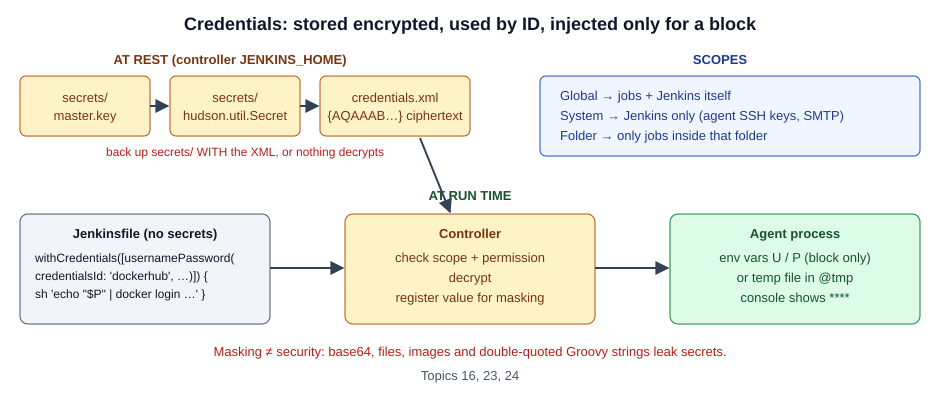

# 24 · Using Credentials Safely

> **Level:** ★★ intermediate · **Status:** 🔀➕ merged and expanded
>
> **You will learn:** how to hand a credential to a build: Freestyle "Use secret text(s) or file(s)", the pipeline `withCredentials` step, the `credentials()` helper in `environment`, and `sshagent`. Also how log masking works and where it fails, the single most common leak (Groovy string interpolation), safe `docker login`, and external secret managers.
>
> **You need:** topic 23.
>
> **From your original notes:** Day 05 › credentials tip ("Use secret text(s) or file(s)"), *B) Build Environment → Use secret text(s) or file(s)* · Day 06 › *Step 1 B) Docker Hub login* (withCredentials, "Why these two?") · Project 01 › *5. Add Token to Jenkins Credentials* (Pipeline Syntax binding, note on security), *withCredentials* explanation · Project 01 › *7. Centralised secrets management* · Day 03 › *Credentials and policies*.

---

## What it is

**Credential binding** = making a stored credential available to a build step **temporarily**, as environment variables or a file, and only for that step or block. The **Credentials Binding** plugin provides it (installed with the suggested plugins).

---

## Why it exists

A credential that's stored safely but used carelessly still leaks: printed in a log, captured in a process list, baked into an image layer, or left in a file on the agent. Binding limits **where** and **for how long** the secret exists, and masks it in output.

---

## Analogy

A **valet parking ticket**: the attendant gets your car key only for the minutes they're parking it, and the receipt shows `****` instead of your licence plate. If the attendant photocopies the key (writes the secret to a file and leaves it there), the system can't protect you.

---

## How it works inside




1. The step asks for credential ID `dockerhub` with variable names `DOCKERHUB_USER`/`DOCKERHUB_PWD`.
2. Jenkins decrypts it on the controller, sends the values to the agent, and sets them as environment variables **only for the processes started inside the block**.
3. For **file** credentials it writes a temporary file under `<workspace>@tmp/secretFiles/…` and sets the variable to its path; the file is deleted when the block ends.
4. A **log filter** replaces any exact occurrence of the secret value in the console with `****`.

### Where masking fails (know these!)

- **Transformed values aren't masked.** If the build prints the secret base64-encoded, reversed, URL-encoded, or one character per line, the filter doesn't recognise it.
- **Very short or common secrets** (e.g. `admin`) get masked everywhere they appear in the log, which is confusing, and they're weak anyway.
- **Things outside the console log** aren't masked: files you archive, image layers you build, test reports, messages you send to Slack.
- **Groovy interpolation** (below) puts the secret into the *command text* itself, which can be visible in process listings and in Jenkins' own step records.

### The #1 leak: Groovy double quotes

Inside a Jenkinsfile, `sh` takes a **Groovy string** (topic 30):
- `sh 'echo $TOKEN'` (**single quotes**): Groovy passes the text `echo $TOKEN` unchanged; the **shell** expands `$TOKEN` from the environment. ✅ The secret never appears in the script text.
- `sh "echo ${TOKEN}"` (**double quotes**): **Groovy** substitutes the value first, so the script text becomes `echo s3cr3tvalue`. ❌ The secret is now part of the command, recorded in the step's arguments, and visible in `ps` on the agent. Jenkins warns you:
  ```
  Warning: A secret was passed to "sh" using Groovy String interpolation, which is insecure.
           Affected argument(s) used the following variable(s): [DOCKERHUB_PWD]
  ```

**Rule:** inside `withCredentials`, always use **single-quoted** `sh '…'` (or triple single quotes `'''…'''`) and let the shell expand `$VAR`.

---

## Config / Jenkinsfile / commands

### Freestyle: Build Environment → Use secret text(s) or file(s)

We inject Docker Hub credentials as environment variables the shell can use:
- Tick **Use secret text(s) or file(s)** → **Add** → **Username and password (separated)**
  - **Credentials:** `dockerhub`
  - **Username variable:** `DOCKERHUB_USER`
  - **Password variable:** `DOCKERHUB_PWD`

This keeps secrets out of scripts and logs while your shell commands use them safely:
```bash
echo "$DOCKERHUB_PWD" | docker login -u "$DOCKERHUB_USER" --password-stdin
```
Console:
```
+ echo ****
+ docker login -u **** --password-stdin
Login Succeeded
```
`--password-stdin` reads the password from standard input instead of the command line, so it never appears in the process list or shell history.

### Pipeline: `withCredentials` (generated by the Snippet Generator)

In **Pipeline Syntax** (topic 33): **Sample Step:** `withCredentials: Bind credentials to variables` → **Binding:** *Username and password (separated)* → credentials `dockerhub`, username variable `DOCKERHUB_USER`, password variable `DOCKERHUB_PWD`. Generated:

```groovy
withCredentials([usernamePassword(credentialsId: 'dockerhub',
  usernameVariable: 'DOCKERHUB_USER', passwordVariable: 'DOCKERHUB_PWD')]) {
  sh 'echo "$DOCKERHUB_PWD" | docker login -u "$DOCKERHUB_USER" --password-stdin'
  sh 'docker push "$IMAGE:$TAG"'
}
```

> **Why these two (from Day 06)?** `git` with `credentialsId` is the safe, fast way to check out. `withCredentials` injects the Docker Hub secret **just for the block**: masked in logs and not saved in `.git/config`. It is passed as an **environment variable**, which other users can't read through `ps`. ⚠️ That protection disappears the moment you put the value on a command line (`-Dsonar.token="$SONAR_TOKEN"`, `--password $P`): command-line arguments **are** visible in `ps` and `/proc/<pid>/cmdline` to anyone on the agent. Prefer tools that read secrets from env vars or stdin (`--password-stdin`).

Other bindings:
```groovy
withCredentials([string(credentialsId: 'sonarqube-token', variable: 'SONAR_TOKEN')]) {
  sh 'mvn -B verify sonar:sonar'          // the Sonar scanner reads $SONAR_TOKEN from the environment; never -Dsonar.token=… (visible in ps)
}
withCredentials([file(credentialsId: 'kubeconfig-stage', variable: 'KUBECONFIG')]) {
  sh 'kubectl get ns'                     // kubectl reads $KUBECONFIG = path to a temp file
}
withCredentials([sshUserPrivateKey(credentialsId: 'deploy-key', keyFileVariable: 'KEY', usernameVariable: 'USER')]) {
  sh 'ssh -i "$KEY" -o StrictHostKeyChecking=yes "$USER@app1.internal" uptime'
}
```

> **Note on security (from Project 01):** using `withCredentials` (Secret text / `string`) is the correct way to give tokens to a pipeline; the Credentials Binding plugin **masks** the secret in the console output when it's used through the binding.

### Pipeline: the `credentials()` helper in `environment`

```groovy
environment {
  SONAR_TOKEN = credentials('sonarqube-token')   // secret text → one variable
  DOCKERHUB   = credentials('dockerhub')         // username/password → DOCKERHUB, DOCKERHUB_USR, DOCKERHUB_PSW
}
```
For username/password credentials it creates `NAME_USR` and `NAME_PSW` (and `NAME` = `user:password`). The binding lasts for the whole pipeline (or stage, if placed in a stage's `environment`), so prefer `withCredentials` when only one step needs it.

### Pipeline: `sshagent` (SSH Agent plugin)

```groovy
sshagent(credentials: ['deploy-key']) {
  sh 'ssh deploy@app1.internal "sudo systemctl restart app"'
  sh 'git push git@github.com:acme/env-config.git HEAD:main'
}
```
Loads the key into a temporary `ssh-agent`; nothing is written to disk.

### Safe `docker login` on shared agents

`docker login` stores the token (base64, *not* encrypted) in `~/.docker/config.json` on the agent, where other builds by the same user can read it. On shared agents:
```groovy
withCredentials([usernamePassword(credentialsId: 'dockerhub', usernameVariable: 'U', passwordVariable: 'P')]) {
  sh '''
    export DOCKER_CONFIG="$WORKSPACE@tmp/docker"   # private, per-build config dir
    echo "$P" | docker login -u "$U" --password-stdin
    docker push "$IMAGE:$TAG"
    docker logout
  '''
}
```

### External secret managers

From your Day 03 and Project 01 notes: instead of storing everything in Jenkins Credentials, enterprises integrate **HashiCorp Vault**, **AWS Secrets Manager**, **Azure Key Vault** or **Google Secret Manager**. These provide **short-lived secrets**, **automatic rotation** and strong encryption, so no long-lived secret sits in Jenkins, in logs or in environment variables longer than needed.

Ways to wire them into Jenkins:
- **Credentials provider plugins** (e.g. *AWS Secrets Manager Credentials Provider*, *Kubernetes Credentials Provider*): secrets in the external store **appear as normal Jenkins credentials** by ID. Jenkinsfiles don't change.
- **HashiCorp Vault plugin:** `withVault(...) { … }` fetches secrets at run time, using a Vault AppRole or Kubernetes auth.
- **No stored secret at all (best):** cloud identity for agents. An EC2 **IAM role** (Project 01, topic 61), Kubernetes **IRSA**/EKS Pod Identity, or **OIDC** federation gives the agent short-lived cloud credentials automatically.
- In Kubernetes: **Kubernetes Secrets**, ideally synced from the external manager by the **External Secrets Operator**.

---

## Hands-on lab

1. Create a secret text credential `demo-secret` with value `S3cr3t-Value-42`.
2. Pipeline job (inline script):
   ```groovy
   pipeline {
     agent any
     stages {
       stage('safe')   { steps { withCredentials([string(credentialsId: 'demo-secret', variable: 'S')]) { sh 'echo "value is $S"' } } }
       stage('unsafe') { steps { withCredentials([string(credentialsId: 'demo-secret', variable: 'S')]) { sh "echo value is ${S}" } } }
       stage('bypass') { steps { withCredentials([string(credentialsId: 'demo-secret', variable: 'S')]) { sh 'echo "$S" | base64' } } }
     }
   }
   ```
3. Read the console:
   - `safe`: `value is ****`.
   - `unsafe`: still masked in the output, but Jenkins prints the **interpolation warning**, because the secret was embedded in the command.
   - `bypass`: prints `UzNjcjN0LVZhbHVlLTQyCg==`, the secret in base64, **unmasked**. Masking is a safety net, not a security boundary: anyone who can change a Jenkinsfile can exfiltrate any credential that job can use.
4. Delete `demo-secret`. Lesson: limit **who can edit pipelines** that use powerful credentials, and scope credentials to folders (topics 23, 65).

---

## Where you'll use it

- Every registry login, scanner token, kubeconfig and SSH deploy.
- Security reviews of Jenkinsfiles (look for double-quoted `sh` with secrets, `printenv`, `set -x` around secrets).
- Moving a company from "secrets in Jenkins" to "secrets in Vault / cloud identity".

---

## When it breaks

| Symptom | Cause | Fix |
|---|---|---|
| `Warning: A secret was passed to "sh" using Groovy String interpolation` | Double-quoted `sh "…${SECRET}…"` | Single quotes; let the shell expand `$SECRET` |
| `ERROR: Could not find credentials entry with ID 'dockerhub'` | Wrong ID/scope/folder | Topic 23 |
| `Error: Cannot perform an interactive login from a non TTY device` | `docker login -p` missing, or the password isn't piped | `echo "$P" \| docker login -u "$U" --password-stdin` |
| Secret visible in an archived file or image | Masking only covers the console | Never write secrets to files you archive; use build secrets (`docker build --secret`) |
| Variable empty inside the block | Wrong binding type (e.g. `string` on a username/password credential) | Match the binding to the credential kind |

---

## Quick recap

- Bind credentials **only where needed**: `withCredentials` (block), the `credentials()` helper (whole pipeline/stage), `sshagent`, the Freestyle "Use secret text(s) or file(s)".
- Use **single quotes** in `sh` with secrets; double quotes leak them into the command.
- Masking hides exact matches in the console only, not encoded values, files or images.
- `docker login --password-stdin`, ideally with a per-build `DOCKER_CONFIG`.
- Best of all: no stored secrets (cloud identity), or external managers with short-lived secrets.

**Interview questions**

1. **Q: Why is `sh "docker login -p ${PASS}"` dangerous in a Jenkinsfile?**
   A: Groovy interpolates the password into the command text, so it's visible in process listings and step records, and it's on the command line. Use single quotes and `--password-stdin`, letting the shell read the bound variable.

2. **Q: Does Jenkins masking make secrets safe?**
   A: No. It only replaces exact matches in the console log. A pipeline can print an encoded secret, write it to a file or send it anywhere, so control who can edit pipelines and scope credentials tightly.

3. **Q: How would you avoid storing AWS keys in Jenkins at all?**
   A: Give agents a cloud identity: an IAM instance role on EC2, IRSA/Pod Identity on EKS, or OIDC federation, so they get short-lived credentials automatically.
