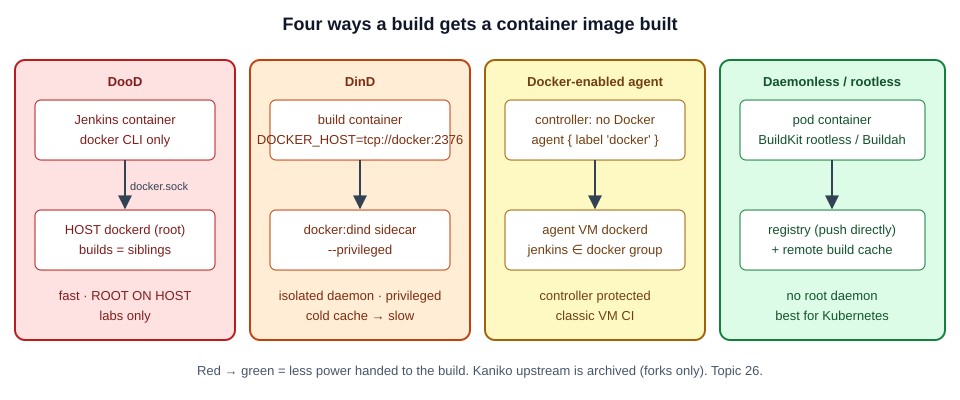
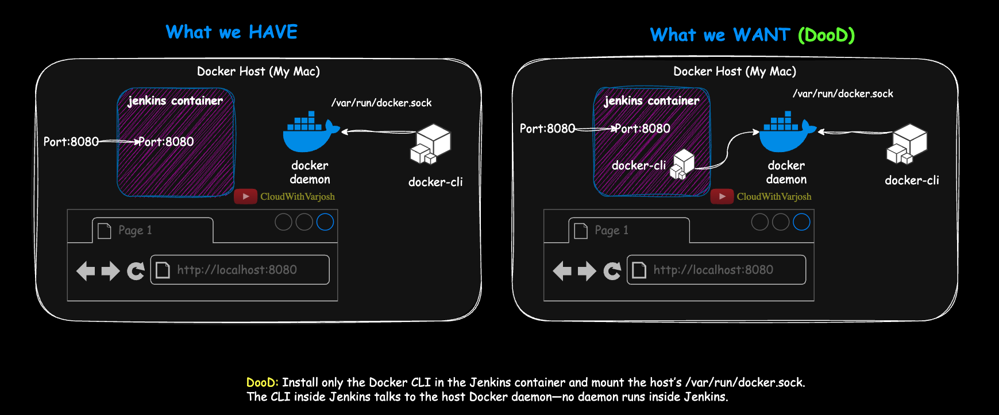

# 26 · Ways to Build Images in Jenkins

> **Level:** ★★ intermediate · **Status:** ➕ expanded from the Day 05 overview and FAQ
>
> **You will learn:** the four ways a Jenkins build can produce a container image (**DooD**, **DinD**, Docker-enabled agents, and **daemonless** builders such as BuildKit rootless and Buildah; plus where Kaniko stands now), how each works, its security trade-offs, and which to use when.
>
> **You need:** topic 25.
>
> **From your original notes:** Day 05 › *What approach we'll use (DooD)* (diagram reading, DooD in one minute, production note), *Quick FAQ*.

---

## What it is

A Jenkins build that runs `docker build` needs **a daemon (or a builder) to do the work**. The options differ in **where** that daemon runs and **how much power** the build gets.

| Approach | Full name | In one line |
|---|---|---|
| **DooD** | Docker-outside-of-Docker | Mount the host's `docker.sock` into the Jenkins container; use the host's daemon |
| **DinD** | Docker-in-Docker | Run a separate, nested Docker daemon inside a (privileged) container |
| **Docker-enabled agent** | n/a | A dedicated agent VM with Docker installed; the controller has none |
| **Daemonless / rootless builders** | n/a | Build images without a root daemon: BuildKit (rootless), Buildah, (Kaniko forks) |

---

## Why it exists

The simplest option (DooD) gives every build **root on the host** (topic 25). That's fine for a personal lab, dangerous on a shared CI server. Production picks an option based on isolation, speed (layer caching) and platform (VMs vs Kubernetes).

---

## Analogy

Needing an **oven** to bake:
- **DooD** = borrowing the landlord's kitchen key: fast, but you can now open every room in the house.
- **DinD** = carrying a portable oven into your room: separate, but it needs a special power socket (privileged mode) and starts cold every time.
- **Docker-enabled agent** = a dedicated bakery building just for baking.
- **Daemonless** = a solar cooker that needs no gas line at all (no root daemon).

---

## How it works inside




### DooD (what the lab uses)



**Reading the diagram:**
- **Left (what we HAVE):** a Jenkins container exposed on **port 8080** with **no Docker access**.
- **Right (what we WANT, DooD):** the **Docker CLI lives inside the Jenkins container**, and a line labelled **`/var/run/docker.sock`** connects it to the **host Docker daemon**. **No daemon runs inside Jenkins.**

**Docker-outside-of-Docker in one minute:**
- We **don't** start a Docker daemon in the Jenkins container.
- We **mount the host socket** `-v /var/run/docker.sock:/var/run/docker.sock` and install **only the Docker CLI** in Jenkins.
- Commands run **inside Jenkins** (`docker build/push/run`) are executed by the **host's Docker daemon** through that socket.
- *Result: fast, simple, perfect for a lab. Handle it with care, because it grants powerful access to the host.*

Side effects you'll notice:
- Containers the build starts are **siblings** of Jenkins on the host (they show in the host's `docker ps`), not children.
- **Bind-mount paths are host paths.** `docker run -v $WORKSPACE:/src` passes the path as the *host* daemon sees it. `/var/jenkins_home/workspace/x` exists only inside the Jenkins container, unless the host path is the same. (A classic DooD gotcha; prefer `docker build` with a context, or `docker cp`.)
- The image cache is the **host's**, so builds are fast after the first one.

### DinD

- A container runs its **own** `dockerd` (image `docker:dind`), which needs `--privileged` (almost all host kernel capabilities, so not much safer in practice).
- Jenkins talks to it over TCP with TLS (`DOCKER_HOST=tcp://docker:2376`).
- **Pros:** isolated from the host's containers; each build can get a fresh daemon.
- **Cons:** `--privileged`, more moving parts, **cold caches** (every new DinD starts with no layers, so builds are slower), storage-driver quirks.
- From your FAQ: *needs `--privileged`, more moving parts, slower caches. Fine for labs, but DooD is simpler here.*

### Docker-enabled agents

- The controller has **no** Docker. A separate agent VM (or several) has Docker Engine installed, and the `jenkins` user there is in the `docker` group.
- Builds with `agent { label 'docker' }` run there (Project 01 uses exactly this: topics 51, 62).
- The agent is still root-equivalent for its builds, but the **controller and its secrets are protected**, and you can dedicate agents per team or trust level, or recreate them often.

### Daemonless / rootless builders

These build OCI images **without a root daemon**, which suits Kubernetes pods where you don't want `docker.sock` or privileged pods:

- **BuildKit (rootless):** Docker's own modern build engine (the same engine behind `docker build`) can run as an unprivileged `buildkitd`; you drive it with `buildctl` or `docker buildx` with a **remote driver** (`docker buildx create --driver remote tcp://buildkitd:1234`). Shared, persistent build cache.
- **Buildah:** builds OCI images from Dockerfiles without a daemon (`buildah bud`); runs rootless; used by Podman and OpenShift.
- **Kaniko:** builds from a Dockerfile inside a normal container without a daemon.

> ⚠️ **Corrected (status update):** the Day 05 production note lists **Kaniko** next to BuildKit/Buildx as a recommended daemonless builder. **Google archived the original Kaniko repository in June 2025** (no more upstream releases or fixes). It continues as community/vendor **forks** (Chainguard took over maintenance, and the osscontainertools fork exists; check their image licensing). For new setups prefer **BuildKit rootless / buildx with a remote builder** or **Buildah**. Existing Kaniko pipelines should move to a maintained fork or migrate.

> **Production note (from Day 05, updated):** prefer **Docker-enabled agents** or **daemonless builders** (BuildKit rootless, Buildx with a remote driver, Buildah) instead of sharing the host socket with the controller.

### Choosing

| | DooD | DinD | Docker agent | Daemonless |
|---|---|---|---|---|
| Setup effort | lowest | medium | medium | medium–high |
| Build speed (cache) | fast | slow (cold) | fast | fast with a shared cache |
| Root on a host | **yes, the controller host** | privileged container | the agent host | no |
| Best for | personal labs | isolated test daemons | VM-based CI | Kubernetes CI |

---

## Config / Jenkinsfile / commands

**DooD** (lab, topic 27): `-v /var/run/docker.sock:/var/run/docker.sock` + Docker CLI in the Jenkins image.

**Docker agent** (topic 51): `agent { label 'docker' }` and plain `sh 'docker build …'`.

**BuildKit rootless in Kubernetes** (sketch; topic 53 covers pod templates):
```groovy
podTemplate(yaml: '''
spec:
  containers:
  - name: buildkit
    image: moby/buildkit:rootless
    args: ["--oci-worker-no-process-sandbox"]
    securityContext: { runAsUser: 1000, seccompProfile: { type: Unconfined }, appArmorProfile: { type: Unconfined } }
''') {
  node(POD_LABEL) {
    checkout scm
    container('buildkit') {
      sh '''buildctl-daemonless.sh build --frontend dockerfile.v0 \
             --local context=. --local dockerfile=. \
             --output type=image,name=registry.example.com/app:$BUILD_NUMBER,push=true'''
    }
  }
}
```
- `buildctl-daemonless.sh` starts a temporary rootless BuildKit inside the container and builds. (It's shipped in the BuildKit images; confirm with `docker run --rm --entrypoint sh moby/buildkit:rootless -c 'ls /usr/bin | grep buildctl'`.)
- Why those settings: BuildKit's rootless docs say it needs `seccomp` and `AppArmor` **unconfined** (for the `unshare` and `mount` system calls), and on Kubernetes it uses `--oci-worker-no-process-sandbox`, because Kubernetes has no equivalent of Docker's `systempaths=unconfined`. The docs call that flag *discouraged*: BuildKit can't fully isolate or kill build processes with it. The official pod manifests are in the BuildKit repo under `examples/kubernetes/`; copy their `securityContext` rather than this sketch.
- `--output type=image,…,push=true` builds and pushes in one go (registry auth comes from a mounted Docker config secret).

**Buildah:**
```bash
buildah bud -t registry.example.com/app:$BUILD_NUMBER . && buildah push registry.example.com/app:$BUILD_NUMBER
```

---

## Hands-on lab

Feel the DooD sibling effect (once topic 27 is done):
1. From a Jenkins build, run `docker run -d --name from-jenkins alpine sleep 300`.
2. On the **host**: `docker ps`. The container is there, next to `jenkins`, not "inside" it.
3. From the build: `docker run --rm -v "$WORKSPACE":/src alpine ls /src`. It lists an empty or unexpected folder, because the host has no such path. Then try `docker build -t demo .` from the workspace: that works, because the CLI **uploads** the build context.

---

## Where you'll use it

- Choosing a CI image-build strategy for a team or platform.
- Interviews: "DinD vs DooD?", "how do you build images in Kubernetes without privileged pods?"
- Security reviews of existing Jenkins setups (look for mounted sockets on the controller).

---

## When it breaks

| Symptom | Cause | Fix |
|---|---|---|
| `docker run -v $WORKSPACE:…` mounts an empty dir (DooD) | Paths are resolved by the host daemon | Use the build context / `docker cp`, or the same path on host and container |
| DinD: `Cannot connect to the Docker daemon at tcp://docker:2376` | DinD sidecar not ready, or TLS certs not shared | Wait for readiness; share `/certs/client` |
| DinD builds are slow every time | Cold cache | Persistent volume for `/var/lib/docker`, or switch to a shared BuildKit |
| BuildKit rootless: `failed to mount … operation not permitted` | Pod security blocks user namespaces/mounts | The documented securityContext for rootless BuildKit, or a dedicated build node pool |

---

## Quick recap

- **DooD:** host socket mounted, CLI only. Fastest and simplest; root on the host. Labs.
- **DinD:** nested privileged daemon; isolated but slow and still privileged.
- **Docker-enabled agents:** keep Docker off the controller (the classic VM setup).
- **Daemonless:** BuildKit rootless/buildx remote, Buildah. Best for Kubernetes. Kaniko upstream is archived; only forks remain.

**Interview questions**

1. **Q: DooD vs DinD?**
   A: DooD mounts the host's Docker socket, so builds use the host daemon: fast with a shared cache, but root on the host. DinD runs a separate daemon inside a privileged container: more isolated from the host's containers, but privileged and slower with cold caches.

2. **Q: How do you build images in Kubernetes without mounting docker.sock?**
   A: Use a daemonless or rootless builder: BuildKit rootless (directly or via a buildx remote builder), or Buildah, typically with a shared cache and registry credentials from a secret.

3. **Q: Why not just mount docker.sock on the Jenkins controller in production?**
   A: Every build would get root on the controller host, and so access to `JENKINS_HOME` and every credential. Builds belong on isolated agents.
