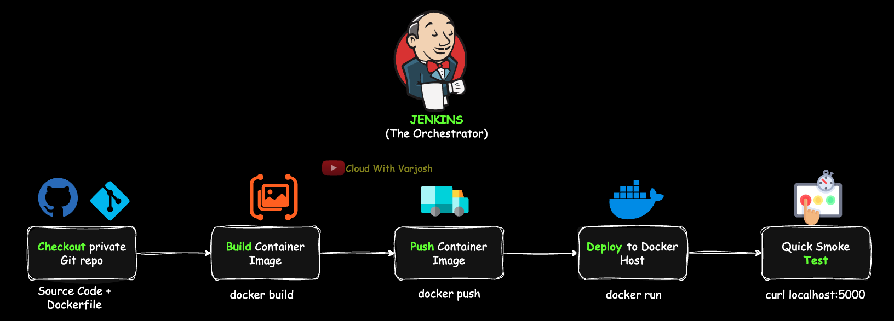

# 28 · Project 1: Build, Push and Run a Flask App (Freestyle)

> **Level:** ★★ intermediate · **Status:** ✅ rewritten from your notes
>
> **You will learn:** the full CI loop in one Freestyle job: check out a private repo, log in to Docker Hub with masked credentials, build a tagged image, push it to a private repository, run it on the host via DooD, and smoke-test it.
>
> **You need:** topics 20, 23, 24, 27.
>
> **From your original notes:** Day 05 › *Demo — Build, Push & Deploy a Flask App with Jenkins (DooD)*: What we'll do, 0) private repo + all four files, 1) PAT, 2) credentials, 3) Freestyle job A–E, 4) run end-to-end, *Conclusion* · files `Day 05/python/*` and `Day 06/test` (the Execute shell script).
>
> 📁 Files: [`project-files/project-1-flask-freestyle/`](../project-files/project-1-flask-freestyle/)

---

## What it is

**What we'll do:**



Create a tiny **Flask** (a small Python web framework) app, **build a container image**, **push** it to a **private Docker Hub repo**, and **deploy** it on the Docker host using **DooD**.
**Why this matters:** it shows the full CI loop in one pass: **Code → Image → Private Registry → Running Container → Smoke Test**.

---

## Why it exists

This is the smallest realistic delivery pipeline. Doing it once as a Freestyle job shows every moving part, and also why it's clumsy, which motivates pipelines as code (Part 6).

---

## Analogy

A small **bakery's first order**: get the recipe (checkout), bake (build), box and label it (tag), put it in the shop's locked display (private registry), serve one slice to a taster (deploy + smoke test).

---

## How it works inside

```
Build #N on the built-in node (Jenkins container)
 1. Git checkout of the private repo  (credential: github-pat)
 2. Credentials Binding → env DOCKERHUB_USER / DOCKERHUB_PWD (masked)
 3. docker login ──socket──▶ host dockerd ──HTTPS──▶ Docker Hub
 4. docker build -t …:N -t …:latest .   (host daemon builds from the uploaded context)
 5. docker push …:N and …:latest       ──▶ Docker Hub (private repo)
 6. docker pull …:N ; docker rm -f cwvj-flask ; docker run -d -p 5000:5000 …:N   (sibling container on the host)
 7. smoke test → http://localhost:5000 on the host
```

---

## Config / Jenkinsfile / commands

### 0) Create a private GitHub repo

The lecture uses **`https://github.com/CloudWithVarJosh/cwvj-private-repo.git`** as the example. **Use your own private repo** (GitHub, GitLab, Bitbucket, any Git host is fine).

All four files you need (**`app.py`**, **`requirements.txt`**, **`Dockerfile`**, **`.dockerignore`**) are in `project-files/project-1-flask-freestyle/python/`. Put them in **your** repo's **root** (or a `python/` folder; just be consistent with the path you use in Jenkins).

**`app.py`**
```python
from flask import Flask, jsonify
app = Flask(__name__)

@app.get("/")
def hello():
    return jsonify(
        message="✨ Welcome to Cloud with VarJosh ✨",
        tip="Built with Flask, shipped by Jenkins, running in Docker."
    )

if __name__ == "__main__":
    app.run(host="0.0.0.0", port=5000)
```
- `@app.get("/")` registers a handler for HTTP GET on `/`; `jsonify` returns JSON.
- `host="0.0.0.0"` listens on all interfaces. **Required in a container**; `127.0.0.1` would only accept connections from inside the container.

**`requirements.txt`**
```
flask==3.0.3
```
An exact pin (`==`) makes builds reproducible (topic 04).

**`Dockerfile`**
```dockerfile
# Small Python base image (Debian slim) to keep the final image light
FROM python:3.11-slim

# Set working directory inside the container
WORKDIR /app

# Copy only dependency list first to leverage Docker layer caching
COPY requirements.txt .

# Install Python dependencies (no pip download cache in the image)
RUN pip install --no-cache-dir -r requirements.txt

# Copy the application code
COPY app.py .

# Document the port the app listens on
EXPOSE 5000

# Start the Flask app
CMD ["python", "app.py"]
```
Copying `requirements.txt` **before** `app.py` means a code-only change reuses the cached `pip install` layer (Docker notes topic 16).

**`.dockerignore`**
```
__pycache__/
*.pyc
.git
```
Keeps these out of the build context (smaller, faster, and no `.git` history in the image).

### 1) Create a GitHub Personal Access Token (PAT)

GitHub → **Settings → Developer settings → Personal access tokens**:
- **Fine-grained token:** grant **Contents: Read** on your private repo; or
- **Classic token:** scope **`repo`** (read is enough for checkout).
- **Copy the token now** (you only see it once). Details in topic 23.

### 2) Add credentials in Jenkins (GitHub & Docker Hub)

- **A) GitHub PAT:** *Username with password*, username = GitHub user, password = PAT, **ID `github-pat`**.
- **B) Docker Hub:** make sure you have a **private** repo on Docker Hub (e.g. `cloudwithvarjosh/cwvj-flask`, use your own namespace). *Username with password*, username = Docker Hub user, password = Docker Hub **access token**, **ID `dockerhub`**.

> Store secrets **once** in Jenkins Credentials and reference them; don't paste them into **Execute shell** (topic 24).

### 3) Create the Jenkins Freestyle job

**Job name:** `flask-dood-demo` → **Freestyle project → OK**

**A) Source Code Management → Git**
- **Repository URL:** your private repo (e.g. `https://github.com/CloudWithVarJosh/cwvj-private-repo.git`)
- **Credentials:** `github-pat`
- **Branches to build:** `*/main` (or your branch)

**B) Build Environment → Use secret text(s) or file(s)**
- Tick it → **Add** → **Username and password (separated)**
  - **Credentials:** `dockerhub`
  - **Username variable:** `DOCKERHUB_USER`
  - **Password variable:** `DOCKERHUB_PWD`

**C) (Optional) Parameters**
For a visible tag parameter: **This project is parameterized → Add Parameter → String Parameter**, **Name:** `TAG`, **Default value:** `${BUILD_NUMBER}`.

> ⚠️ **Corrected (clarified):** a String parameter's default value is **not expanded**. With default `${BUILD_NUMBER}`, the variable `TAG` contains the literal text `${BUILD_NUMBER}`, and the shell won't expand it a second time. The script below works anyway only because it **overwrites** `TAG="${BUILD_NUMBER}"`. If you want an overridable tag, leave the default **empty** and use `TAG="${TAG:-$BUILD_NUMBER}"` in the script (`${VAR:-default}` = use `$VAR` if set and non-empty, else the default; Linux notes topic 012).

**D) Build Steps → Execute shell**

Paste this (kept beginner-simple, deploys with the exact tag; saved as `freestyle-execute-shell.sh`):
```bash

# 1) Docker login (uses injected env vars)
echo "Logging in to Docker Hub..."
echo "$DOCKERHUB_PWD" | docker login -u "$DOCKERHUB_USER" --password-stdin

# 2) Image naming
IMAGE="docker.io/cloudwithvarjosh/cwvj-flask"
TAG="${BUILD_NUMBER}"

# 3) Build and push (exact tag + latest for convenience)
echo "Building image..."
docker build -t "$IMAGE:$TAG" -t "$IMAGE:latest" .

echo "Pushing image..."
docker push "$IMAGE:$TAG"
docker push "$IMAGE:latest"

# 4) Deploy on the Docker host (DooD)
echo "Deploying..."
docker pull "$IMAGE:$TAG"
docker rm -f cwvj-flask || true
docker run -d --name cwvj-flask -p 5000:5000 "$IMAGE:$TAG"

# 5) Quick smoke check (optional)
sleep 2
echo "Hit http://localhost:5000 to see the app."
```
Line by line:
- `echo "$DOCKERHUB_PWD" | docker login … --password-stdin`: pipe the token in, never on the command line.
- `IMAGE`/`TAG`: change `cloudwithvarjosh` to **your** Docker Hub namespace.
- `docker build -t A -t B .`: one build, two tags pointing at the same image.
- `docker rm -f cwvj-flask || true`: remove the previous container; `|| true` so the first run (no container yet) doesn't fail under `sh -e`.
- `docker run -d --name cwvj-flask -p 5000:5000 …:$TAG`: deploy the **exact** build, not `latest`.

> Because the job runs **inside** your Jenkins container but talks to the **host** Docker daemon (via `/var/run/docker.sock`), the deployed container (`cwvj-flask`) appears in your **host's** `docker ps`.

**A real smoke test** (improvement): `curl http://localhost:5000` from the build would hit the **Jenkins container's** own localhost, not the app. Run the check *inside the app's network namespace* instead:
```bash
docker run --rm --network container:cwvj-flask curlimages/curl -fsS --retry 5 --retry-connrefused http://localhost:5000
```
`--network container:cwvj-flask` puts the curl container into the app container's network (Docker notes topic 27), and `-f` makes curl fail on HTTP errors, so a broken app fails the build.

**E) (Optional, at the very end) Workspace cleanup**
After you've confirmed everything works: **Post-build Actions → Delete workspace when build is done** (topic 22).

### 4) Run it end to end

1. **Commit & push** the four files to your private GitHub repo.
2. In Jenkins, click **Build Now**.
3. Watch the Console Output: login → build → push → deploy.
   ```
   Logging in to Docker Hub...
   + docker login -u **** --password-stdin
   Login Succeeded
   + docker build -t docker.io/cloudwithvarjosh/cwvj-flask:3 -t docker.io/cloudwithvarjosh/cwvj-flask:latest .
   #8 naming to docker.io/cloudwithvarjosh/cwvj-flask:3 done
   + docker push docker.io/cloudwithvarjosh/cwvj-flask:3
   3: digest: sha256:7d1e… size: 1990
   + docker run -d --name cwvj-flask -p 5000:5000 docker.io/cloudwithvarjosh/cwvj-flask:3
   5b9e0c3f1a…
   Finished: SUCCESS
   ```
4. Open `http://localhost:5000` in your browser, or on the host:
   ```bash
   curl -s http://localhost:5000
   ```
   ```
   {"message":"✨ Welcome to Cloud with VarJosh ✨","tip":"Built with Flask, shipped by Jenkins, running in Docker."}
   ```

---

## Hands-on lab

1. Do steps 0–4 with your own repo and Docker Hub namespace.
2. Change the message in `app.py`, push, build again, and refresh the browser: the new container is build `#N+1`.
3. In Docker Hub, look at the repo's **Tags**: `N`, `N+1` and `latest` (which now equals `N+1`). Note how `latest` moved (topic 07).
4. Roll back by hand: `docker rm -f cwvj-flask && docker run -d --name cwvj-flask -p 5000:5000 docker.io/<you>/cwvj-flask:<N>`.
5. Add the improved smoke test; break the app (e.g. a syntax error) and confirm the build now **fails**.

---

## Where you'll use it

- The shape of every container CI job: login → build → tag → push → deploy → verify.
- Quick internal tools and demos deployed to a single Docker host.

---

## When it breaks

| Error | Meaning | Fix |
|---|---|---|
| `denied: requested access to the resource is denied` (push) | Not logged in, wrong namespace, or token without write | Check `IMAGE` uses your namespace; token Read & Write |
| `Bind for 0.0.0.0:5000 failed: port is already allocated` | Old container (or something else) on 5000 | `docker rm -f cwvj-flask`; check `docker ps` |
| `unable to prepare context: unable to evaluate symlinks in Dockerfile path` | Dockerfile not at the workspace root | `docker build -f python/Dockerfile python/` |
| Smoke test passes but the browser shows nothing | Curl ran against the Jenkins container's localhost | Use the `--network container:` check |
| `toomanyrequests: You have reached your pull rate limit` | Docker Hub anonymous/free limits | Log in before pulling base images; mirror (Docker notes 22) |

---

## Quick recap

- One Freestyle job: checkout → login (masked) → build two tags → push → run the exact tag → smoke test.
- DooD makes the deployed container a sibling on the host.
- Deploy the **build-number tag**, not `latest`.
- Test the app from its own network namespace, and use `curl -f` so failures fail the build.

**Interview questions**

1. **Q: Why push both `:BUILD_NUMBER` and `:latest`?**
   A: The build number is a unique, traceable tag you deploy and roll back to. `latest` is just a convenience for humans and is overwritten every build.

2. **Q: How do you keep the Docker Hub password out of the logs?**
   A: Store it as a credential, bind it with "Use secret text(s) or file(s)" (or `withCredentials`), and pass it to `docker login --password-stdin`. The binding also masks it in the console.

3. **Q: Your smoke test `curl localhost:5000` passes even when the app is down. Why?**
   A: `|| true` swallowed the failure, or the curl ran in a different network namespace (the Jenkins container). Run it in the app container's network with `curl -f` and no `|| true`.

---

*Day 05 conclusion, kept:* you now have a working Jenkins job that checks out a private repo, logs in to Docker Hub with masked credentials, builds a tagged image, pushes both a reproducible tag (e.g. `:BUILD_NUMBER`) and `:latest`, and runs the container on the host via DooD. You understand where `docker.sock` fits, why we use the Docker **CLI** (not a daemon) inside the Jenkins container, and how to deploy reliably by pinning exact tags. Next, we move these steps into a **Pipeline (Jenkinsfile)** so builds are codified, reviewable and reusable.

---

## References (from your original Day 05 notes)

* [Docker: `docker login` (including `--password-stdin`)](https://docs.docker.com/reference/cli/docker/login/)
* [Jenkins Credentials: Using credentials](https://www.jenkins.io/doc/book/using/using-credentials/)
* [Credentials Binding (Freestyle & masking in console)](https://plugins.jenkins.io/credentials-binding/)
* [Dockerfile reference (`HEALTHCHECK`, `COPY`, `RUN`)](https://docs.docker.com/reference/dockerfile/)
* [Flask Quickstart](https://flask.palletsprojects.com/en/latest/quickstart/)
