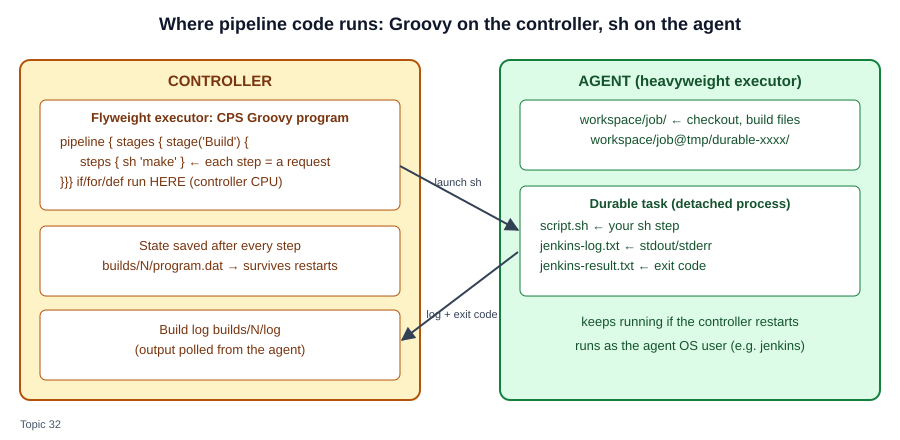

# 32 · What Happens When a Pipeline Runs

> **Level:** ★★★ advanced · **Status:** 🆕 new topic
>
> **You will learn:** how the Pipeline engine actually executes a Jenkinsfile: the **CPS** engine, flyweight vs heavyweight executors, how `sh` steps reach agents, the extra `@tmp`/`@script`/`@libs` folders, **durability** (pipelines surviving a controller restart), and the **Replay** and **Restart from Stage** features.
>
> **You need:** topics 11, 31.
>
> **From your original notes:** none directly (new); builds on Day 06's pipeline basics.

---

## What it is

The **Pipeline engine** (plugins *workflow-cps* and friends) runs your Jenkinsfile **on the controller** as Groovy code, written in a special style called **CPS** (**Continuation-Passing Style**). CPS lets Jenkins **pause** the program at any step, **save** its state to disk, and **resume** later, even after a restart.

---

## Why it exists

A pipeline can run for hours or wait days for an approval (`input`). If the controller restarts during that time, a normal program would lose its place. CPS-transformed code can be serialised (saved) between steps, so Jenkins can resume. That power has costs: some Groovy features behave oddly (topic 42), and heavy logic in Groovy slows the controller.

---

## Analogy

A **video game with save points**. Every time you reach a checkpoint (a step), the game saves your position. If the console reboots, you continue from the last checkpoint instead of starting over. But anything you're holding that can't be saved (a non-serialisable object) is lost, and the game refuses to save while you hold it.

---

## How it works inside




### Two kinds of executors

1. Build starts → a **flyweight executor** on the controller runs the Groovy program (the `pipeline {}` logic). It uses no node executor slot.
2. When the program reaches an `agent` (declarative) or `node` (scripted) block, it requests a **heavyweight executor** on a node matching the label, through the normal queue (topic 11).
3. Inside that block, each step like `sh` is a **request sent to the agent**: the agent starts the process, and its output streams back.
4. Between steps, control returns to the Groovy program on the controller.

So **Groovy runs on the controller; shell commands run on the agent.** A `for` loop over 10,000 items in Groovy burns *controller* CPU. Do heavy work in `sh` instead.

### How an `sh` step runs (durable task)

1. The engine writes your script to `<workspace>@tmp/durable-<id>/script.sh` on the agent.
2. A small wrapper launches it **detached**, redirecting output to `jenkins-log.txt` and the exit code to `jenkins-result.txt` in that folder.
3. The controller polls the log file and appends new output to the build log.
4. When the result file appears, the step finishes with that exit code.

That's why a shell step **keeps running if the controller restarts**: it's an independent process on the agent, and Jenkins reconnects and keeps reading the log.

### The extra folders

| Folder (next to the workspace) | Contains |
|---|---|
| `<job>@tmp/` | durable-task wrapper scripts and logs, secret files from `withCredentials(file…)` |
| `<job>@script/` | a full checkout used to read the Jenkinsfile when a lightweight checkout isn't possible |
| `<job>@libs/<id>/` | shared-library code checked out for this build (topic 55) |
| `<job>@2/` | workspace of a second concurrent build |

### Durability

Every step, the engine saves the program state under `builds/<n>/` (`program.dat`, `workflow/*.xml`). The **durability setting** trades safety for speed:
- **Maximum survivability/durability**: save often; slowest.
- **Performance-optimized** (`options { durabilityHint('PERFORMANCE_OPTIMIZED') }`): save less often; much faster for pipelines with many steps; a running build might not resume after an *unclean* crash.
- Set the global default in **Manage Jenkins → System → Pipeline Speed/Durability Settings**.

### Serialisation (why some code fails)

Because state is saved between steps, every local variable must be **serialisable**. Holding a non-serialisable object (like a `java.util.regex.Matcher` or a JSON parser object) across a step causes `java.io.NotSerializableException`. Fix it by keeping such code in a `@NonCPS` method, or by finishing with the object before the next step (topic 42).

### Replay and Restart from Stage

- **Replay** (build page → *Replay*): re-runs the build with an **edited copy** of the Jenkinsfile (and of shared-library files), **without committing**. Great for quick experiments while debugging; the edit isn't saved to Git. It needs the *Run/Replay* permission.
- **Restart from Stage** (declarative only): re-runs a finished build starting from a chosen top-level stage, reusing the earlier stages' results. Files from earlier stages are **not** kept unless you `stash` them with `options { preserveStashes() }` (topic 40).
- **Rebuild** with the same parameters: *Rebuild* (plugin) or **Build with Parameters**.

### Script approval and the sandbox

During CPS transformation, the sandbox checks every method call against an allow-list. Unapproved calls go to **Manage Jenkins → In-process Script Approval** for an admin to approve (topic 65).

---

## Config / Jenkinsfile / commands

See the controller/agent split in a log:
```groovy
pipeline {
  agent { label 'built-in' }
  options { timestamps() }
  stages {
    stage('where') {
      steps {
        echo "Groovy runs on the controller; NODE_NAME=${env.NODE_NAME}"
        sh 'hostname; ls -d "$WORKSPACE"@tmp'
      }
    }
  }
}
```
```
10:14:02  Groovy runs on the controller; NODE_NAME=built-in
10:14:02  + hostname
10:14:02  3f2c1a9b8d7e
10:14:02  + ls -d /var/jenkins_home/workspace/where@tmp
10:14:02  /var/jenkins_home/workspace/where@tmp
```

Watch durability in action:
```groovy
stage('long') { steps { sh 'for i in $(seq 1 60); do echo tick $i; sleep 2; done' } }
```
Start it, run `docker restart jenkins` halfway, log back in: the build is still running, and the ticks continue after the restart.
```
Resuming build at Tue Nov 18 10:20:11 IST 2026 after Jenkins restart
Waiting to resume part of flask-pipeline #9: Waiting for next available executor on built-in
Ready to run at Tue Nov 18 10:20:14 IST 2026
tick 31
```

---

## Hands-on lab

1. Run the `long` stage above and restart Jenkins mid-build. Read the "Resuming build" lines.
2. Use **Replay** on a finished build: change an `echo` message and run. The new build uses your edit; the Git repo is unchanged.
3. Make stage 3 of a 4-stage declarative pipeline fail, fix the cause outside Jenkins (e.g. create a missing file on the node), then **Restart from Stage** at stage 3.
4. Try `NotSerializableException`:
   ```groovy
   script { def m = ('abc' =~ /b/); sh 'true'; echo m[0] }
   ```
   It fails because the Matcher `m` is held across the `sh` step. Fix: `def found = ('abc' =~ /b/)[0]` (take the string before the step).

---

## Where you'll use it

- Understanding why pipelines survive restarts (and when they don't).
- Debugging with Replay instead of 20 "try again" commits.
- Diagnosing slow controllers (too much Groovy) and serialisation errors.
- Interviews: "What is CPS?", "What's a flyweight executor?"

---

## When it breaks

| Error / symptom | Cause | Fix |
|---|---|---|
| `java.io.NotSerializableException: java.util.regex.Matcher` | Non-serialisable object kept across a step | `@NonCPS` helper, or finish with the object before the next step |
| `expected to call … but wound up catching …` / CPS mismatch warnings | Calling CPS code from non-CPS code (e.g. closures in `sort`, `collect` inside `@NonCPS`) | Keep `@NonCPS` methods pure; don't call steps inside them |
| Controller CPU high while builds do "nothing" | Heavy Groovy loops / JSON parsing in pipeline code | Move work into `sh` (jq, scripts) |
| Build doesn't resume after a crash | Performance-optimised durability, or the agent died | Accept, or use a higher durability for critical long pipelines |
| `Restart from Stage` missing | Scripted pipeline, or not a top-level stage | Declarative only, top-level stages |

---

## Quick recap

- Groovy pipeline code runs on the **controller** (flyweight executor); `sh` steps run on **agents** (heavyweight executors).
- CPS saves state between steps → pipelines survive restarts; non-serialisable objects break this.
- `sh` runs as a durable, detached process with output in `@tmp`.
- **Replay** = edit and re-run without committing; **Restart from Stage** = resume a declarative build from a stage.

**Interview questions**

1. **Q: Where does pipeline Groovy code execute, and where do `sh` steps execute?**
   A: Groovy runs on the controller in a flyweight executor; `sh` and other node steps run on the agent allocated by `agent`/`node`.

2. **Q: What is CPS in Jenkins pipelines?**
   A: Continuation-Passing Style: the engine transforms Groovy so it can pause and save its state between steps, letting pipelines survive controller restarts and wait for input.

3. **Q: How would you test a Jenkinsfile change without committing?**
   A: Use Replay on an existing build to run an edited copy, or validate syntax with the declarative linter (topic 33).
