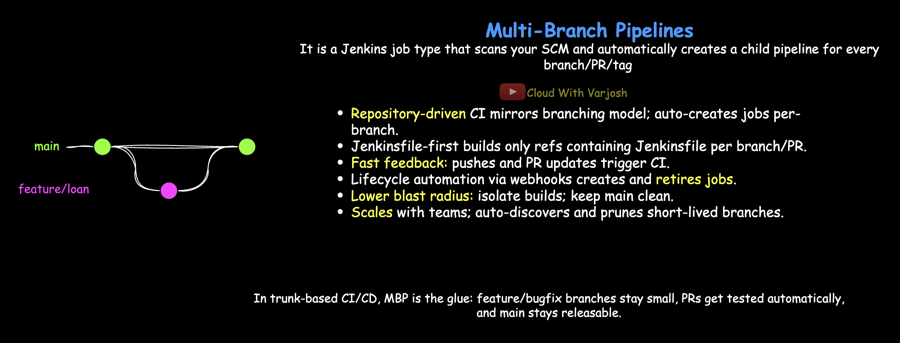

# 43 · Multibranch Pipelines

> **Level:** ★★ intermediate · **Status:** ✅ rewritten from your notes (+ orphan cleanup and organization folders)
>
> **You will learn:** what a **Multibranch Pipeline (MBP)** is, why it's the standard job type for real repos, how Jenkins discovers branches/PRs and builds them, how retired branches are cleaned up, which branch-source plugin to use, and how **Organization Folders** scale this to every repo in an org.
>
> **You need:** topics 05, 08, 21, 31.
>
> **From your original notes:** Day 07 › *Introduction*, *Multi-Branch Pipelines — What they are and why they matter* (all bullets and use cases, closing quote), *How Jenkins discovers and builds (at a glance)*, *Why MBP (vs a single Pipeline with many branches)*, *Step 0: Create the MBP job* (Branch Sources note), *What you should see*.
>
> 🎥 Original video: [Jenkins Multibranch Pipelines | CI/CD with GitHub PRs & Docker Deploy](https://www.youtube.com/watch?v=Eq-HHLtSJM4)

---

## What it is

A **Multibranch Pipeline (MBP)** is a Jenkins job type that **scans your SCM** and **automatically creates a child pipeline job for every branch, PR or tag that contains a `Jenkinsfile`**. Builds are triggered by **webhooks** on pushes and PR updates, and child jobs are **retired** when branches/PRs close. MBP maps CI directly onto your branching strategy and adds **PR-aware** builds (**Head**/**Merge**, topic 44) with status checks back to the repo.



In this part we set up an MBP against a **private GitHub repo**, push a branch, open a PR, rescan manually (no webhooks yet), and watch Jenkins build/deploy the Dockerized Python app on **port 5000**. You'll see how MBP maps onto **trunk-based development**: short-lived feature branches, PR-aware builds, and a `main` that stays releasable.

---

## Why it exists

The "what & why" at a glance:

- **Repository-driven CI that mirrors your branching model.** Jenkins scans your Git host (GitHub/GitLab/Gitea/on-prem) and **creates one sub-job per discovered branch/PR/tag**, so there's **no manual job sprawl**; CI automatically reflects trunk-based development where **`main` is the single source of truth** and feature/bugfix branches are short-lived.
  - *Use case:* a fintech team creates 20 feature branches during a sprint. Jenkins auto-creates jobs for each and retires them when the branches are deleted, with no admin work.
- **Jenkinsfile-first, per branch/PR.** A ref (a branch, PR or tag) is "buildable" only if it **contains a `Jenkinsfile`** at the expected path: **pipeline as code** per branch/PR; no Jenkinsfile → no build.
  - *Use case:* the platform team requires every new microservice to include a `Jenkinsfile`; branches without one are ignored, keeping CI clean and policy-compliant.
- **Fast feedback where code lives.** Every push to a branch, and every **PR update**, triggers CI, so developers catch failures **before merging to `main`**.
  - *Use case:* a developer pushes a failing test to `feature/x`; CI fails within minutes on the branch/PR, preventing a broken `main`.
- **Lifecycle automation via webhooks.** Push a new branch → job created; open/update a PR → PR job updated; close the PR or delete the branch → job retired. Webhooks keep discovery and builds current with zero manual effort.
  - *Use case:* after a PR is merged and `feature/y` is auto-deleted by the host, Jenkins marks the branch job orphaned and removes it (including its workspace) per the cleanup policy.
- **Policy by configuration (quality gates).** Enforce tests, lint and coverage **per branch/PR**, and require green checks before merging.
  - *Use case:* branch protection requires "Tests" + "Coverage ≥ 80%" checks from Jenkins; PRs can't merge until both are green.
- **Lower blast radius.** Build/test **in isolation** on the branch or PR job; only clean, reviewed changes land in `main`.
  - *Use case:* a risky dependency bump runs E2E tests only in the PR job; `main` stays stable for on-call.
- **Scales with teams.** New contributors and short-lived topic branches are discovered automatically; **CI stays in sync** as the repo evolves.
  - *Use case:* hackathon week creates 50 short-lived branches; Jenkins discovers and builds them all, then prunes the jobs as branches close.

> In trunk-based CI/CD, MBP is the glue: feature/bugfix branches stay small, PRs get tested automatically, and `main` stays releasable.

### Why MBP (vs a single Pipeline with many branches)

- **Auto-discovery:** Jenkins scans your repo and **creates one child job per branch/PR/tag** that contains a `Jenkinsfile`. No manual job sprawl.
- **PR awareness:** builds the **PR "Head"** and/or a **synthetic "Merge"**, so you validate integration before merging.
- **Lifecycle automation:** new branch/PR → job created. PR closed/branch deleted → job retired.
- **Per-branch history:** each branch/PR has its own build history, test reports and checks.
- **Policy at scale:** enforce quality gates (tests/coverage/lint/scans) **per branch/PR**; protect `main` with required checks.

> Key idea: you don't list branches. MBP **finds them** and runs the pipeline wherever a `Jenkinsfile` exists.

---

## Analogy

A **school that automatically opens a class register** for every new student who enrols (branch with a Jenkinsfile), records each one's marks separately (per-branch history), and archives the register when the student leaves (orphan cleanup).

---

## How it works inside

### How Jenkins discovers and builds (at a glance)

1. **Scan / webhook:** Jenkins scans the repo on a schedule ("**Scan Multibranch Pipeline Triggers → Periodically if not otherwise run**") and on webhook events (push, PR opened/synchronised). This is called **branch indexing**.
2. **Filters/traits apply:** include/exclude rules, the branch build strategy, PR strategies and fork-trust policies decide what to build. **Traits** are the "Behaviours" you add to a branch source (*Discover branches*, *Discover pull requests from origin*, *Filter by name (with wildcards)*, *Discover tags*…).
3. **Per-branch/PR job:** Jenkins reads **that branch's own `Jenkinsfile`** and runs the pipeline for that ref.
4. **Status reporting:** a commit/PR status is posted back to the host (checks). Branch protection can require these to pass before merging.

Child job names: branches keep their names (`main`, `feature%2Fui` in URLs because `/` is encoded); PRs become `PR-1`, `PR-2`…; tags appear under a **Tags** tab (tag builds aren't triggered automatically unless you add a *build strategy* plugin, e.g. Basic Branch Build Strategies).

Environment in child jobs: `BRANCH_NAME` (`main`, `PR-7`), and for PRs `CHANGE_ID` (7), `CHANGE_TARGET` (`main`), `CHANGE_BRANCH` (`feature/ui`), `CHANGE_AUTHOR`, `CHANGE_URL`.

### Orphaned item strategy (cleanup of retired branches)

**Orphaned Item Strategy → Discard old items** (with optional "days to keep" / "max # to keep") decides what happens to child jobs whose branch/PR no longer exists. They're marked orphaned at the next scan and deleted per the policy, together with their build history; agent workspaces are cleaned by Jenkins' workspace cleanup thread. Each child job's own `buildDiscarder` (topic 37) still limits builds per branch.

### Branch-source plugins

> You see **GitHub** under *Branch Sources* because the **GitHub Branch Source** plugin is installed. Similar host-specific plugins exist: **Bitbucket Branch Source** and **GitLab Branch Source**. They add PR/MR discovery, Head/Merge strategies, auto-webhooks and status checks. You can choose plain **Git**, but you'll miss those richer integrations (no PR discovery, no statuses).

### Organization Folders (MBP for a whole org)

**New Item → Organization Folder** (GitHub Organization / Bitbucket Team/Project / GitLab Group): Jenkins scans **every repo** in the org and creates an MBP for each repo that has a `Jenkinsfile`. New repos get CI automatically: the usual setup at companies with hundreds of repos.

---

## Config / Jenkinsfile / commands

### Step 0: create the MBP job

**New Item →** name `flask-mbp` → choose **Multibranch Pipeline**.

**Branch Sources → Add source → GitHub** (you could choose "Git", but "GitHub" gives PR awareness and auto-webhook management):
- **Credentials:** the GitHub App or PAT you configured (topic 23; GitHub App preferred, topic 46).
- **Repository HTTPS URL:**
  ```
  https://github.com/CloudWithVarJosh/cwvj-private-repo.git
  ```
  *(Replace with your account and private repo.)* Click **Validate**.
- **Behaviours:** keep the defaults for now (*Discover branches*, *Discover pull requests from origin*, *Discover pull requests from forks*); topic 44 explains every choice.
- **Build Configuration:** *by Jenkinsfile*, **Script Path** `Jenkinsfile`.
- **Scan Multibranch Pipeline Triggers:** *Periodically if not otherwise run*, e.g. 1 hour (a safety net when webhooks are missed).
- **Orphaned Item Strategy:** *Discard old items*.

Click **Save**.

### What you should see

- Jenkins immediately **scans the repo**, finds branches with a `Jenkinsfile`, and creates child jobs.
- Open **flask-mbp → Scan Repository Log** to see which refs were discovered and why some were skipped:
  ```
  Checking branches...
    Checking branch main
        ‘Jenkinsfile’ found
      Met criteria
  Scheduled build for branch: main
    Checking branch docs-only
        ‘Jenkinsfile’ not found
      Does not meet criteria
  Processed 2 branches
  Checking pull-requests...
  Processed 0 pull requests
  Finished: SUCCESS
  ```
- You should see at least **`main`** as a child job (since `main` has a `Jenkinsfile`).

---

## Hands-on lab

Do Step 0 for your private Flask repo (it needs a `Jenkinsfile`; use the one from topic 36). Then:
1. A new branch inherits `main`'s Jenkinsfile, so create `docs-only`, **delete** its `Jenkinsfile`, push, click **Scan Repository Now**, and read the "‘Jenkinsfile’ not found / Does not meet criteria" log line.
2. Delete that branch on GitHub, scan again, and see the job disappear (orphan strategy).
3. Look at `BRANCH_NAME` in a child build's console (`echo "$BRANCH_NAME"`).

Topic 47 is the full demo with a PR.

---

## Where you'll use it

The default job type for every repo with a Jenkinsfile, and Organization Folders for whole GitHub orgs.

---

## When it breaks

| Symptom | Cause | Fix |
|---|---|---|
| No child jobs after scan | No `Jenkinsfile` at the Script Path, or credentials can't read the repo | Read the Scan Repository Log |
| PRs not discovered | "Git" source instead of "GitHub", or PR traits removed | Use the GitHub branch source; add *Discover pull requests* |
| New branch builds only after an hour | No webhook; only periodic scan | Webhook (topic 46) |
| `GitHub API rate limit exceeded` in the scan log | PAT limits on big orgs | GitHub App credential |
| Old branch jobs pile up | No orphaned item strategy | *Discard old items* |

---

## Quick recap

- MBP = one child pipeline per branch/PR/tag that has a Jenkinsfile, created and retired automatically.
- Branch indexing via webhooks + periodic scans; traits/filters decide what's built.
- Use host-specific branch sources (GitHub/Bitbucket/GitLab) for PRs and statuses.
- Organization Folders do this for every repo in an org.

**Interview questions**

1. **Q: What is a Multibranch Pipeline?**
   A: A job that scans a repository and automatically creates and manages a pipeline job for each branch, PR or tag containing a Jenkinsfile, triggered by webhooks and retired when the branch is gone.

2. **Q: What's branch indexing?**
   A: Jenkins scanning the repo (on a schedule or a webhook event) to discover branches/PRs, apply filters, and create/update/remove child jobs.

3. **Q: How would you give every repo in a GitHub org CI without creating jobs by hand?**
   A: A GitHub Organization Folder: it discovers each repo with a Jenkinsfile and creates a multibranch job for it automatically.
