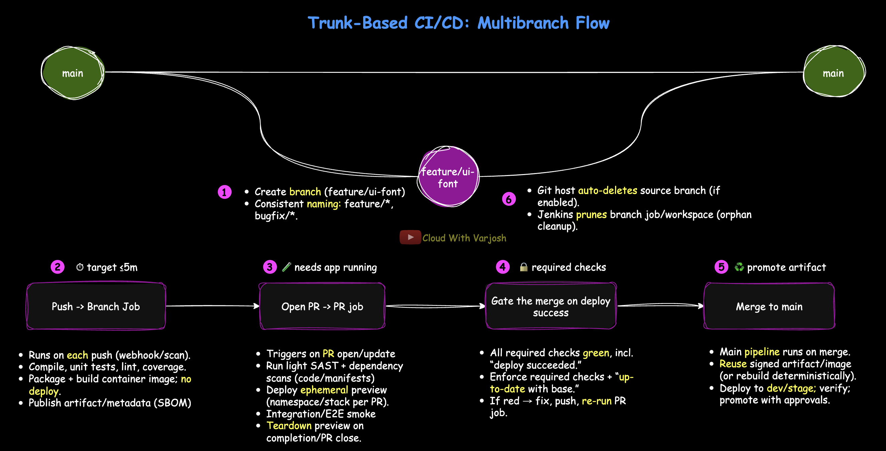

# 45 · Trunk-Based CI/CD with Multibranch

> **Level:** ★★ intermediate · **Status:** ✅ rewritten from your notes
>
> **You will learn:** the production six-step trunk-based flow on top of a multibranch pipeline: create branch → branch job (build only) → PR job (deploy a preview and test it) → gate the merge → main job (promote) → cleanup, and what runs at each step and why.
>
> **You need:** topics 08–09, 43–44.
>
> **From your original notes:** Day 07 › *Trunk-Based CI/CD: Multibranch Flow* (assumptions, steps 1–6 with what/why/tips).

---

## What it is

**Assumptions:** a Jenkins **Multibranch Pipeline**, **branch protection + required checks** on `main`, and **containerized builds**.



---

## Why it exists

It turns the strategy settings of topic 44 into a concrete **policy for what each kind of build does**: cheap checks on branch pushes, real "does it run?" checks on PRs, and promotion only from `main`.

---

## Analogy

A **theatre production**: individual rehearsals at home (branch job), a dress rehearsal on the real stage (PR preview), the director's sign-off (merge gate), the opening night (main promotion), and clearing the set afterwards (cleanup).

---

## How it works inside

### 1) Create a branch (`feature/ui-font`)

- **What happens:** branch from the latest `main`. Keep branches short-lived and predictably named (`feature/*`, `bugfix/*`) so CI filters work well.
- **Why:** small, frequent changes keep reviews quick and merges clean.
- **Good practice:** rebase/merge with `main` often (or enforce **Require branches to be up to date before merging**). Enforce naming with repo rules or a **pre-receive hook** (a server-side Git hook that can reject pushes).

### 2) Push → branch job (build-only, target ≤ 5 min)

- **Trigger:** every push to the feature branch (webhook preferred; scheduled scan as backup). With **Exclude branches that are also filed as PRs**, branch builds **stop** once a PR is opened.
- **What runs:** **lint/format → compile → unit tests → coverage**; **package & build the container image** (do **not** run it); **publish artifacts/metadata** (image digest, build info; optional SBOM/signature).
- **Why:** fast feedback for obvious breakage without consuming environments.
- **Ops tip:** cache dependencies; add `disableConcurrentBuilds()` + `milestone()` so the newest push wins (topics 37–38).

### 3) Open PR → PR job (needs the app running)

- **Trigger:** on PR open and each update. Prefer PR strategies **Head + Merge** to test the PR tip and its merge with current `main`.
- **What runs (shift-left order):**
  1. **Light SAST + dependency scan** on code/manifests.
  2. **Build image → image scan** (block on High/Critical).
  3. **Deploy an ephemeral preview** (a temporary environment, e.g. a namespace/stack per PR, such as `pr-42`).
  4. **Integration/E2E smoke tests** against the running app.
  5. **Tear down** the preview on completion/PR close (with a **TTL**, time-to-live, as a safety net).
- **Why:** proves the change **runs** and **integrates** before merging, which unit tests alone can't show.
- **Forks/secrets:** use trust policies; run reduced checks when secrets aren't available (topic 44).

### 4) Gate the merge on deploy success (required checks)

- **Rule:** all required checks must be **green**, including a status like **`deploy-preview: succeeded`**, and the PR must be **up to date with base**.
- **Flow:** if any check is red, fix → push → the PR job rebuilds automatically. Optionally enable **auto-merge on green** (or a merge queue/train).
- **Why:** keeps `main` continuously releasable.

### 5) Merge to `main` (promote the artifact)

- **Trigger:** merging (squash/merge/rebase) creates a new commit on `main`; MBP runs the **`main`** job.
- **What runs:** **reuse the signed artifact/image** built in the PR (preferred) or **rebuild deterministically**; **deploy to dev/stage**, run smoke checks; **promote** onwards with approvals/change control; run **full, authenticated DAST** here (not in the PR) and block on High/Critical.
- **Why reuse:** promoting the **same digest** from PR → stage → prod improves auditability and removes "works on my build" drift.

  > Note: with a **squash** or **rebase** merge, the commit on `main` differs from the PR's commit. To reuse the PR's image, look it up by the PR's head SHA (e.g. stored in the image labels / manifest) rather than by `main`'s new SHA. Many teams instead rebuild once on `main` and promote *that* digest (topic 09), which is simpler and still "build once, promote many" from that point on.

- **Hygiene:** record release notes/provenance; attach SBOMs/signatures.

### 6) Cleanup

- **What happens:** the Git host can **auto-delete the source branch** after merging (same-repo PRs). MBP's **orphan cleanup** prunes the retired branch job/workspace. A preview-environment **GC/TTL** (garbage collection) removes stray namespaces/volumes/databases.
- **Why:** keeps Jenkins lean and your cloud bill down; removes stale jobs and environments.

---

## Config / Jenkinsfile / commands

One Jenkinsfile implementing steps 2, 3 and 5 by build type:

```groovy
pipeline {
  agent { label 'docker' }
  options { disableConcurrentBuilds(abortPrevious: true); timeout(time: 30, unit: 'MINUTES') }
  environment { IMAGE = "registry.example.com/acme/loans" }
  stages {
    stage('Lint & unit') { steps { sh 'make lint test' } }                       // every build
    stage('Image') {
      steps {
        sh 'docker build -t "$IMAGE:$GIT_COMMIT" .'
        sh 'trivy image --exit-code 1 --severity HIGH,CRITICAL "$IMAGE:$GIT_COMMIT"'
      }
    }
    stage('Preview') {
      when { changeRequest() }                                                    // PR jobs only
      steps {
        sh './preview.sh up "pr-$CHANGE_ID" "$IMAGE:$GIT_COMMIT"'
        sh './smoke.sh "https://pr-$CHANGE_ID.preview.example.com"'
      }
      post { always { sh './preview.sh down "pr-$CHANGE_ID" || true' } }
    }
    stage('Promote') {
      when { branch 'main' }                                                      // main only
      steps { sh './push_and_deploy.sh dev "$IMAGE:$GIT_COMMIT"' }
    }
  }
}
```
- `changeRequest()` is true for PR builds; `CHANGE_ID` is the PR number.
- The preview is torn down in `post { always }` even if smoke tests fail.

---

## Hands-on lab

Map each of the 6 steps to your `jenkins-lab` repo setup: which branch protection rule, which MBP strategy, which `when` condition. Topic 47 implements a simplified version locally (preview = the same Docker host).

---

## Where you'll use it

As the default CI/CD design for microservices with Jenkins multibranch.

---

## When it breaks

| Symptom | Cause | Fix |
|---|---|---|
| Preview environments pile up | No teardown on failure/abandoned PRs | `post { always }` teardown + TTL garbage collection |
| PR job deploys over `main`'s environment | No `when` separation | `changeRequest()` vs `branch 'main'` stages |
| Main rebuilds a different image than the PR tested | Non-deterministic build, or squash changed the SHA | Promote the PR digest by recorded SHA, or build once on main and promote that |
| Merge allowed with red preview | Preview status not required | Add it to the required checks |

---

## Quick recap

1. Short-lived branch → 2. branch job: fast build-only checks → 3. PR job: scan, build, preview deploy, smoke → 4. required checks gate the merge → 5. main: promote the same digest, DAST, approvals → 6. delete branch, orphan cleanup, preview TTL.

**Interview questions**

1. **Q: What should a PR pipeline do that a branch pipeline doesn't?**
   A: Prove the change runs and integrates: build and scan the image, deploy an ephemeral preview, run integration/smoke tests, then tear the preview down.

2. **Q: Where do you run full DAST?**
   A: After merging, against a stable dev/stage environment with authentication. It's too slow and too environment-dependent for every PR.

3. **Q: How do you avoid leftover preview environments?**
   A: Tear down in `post { always }`, delete on PR close (webhook/orphan cleanup), and run a TTL-based garbage collector as a safety net.
