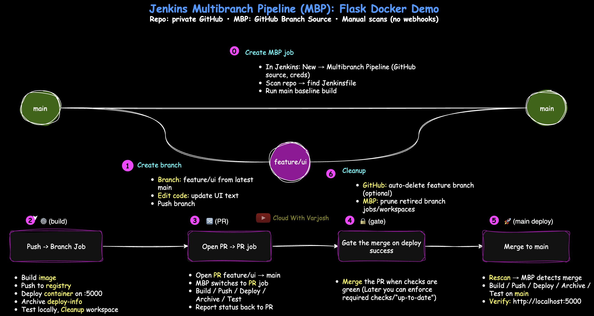

# 47 · Project 3: Multibranch Lab

> **Level:** ★★ intermediate · **Status:** ✅➕ rewritten from your notes (one important fix)
>
> **You will learn:** the full Day 7 demo end to end: create the MBP, push a feature branch and let Jenkins discover it, open a PR and watch the PR job and the GitHub status, merge, run `main`, verify the deployed app and its deploy-info artifact, clean up. Plus the fix that keeps PR builds from deploying over `main`.
>
> **You need:** topics 36, 43–46.
>
> **From your original notes:** Day 07 › *Demo: Jenkins Multi-Branch Pipeline (MBP)*: What we'll do, Prerequisites, Step 1 (create `feature/ui` and push), Step 2 (let MBP discover), Steps 3–6 (ports heads-up, PR job, gate, merge, cleanup), *Verify the result* A–D, *Conclusion* · file `Day 07/Jenkinsfile`.
>
> 📁 Files: [`project-files/project-3-multibranch/`](../project-files/project-3-multibranch/) (`Jenkinsfile` = original, `Jenkinsfile.corrected` = with the fix)

---

## What it is



**What we'll do:**
- **Create an MBP job** (GitHub Branch Source) → scan the repo, discover the `Jenkinsfile`, run a **baseline `main` build**.
- **Create `feature/ui`**, make a tiny UI change, **push**, then **manually rescan** (no webhooks) so MBP finds the branch and runs its **branch job**.
- **Open a PR** (`feature/ui` → `main`) → MBP switches to a **PR job**; we run the same pipeline and **report status back to GitHub**.
- **Merge when green**, then **rescan** so MBP sees the new commit on `main` and runs the **main deploy**.
- **Verify** at **http://localhost:5000** and inspect the archived **deploy-info** artifact.
- **Cleanup:** optionally auto-delete the feature branch on merge; MBP prunes retired branch jobs/workspaces.

**Prerequisites:**
- A **private GitHub repo** with the application code, `Dockerfile` and `Jenkinsfile` (from topic 36).
- Jenkins has **GitHub credentials** (PAT or GitHub App) saved and working.
- (Optional but recommended) a GitHub **webhook** so builds trigger immediately (topic 21: tunnel for a laptop Jenkins); a periodic scan remains as a safety net.
- The DooD Jenkins from topic 27.

---

## Why it exists

It ties Parts 6 and 7 together on your own machine: one Jenkinsfile, many branches, PR gating, deploy from `main`.

---

## Analogy

The dress rehearsal for everything in Part 7, on a small stage.

---

## How it works inside

```
feature/ui push ──scan──▶ job flask-mbp/feature%2Fui (branch job)
open PR #1     ──scan──▶ job flask-mbp/PR-1 (branch job paused: "Exclude…") ──status──▶ GitHub PR
merge          ──scan──▶ job flask-mbp/main ──▶ build, push, deploy cwvj-flask:N, archive deploy-info
branch deleted ──scan──▶ feature%2Fui and PR-1 orphaned → discarded
```

---

## Config / Jenkinsfile / commands

### Step 0: create the MBP job

As in topic 43: **New Item → `flask-mbp` → Multibranch Pipeline → GitHub source**, your credentials and repo URL, the "best general setup" strategies from topic 44, **Save**. You should see `main` as a child job and a baseline build.

### Step 1: create another branch (`feature/ui`) locally and push

> ⚠️ The original uses a **PAT in the clone URL** for a private repo; be careful not to show it on screen. Better options are below.

```bash
# Clone (I name the remote to indicate the repo)
git clone --origin flask-private https://<YOUR-PAT>@github.com/CloudWithVarJosh/cwvj-private-repo.git
cd cwvj-private-repo

git remote -v         # shows URLs (avoid showing the PAT on screen)
git branch -l

# Create and switch to a new feature branch
git switch -c feature/ui      # (preferred) creates + checks out
# Why `switch`? It's clearer and has safer defaults than `checkout`.

# Make a change
vim app.py
# UI = "We've added a new Feature"
# then press Esc, type :wq and Enter to save & quit

git status
git add app.py
git commit -m "feature(ui): update UI string"

git switch main
cat app.py   # main still has the old content.
             # main's app.py changes ONLY after you merge the PR.

# Push the new branch to the remote you named earlier
git push flask-private feature/ui
```

> ⚠️ **Corrected (safer authentication):** was a token embedded in the clone URL (`https://<PAT>@github.com/…`). Now: authenticate Git with the GitHub CLI or a credential helper, e.g. `gh auth login` once, then `git clone https://github.com/<you>/<repo>.git`, or SSH keys (`git@github.com:<you>/<repo>.git`). That's because a token in the URL is saved in plain text in `.git/config` (`git remote -v` prints it), ends up in shell history, and leaks into screenshots and logs. If you already cloned that way: `git remote set-url flask-private https://github.com/<you>/<repo>.git` and revoke the token.

(`app.py` in your repo has a `UI` string. The project-files copy prints a JSON message; add a line like `UI = "We've added a new Feature"` and return it to follow along.)

**Result:** the repo now has **two branches** (`main`, `feature/ui`). `main` is the releasable trunk; `feature/ui` holds work in progress.

### Step 2: let MBP discover and build the new branch

With webhooks, Jenkins discovers `feature/ui` automatically. If not: MBP job → **Scan Repository Now**.

**Observation:**
- You now see **two child jobs**: `main` and `feature/ui`.
- Because we chose **Exclude branches that are also filed as PRs**, the **branch job builds on every push** *until* you open a PR from `feature/ui`.
- Once you open a PR, Jenkins **stops building the `feature/ui` branch job** and **builds the PR job** on open and on each update.

### Steps 3, 4, 5 & 6: open PR → gate → merge to `main` → cleanup

> **Heads-up about ports:** the Flask app listens on **port 5000**. Jenkins' inbound-agent TCP port is **50000** by default, which we don't use here, so there's no conflict.

**3) Open a PR → the PR job runs (preview-style build)**
1. **Open the PR (GitHub):** **Compare & pull request** (or **Pull requests → New pull request**); **base:** `main`, **compare:** `feature/ui`; title/description → **Create pull request**.
2. **(Optional) Auto-delete branch on merge:** **Settings → General → Pull Requests →** **Automatically delete head branches**.
3. **Rescan in Jenkins** (manual, since no webhooks yet): **flask-mbp → Scan Repository Now**. You should now see a **PR job** (e.g. `PR-1`).
4. **Run the PR job:** open it → **Build Now** (or it may start right after the scan). With the original shared `Jenkinsfile`, the PR job will:
   - **Build & push** `docker.io/<your-dockerhub-user>/cwvj-flask:$BUILD_NUMBER` (and `:latest`)
   - **Deploy** a container on the **local agent** as `cwvj-flask` on **port 5000**
   - **Write & archive** `deploy-info-$BUILD_NUMBER.txt`
   - Jenkins posts the build status back to the PR on GitHub.

> ⚠️ **Corrected (deploy only from `main`):** the original Jenkinsfile has **no branch condition**, so **every** branch job and PR job pushes `:latest` and redeploys the single `cwvj-flask` container on port 5000. A PR build therefore **overwrites what `main` deployed**, and two PRs overwrite each other; `latest` in the registry points at unreviewed code. Also, `BUILD_NUMBER` restarts at 1 for every branch/PR job, so tags like `:3` from `PR-1` and `:3` from `main` **collide** and overwrite each other in Docker Hub. `Jenkinsfile.corrected` fixes this:
> - tag with the **commit** (`$GIT_COMMIT` short) instead of the per-job build number;
> - push `:latest` and **deploy only `when { branch 'main' }`**;
> - for PRs, run the container on a **separate port** as a throwaway preview, smoke-test it, and remove it in `post`.
>
> In the original lecture flow the PR job deploys "preview-style" on the same port; that's fine for a one-person demo, as long as you know why it breaks with real teams.

**Note: protecting `main` in GitHub** is in topic 46 (rulesets, required checks, up to date, approvals).

**4) Gate the merge on success (required checks)**
- The idea: merge only when the PR build(s) are **green**.
- In production you'd enforce **required checks** (e.g. "Build", "Deploy preview succeeded", "Up-to-date with base").
- For this demo, once the Jenkins check on the PR shows **success**, you can merge.
- If any check is **red**, fix the code, push, **rescan**, and the PR job re-runs.

**5) Merge to `main` → run the `main` job**
1. **Merge the PR (GitHub):** click **Merge**. If auto-delete is on, GitHub removes `feature/ui`.
2. **Rescan** so MBP sees the new commit on `main`: **Scan Repository Now**. The **`main` job** runs (or click **Build Now**): **build / push / deploy / archive / test**.
3. **Verify locally:** the container runs on the agent host at **http://localhost:5000**.

**6) Cleanup**
- **GitHub** (optional): auto-deletes the source branch after merging.
- **Jenkins MBP:** prunes retired **branch/PR jobs** and their **workspaces** per the orphan cleanup policy.

### Verify the result (code + running app)

**A) The container is running**
```bash
docker ps
# Expect a container named cwvj-flask publishing 0.0.0.0:5000->5000/tcp
```

**B) The app responds on localhost:5000**
```bash
curl -s http://localhost:5000
# Expect output containing: "We've added a new Feature"
```

**C) Deployment info archived in Jenkins**
In the PR (or main) job → **Build #N** → **Artifacts** → open `deploy-info-N.txt`:
```
build: N
image: docker.io/<your-dockerhub-user>/cwvj-flask:N
commit: <GIT_COMMIT>
branch: <GIT_BRANCH>
time: <UTC timestamp>
url: <Jenkins build URL>
```
(In multibranch, `GIT_BRANCH` holds the branch/PR name, e.g. `main` or `PR-1`.)

**D) Code landed on `main`**
On **GitHub → main**, open `app.py` and confirm it contains:
```python
UI = "We've added a new Feature"
```

> *Tip:* if Jenkins runs on a remote agent/VM, run the `docker`/`curl` commands **on that agent host**, since the container starts there.

### The corrected Jenkinsfile (deploy section)

```groovy
environment {
  IMAGE = "docker.io/<your-dockerhub-user>/cwvj-flask"
}
stages {
  stage('meta')  { steps { script {
    // PR merge builds: GIT_COMMIT is a synthetic merge commit that never exists on GitHub, so tag with the PR head.
    env.TAG = env.CHANGE_ID
      ? "pr${env.CHANGE_ID}-" + sh(script: 'git rev-parse --short=7 HEAD^2 2>/dev/null || git rev-parse --short=7 HEAD', returnStdout: true).trim()
      : env.GIT_COMMIT.take(7)
  } } }
  stage('build') { steps { sh 'docker build -t "$IMAGE:$TAG" .' } }
  stage('push')  { /* withCredentials … docker push "$IMAGE:$TAG"; on main also tag+push :latest */ }
  stage('deploy main') {
    when { branch 'main' }
    steps { sh 'docker rm -f cwvj-flask || true; docker run -d --name cwvj-flask -p 5000:5000 "$IMAGE:$TAG"' }
  }
  stage('preview PR') {
    when { changeRequest() }
    steps {
      sh 'docker rm -f "pr-$CHANGE_ID" || true; docker run -d --name "pr-$CHANGE_ID" "$IMAGE:$TAG"'
      sh 'docker run --rm --network "container:pr-$CHANGE_ID" curlimages/curl -fsS --retry 5 --retry-connrefused http://localhost:5000'
    }
    post { always { sh 'docker rm -f "pr-$CHANGE_ID" || true' } }
  }
}
```
Full file: `project-files/project-3-multibranch/Jenkinsfile.corrected`.

---

## Hands-on lab

1. Run the whole demo with the **original** Jenkinsfile; while a PR build runs, look at `localhost:5000` and see `main`'s app replaced.
2. Switch to `Jenkinsfile.corrected`, repeat: `main`'s app stays put; the PR gets its own short-lived preview container.
3. Add the GitHub webhook (tunnel) and redo steps 2–5 **without** clicking Scan Repository Now.

---

## Where you'll use it

The exact pattern for team repos (with real preview environments instead of a local container).

---

## When it breaks

| Symptom | Cause | Fix |
|---|---|---|
| `feature/ui` doesn't appear | No webhook and no rescan | **Scan Repository Now**; check the scan log |
| PR job missing after opening the PR | Credentials can't list PRs, or PR discovery trait removed | Check traits and credentials (GitHub App) |
| `localhost:5000` shows the PR's version, not main's | Original Jenkinsfile deploys from every job | `when { branch 'main' }` |
| Docker Hub tag `:3` overwritten unexpectedly | Build numbers repeat across branch/PR jobs | Tag with commit SHA |
| GitHub shows no Jenkins status | Plain "Git" source, or no status permission | GitHub source + statuses permission (topic 46) |

---

## Quick recap

- MBP discovered `main`, then `feature/ui`, then `PR-1`, and posted the status to GitHub; merging ran `main`.
- Deploy **only from `main`**; give PRs isolated previews; tag images by commit, not by build number.
- Don't put tokens in Git remote URLs.

**Interview questions**

1. **Q: In a multibranch pipeline, why tag images with the commit SHA rather than `BUILD_NUMBER`?**
   A: Build numbers restart in every branch/PR job, so tags collide across jobs. A commit SHA is unique and traceable to the source.

2. **Q: How do you stop PR builds from deploying to the shared environment?**
   A: Guard deploy stages with `when { branch 'main' }` and give PRs separate ephemeral previews (`when { changeRequest() }`) that are torn down afterwards.

3. **Q: Without webhooks, how does MBP learn about a new branch?**
   A: Through a periodic or manual repository scan (branch indexing).

---

*Day 07 conclusion, kept:* you built an end-to-end **MBP workflow**: Jenkins **discovered** branches/PRs from your repo, ran a **branch job** until a PR opened and then a **PR job**, **built/pushed** an image and **deployed** it locally on the agent, you **merged** the PR and **rescanned** to run `main`, and you **verified** the change via `localhost:5000` and the archived deploy info. This pattern scales: add **webhooks** for instant triggers, **required checks** to protect `main`, choose **PR strategies** (Head/Merge), and later layer in **tests, scans and promotion**. MBP keeps CI aligned to your branching model while avoiding manual job sprawl.

---

## References (from your original Day 07 notes)

* Jenkins: [Multibranch Pipeline (overview)](https://www.jenkins.io/doc/book/pipeline/multibranch/)
* Jenkins: [GitHub Branch Source Plugin](https://plugins.jenkins.io/github-branch-source/)
* Jenkins: [Declarative Pipeline (Jenkinsfile) syntax](https://www.jenkins.io/doc/book/pipeline/syntax/)
* Jenkins MBP: [Orphaned Item Strategy](https://www.jenkins.io/doc/book/pipeline/multibranch/#orphaned-item-strategy)
* GitHub: [Automatically delete head branches](https://docs.github.com/repositories/configuring-branches-and-merges-in-your-repository/managing-branches-in-your-repository/automatically-delete-head-branches)
* Docker: [CLI reference: build, push, run](https://docs.docker.com/reference/cli/docker/)
