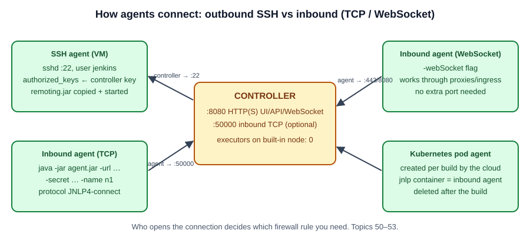

# 50 · Agents Explained

> **Level:** ★★ intermediate · **Status:** 🆕 new topic
>
> **You will learn:** every kind of agent (permanent vs cloud/ephemeral), both ways they connect (**outbound SSH** from the controller, or **inbound** to the controller over TCP or WebSocket), the node settings that matter (executors, remote root, labels, usage, availability), why the controller should have **0 executors**, and agent → controller security.
>
> **You need:** topics 11, 12, 48.
>
> **From your original notes:** Day 03 › *Controller and agents (simple view)*, Docker scaling note ("external agents via SSH/JNLP") · Day 04 › *Workspaces & Queues*, *Controller executors = 0* · Project 01 › controller-only VM, the note on port 50000.

---

## What it is

An **agent** is a machine (VM, physical server, container or Kubernetes pod) running the Jenkins **agent process** (`agent.jar`/`remoting.jar`, Java), connected to the controller, offering **executors** for builds.

| Kind | Lifetime | Examples |
|---|---|---|
| **Permanent (static)** | Configured once, runs for months | An EC2 VM added in **Nodes → New Node** (topic 51) |
| **Cloud / ephemeral** | Created per build (or on demand), deleted after | Kubernetes pods (topic 53), EC2 Fleet/Spot, Docker cloud, Azure VM agents |

Connection methods:

| Method | Who connects to whom | Network needs | Typical use |
|---|---|---|---|
| **Launch agents via SSH** (SSH Build Agents plugin) | Controller → agent | Agent's port 22 reachable from the controller | Linux VMs in the same network |
| **Inbound (TCP)** | Agent → controller, port 50000 | Controller's port 50000 reachable | Agents behind NAT/firewalls; Windows |
| **Inbound (WebSocket)** | Agent → controller over the **normal HTTP(S) port** | Only 443/8080 | Kubernetes, anything behind proxies |

> From your Project 01 notes: the controller connects to SSH agents over **SSH (port 22)**. Only open TCP **50000** on the controller if you use inbound TCP agents; otherwise it's not required.

> ⚠️ **Corrected (terminology):** the Day 03 scaling note says external agents connect "via SSH/JNLP". Now: **SSH or inbound (TCP/WebSocket)**. The old "JNLP agent / Java Web Start" launch method is gone (topic 12); "inbound agent" is the current name.

---

## Why it exists

Agents give **isolation** (builds can't touch the controller's secrets), **scale** (add machines, not a bigger controller), and **specialisation** (labels for Docker, GPU, Windows, ARM).

---

## Analogy

Contract workers: some are permanent staff at their own desks (permanent agents); some are temps called in when it's busy and sent home after (cloud agents). Some you phone (SSH: the controller calls them); some phone in when they arrive (inbound).

---

## How it works inside




### SSH launch (outbound)

1. The controller opens SSH to the agent (credential: **SSH Username with private key**, System scope).
2. It verifies the agent's **host key** (strategy, topic 51).
3. It checks Java, copies `remoting.jar` into the **remote root directory**, and starts `java -jar remoting.jar` over the SSH session.
4. The Remoting channel runs **inside that SSH connection**. If SSH drops, the agent goes offline.

### Inbound launch

1. On **Nodes → New Node**, choose **Launch method: Launch agent by connecting it to the controller**. Jenkins shows a **secret** for this node.
2. On the agent: `java -jar agent.jar -url https://jenkins.example.com/ -secret <secret> -name linux-2 -webSocket -workDir /home/jenkins` (or the `jenkins/inbound-agent` container, topic 52).
3. The agent downloads `agent.jar` from `<jenkins>/jnlpJars/agent.jar`, connects (TCP 50000 with the `JNLP4-connect` protocol, or WebSocket over HTTP/S), verifies the controller's identity (`identity.key`), presents the secret, and the channel is up.

### Node settings that matter

| Setting | Meaning / advice |
|---|---|
| **Number of executors** | Parallel builds on this node. Start with 1 per 1–2 CPUs; Docker builds are heavy |
| **Remote root directory** | Agent's working folder (workspaces, tool caches, remoting logs), e.g. `/home/jenkins` |
| **Labels** | Space-separated tags (`linux docker maven trivy`) that jobs select with label expressions |
| **Usage** | *Use this node as much as possible* (any job may land here) or *Only build jobs with label expressions matching this node* (reserve it for specific jobs) |
| **Availability** | *Keep this agent online as much as possible*, or bring online on demand / on a schedule |
| **Node properties** | Environment variables and tool locations specific to this node |

### Controller executors = 0

Production rule: **Manage Jenkins → Nodes → Built-In Node → Configure → Number of executors: 0**. Builds can then never run on the controller (topic 11). Pipelines still run their Groovy on flyweight executors there (topic 32). Some admin jobs may use a dedicated label instead.

### Agent → controller security

The Remoting channel lets the **agent** send commands to the **controller** too. Jenkins restricts what agents may do (the **agent-to-controller access control**, always on in current versions), so a compromised agent can't read `JENKINS_HOME`. Also:
- Use **separate agents** (or agent pools) for **untrusted** code (fork PRs) and for **privileged** work (prod deploys, signing).
- Prefer **ephemeral** agents: a fresh machine per build leaves nothing behind for the next build.

### Monitoring nodes

**Manage Jenkins → Nodes** shows per-node architecture, clock difference, free disk/temp space, free swap and response time. Node monitors take nodes offline when thresholds are crossed (topic 22).

---

## Config / Jenkinsfile / commands

Using agents from Jenkinsfiles:
```groovy
pipeline {
  agent { label 'linux && docker' }        // any online node with both labels
  stages {
    stage('Build') { steps { sh 'docker build -t app:$BUILD_NUMBER .' } }
    stage('Windows test') {
      agent { label 'windows' }            // a different node for this stage
      steps { bat 'run-tests.cmd' }        // bat = Windows batch step
    }
  }
}
```
Agent log (on SSH launch), node page → **Log**:
```
[11/18/26 10:30:01] [SSH] Opening SSH connection to 172.31.40.86:22.
[11/18/26 10:30:01] [SSH] SSH host key matches key in Known Hosts file. Connection will be allowed.
[11/18/26 10:30:02] [SSH] Authentication successful.
[11/18/26 10:30:02] [SSH] Checking java version of java
[11/18/26 10:30:02] [SSH] java -version returned 21.0.5.
[11/18/26 10:30:02] [SSH] Starting agent process: cd "/home/jenkins" && java  -jar remoting.jar -workDir /home/jenkins -jar-cache /home/jenkins/remoting/jarCache
<===[JENKINS REMOTING CAPACITY]===>channel started
Remoting version: 3301.v4363ddcca_4e7
Agent successfully connected and online
```

---

## Hands-on lab

1. On your lab controller, set the built-in node's executors to 0. Run any job: it waits with `Waiting for next available executor`. This is the starting point for topics 51–52.
2. Open **Manage Jenkins → Security → Agents**: see the TCP port setting (fixed 50000 / random / disabled).
3. Open `http://localhost:8080/jnlpJars/agent.jar`: that's the file inbound agents download.

---

## Where you'll use it

Every production Jenkins: designing agent pools, labels and connection methods; debugging offline agents.

---

## When it breaks

| Symptom | Cause | Fix |
|---|---|---|
| Agent offline: `Connection refused` (SSH) | sshd down, wrong host/port, security group | Check port 22 from the controller |
| Inbound agent: `SEVERE: http://…/tcpSlaveAgentListener/ is invalid: 404` | TCP port disabled | Enable the TCP port, or use `-webSocket` |
| Inbound agent: `Failed to connect to …:50000` | Firewall blocks 50000 | Open it, or use WebSocket |
| `java: command not found` on SSH launch | No Java on the agent | Install the same Java major version as the controller |
| Builds land on the wrong node | Usage "as much as possible" + broad labels | "Only build jobs with label expressions…" |

---

## Quick recap

- Agents run `agent.jar`; permanent or cloud/ephemeral.
- **SSH:** controller → agent port 22. **Inbound:** agent → controller TCP 50000 or WebSocket over HTTP(S).
- Executors, remote root, labels and usage are the key node settings.
- Controller executors = 0 in production; separate agent pools by trust level.

**Interview questions**

1. **Q: SSH agents vs inbound agents?**
   A: For SSH agents the controller connects out to the agent's sshd and starts the agent process. Inbound agents start themselves and connect to the controller (TCP 50000 or WebSocket). Inbound suits agents behind NAT/firewalls and Kubernetes pods.

2. **Q: Why set the built-in node's executors to 0?**
   A: So no build code runs on the controller, protecting its stability and the secrets in `JENKINS_HOME`.

3. **Q: What are labels for?**
   A: Tags on nodes that pipelines select with label expressions (`agent { label 'linux && docker' }`), routing work to nodes with the right tools or capabilities.
