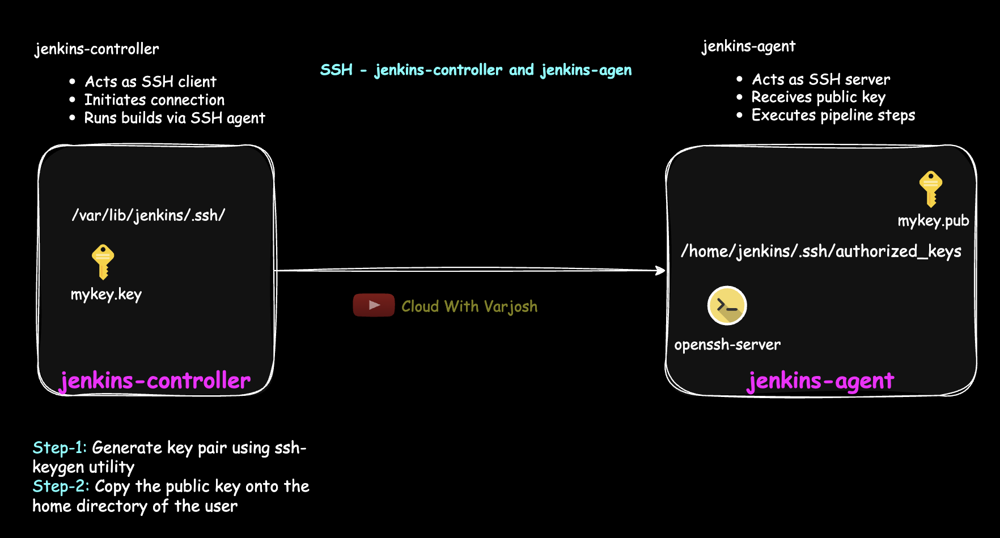

# 51 · Lab: SSH Agent

> **Level:** ★★ intermediate · **Status:** ✅➕ rewritten from your notes, plus a local version
>
> **You will learn:** how to add a permanent agent that the controller launches over SSH, two ways: **A)** locally, with an agent container next to your Docker Jenkins (free, 10 minutes), and **B)** on AWS EC2, exactly as in Project 01 (agent VM, Java, non-root `jenkins` user, key pair, `authorized_keys`, host-key verification strategies, node configuration, verification).
>
> **You need:** topics 48–50. For B: a controller VM from topic 49.
>
> **From your original notes:** Project 01 › *Lab: Configure SSH-based Jenkins Agent on EC2* (1 create instance + security group note, 2 connect, 3 Java 21, 4 jenkins user), *Lab: Add the jenkins-agent to the Jenkins Controller* (1 generate key, 2 copy public key incl. manual copy, permissions, test, why this matters, 3 configure the agent in the UI incl. all host key strategies, advanced options, expected result, quick verification).

---

## What it is

A **permanent SSH agent**: a machine you register once in **Manage Jenkins → Nodes**; the controller connects to it over SSH and starts the agent process whenever needed. In Project 01 this VM **executes all Jenkins jobs**; it has JDK 21, Docker, Maven/Trivy tooling, and a non-root `jenkins` user.



---

## Why it exists

It's the simplest production-grade way to move builds off the controller.

---

## Analogy

Giving the head chef (controller) a **key to a separate kitchen** (agent) where only the kitchen's cook account exists. The chef lets himself in, starts the cook, and hands over orders.

---

## How it works inside

```
Controller (user jenkins)                         Agent (user jenkins, home /home/jenkins)
private key  ──SSH 22──▶ sshd checks ~/.ssh/authorized_keys
known_hosts  ◀── verifies agent host key
copies remoting.jar → /home/jenkins ; starts "java -jar remoting.jar" → channel up → executors available
```

---

## Config / Jenkinsfile / commands

## Part A: local lab (agent container)

The official image `jenkins/ssh-agent` runs `sshd` with a `jenkins` user and Java.

1. **Key pair for the controller** (on your WSL2 host; it'll be pasted into a credential):
   ```bash
   ssh-keygen -t ed25519 -f ~/jenkins-agent-key -C "jenkins-agent-access" -N ''
   ```
2. **A shared Docker network** so the controller can reach the agent by name:
   ```bash
   docker network create jenkins-net
   docker network connect jenkins-net jenkins
   docker run -d --name agent1 --network jenkins-net --restart unless-stopped \
     -e "JENKINS_AGENT_SSH_PUBKEY=$(cat ~/jenkins-agent-key.pub)" \
     jenkins/ssh-agent:latest-jdk21
   ```
   The image writes the public key into `/home/jenkins/.ssh/authorized_keys` for you.
3. **Credential:** **Manage Jenkins → Credentials → System → Global → Add → SSH Username with private key**: ID `agent1-ssh`, username `jenkins`, private key = contents of `~/jenkins-agent-key`. Scope **System** (only Jenkins uses it).
4. **Node:** **Manage Jenkins → Nodes → New Node** → `agent1`, *Permanent Agent*:
   - Executors `2`, Remote root directory `/home/jenkins/agent`, Labels `linux docker-free`
   - Launch method **Launch agents via SSH**, Host `agent1`, Credentials `agent1-ssh`
   - Host Key Verification Strategy: *Manually trusted key Verification Strategy* (lab; see the options below)
   - Save → the agent connects within seconds.
5. **Test:** a job with `agent { label 'linux' }` and `sh 'hostname; whoami; java -version'`. It prints the agent container's hostname and `jenkins`.

(This agent has no Docker. Docker-capable agents are part B, or a VM agent with Docker installed.)

## Part B: AWS EC2 agent (Project 01)

### 1) Create the EC2 instance

- **AMI:** Ubuntu 24.04 LTS · **Instance type:** `c7i-flex.large` · **Root volume:** **30 GB+** (Trivy scans and Docker images need space)
- **Security group (jenkins-agent):**
  - Allow **SSH (22)** from the **controller's IP only** (plus your IP for admin, if needed)
  - Don't expose the Jenkins UI (8080) on the agent

> Note: the controller connects to agents over SSH (port 22). Only open TCP 50000 on the controller if you use inbound agents; otherwise it isn't needed.

### 2) Connect to the instance

```bash
ssh -i <your-key>.pem ubuntu@<jenkins-agent-public-ip>
```
Secure your SSH key on your workstation:
```bash
chmod 600 ~/.ssh/<your-private-key>
chown $(whoami):$(whoami) ~/.ssh/<your-private-key>
```
Set hostname and timezone:
```bash
sudo hostnamectl set-hostname jenkins-agent
exec bash
sudo timedatectl set-timezone Asia/Kolkata
timedatectl status
```

### 3) Install Java 21

```bash
sudo apt update
sudo apt install -y openjdk-21-jdk
java -version
javac -version
```
The agent's Java must be compatible with the controller (same major version: 21).

### 4) Create a dedicated jenkins user (non-root)

```bash
# Create a dedicated non-root 'jenkins' user with home directory and bash shell
sudo useradd -m -s /bin/bash jenkins
```
Builds will run as this user, never as root.

### Add the agent to the controller

SSH into the controller:
```bash
ssh -i <your-key>.pem ubuntu@<jenkins-controller-public-ip>
```

#### 1. Generate an SSH key on the controller (as the jenkins user)

The Jenkins service runs as `jenkins`, so we generate the key inside its home. Use a **meaningful filename** and a **different comment**:
```bash
# You land in the home directory of the jenkins user, which is /var/lib/jenkins
sudo su - jenkins
ssh-keygen -t ed25519 -f /var/lib/jenkins/.ssh/jenkins-agent-key -C "jenkins-agent-access"
```
- **File:** `/var/lib/jenkins/.ssh/jenkins-agent-key`
- **Comment:** `jenkins-agent-access`
- They're intentionally different, for clarity.

Show the public key:
```bash
cat /var/lib/jenkins/.ssh/jenkins-agent-key.pub
```

#### 2. Copy the public key to the agent

> Assume you already have SSH sessions open to **both** the controller and the agent.

**Manual copy (recommended for EC2):**
1. **On the controller (as jenkins),** print the public key and copy it:
   ```bash
   sudo su - jenkins
   cat ~/.ssh/jenkins-agent-key.pub
   ```
   Copy the single line starting with `ssh-ed25519`.
2. **On the agent,** switch to the jenkins user:
   ```bash
   sudo su - jenkins
   mkdir -p ~/.ssh
   vim ~/.ssh/authorized_keys
   ```
   Paste the public key, save and exit.
   > ⚠️ **Corrected:** the original says this "will prompt you to set the password for the `jenkins` user". It won't: `sudo su - jenkins` uses sudo's (passwordless on EC2) authorisation, and switching from root never needs the target's password. Full explanation in topic 48. `sudo -i -u jenkins` is equivalent.
3. **Set permissions** (you're already the jenkins user):
   ```bash
   chmod 700 ~/.ssh
   chmod 600 ~/.ssh/authorized_keys
   ```
4. **From the controller, test the connection.** Run it as the **jenkins** user so `~` expands to `/var/lib/jenkins`:
   ```bash
   # switch to jenkins (loads jenkins HOME)
   sudo su - jenkins

   # test SSH using the private key from jenkins home
   ssh -i /var/lib/jenkins/.ssh/jenkins-agent-key jenkins@<jenkins-agent-private-ip> hostname

   # expected output:
   # jenkins-agent

   # when finished, exit the jenkins shell to return to your previous user
   exit
   ```
   **Why this matters:** running the command as `jenkins` makes the key path resolve to `/var/lib/jenkins/.ssh/jenkins-agent-key`. Running the same `ssh -i ~/.ssh/jenkins-agent-key …` as another user (e.g. `ubuntu`) looks for `/home/ubuntu/.ssh/jenkins-agent-key` and fails. This first connection also asks you to accept the agent's host key and stores it in `/var/lib/jenkins/.ssh/known_hosts`.

(Use the agent's **private** IP when both VMs are in the same VPC: it's stable, free and doesn't need the public internet.)

#### 3. Configure the agent in the Jenkins UI

1. **Manage Jenkins → Nodes → New Node**
2. Name: `jenkins-agent`
3. Type: **Permanent Agent**
4. Configure:
   - **Number of executors:** `1` (or as needed)
   - **Remote root directory:** `/home/jenkins` (must match the agent's jenkins home)
   - **Labels:** `docker-maven-trivy`
   - **Usage:** Use this node as much as possible
   - **Launch method:** Launch agents via **SSH**
5. Connection details:
   - **Host:** `<jenkins-agent-PRIVATE-ip>`
   - **Credentials:** Add → **SSH Username with private key**
     - **Username:** `jenkins`
     - **Private key:** paste the contents of `/var/lib/jenkins/.ssh/jenkins-agent-key` (the file on the controller)
     - **Passphrase:** leave empty unless you set one
6. **Host Key Verification Strategy** (choose one):
   - **Known hosts file Verification Strategy:** recommended for production. Jenkins uses its `known_hosts` file (`/var/lib/jenkins/.ssh/known_hosts`). Populate it in advance (a one-time `ssh` from the controller, or `ssh-keyscan`) so connections are trusted automatically.
   - **Manually provided key Verification Strategy:** very secure. You paste the agent's host key into Jenkins yourself. Use it in regulated environments where keys must be verified out of band.
   - **Manually trusted key Verification Strategy:** convenient for small teams and controlled labs. Jenkins accepts the host key on first connection (**TOFU**) and saves it as trusted (optionally requiring an admin to approve it). Use it only when you can trust the network at the time of the first connection.
   - **Non verifying Verification Strategy:** insecure. Jenkins doesn't verify host keys at all. Only for isolated test environments.

   **We choose Known hosts file Verification Strategy.** Populate Jenkins' `known_hosts` once from the controller so future connections are trusted automatically. As the `jenkins` user on the controller (it prompts `yes` on first connect and appends the host key):
   ```bash
   sudo -u jenkins ssh -i /var/lib/jenkins/.ssh/jenkins-agent-key jenkins@172.31.40.86 ls -la
   ```
   Alternative (non-interactive): fetch and append the agent's host key without a prompt:
   ```bash
   ssh-keyscan 172.31.40.86 | sudo -u jenkins tee -a /var/lib/jenkins/.ssh/known_hosts > /dev/null
   ```
   After either step, Jenkins uses its `known_hosts` file for secure, automated SSH verification. (`ssh-keyscan` itself doesn't verify anything; compare the fingerprint with the instance's console output if you need to be strict.)
7. Advanced (optional):
   - **SSH port:** change it if the agent's sshd uses a non-standard port (default 22).
   - **Connection timeout / retries:** increase on high-latency networks.
   - **Remote FS root note:** if the agent user's home isn't `/home/jenkins`, update the remote root directory.
   - **Tool locations / Java path:** only if the agent's Java is non-standard (**JavaPath** under Advanced).
8. **Save** → click **Launch agent**.

**Expected result:**
```
Agent successfully connected and online
```

**Quick verification** (if the UI shows connected but you want to confirm):
- On the agent page, click **Log** and look for `Authentication successful` / `Agent successfully connected`.
- Create a tiny job restricted to this node (label) with a shell step:
  ```bash
  echo "hello from agent"
  hostname
  whoami
  ```
  The console should print the agent's hostname and `jenkins`.

As a pipeline:
```groovy
pipeline {
  agent { label 'docker-maven-trivy' }
  stages { stage('where') { steps { sh 'echo "hello from agent"; hostname; whoami' } } }
}
```
```
Running on jenkins-agent in /home/jenkins/workspace/where
+ echo hello from agent
hello from agent
+ hostname
jenkins-agent
+ whoami
jenkins
```

Then set the controller's built-in executors to **0** (topic 50). Docker, Maven, Trivy, AWS CLI and kubectl get installed on this agent in topics 62–63.

---

## Hands-on lab

Do Part A now (free). Then:
1. Stop the agent container (`docker stop agent1`): the node goes offline and queued builds wait. Start it again: Jenkins reconnects (use "Keep this agent online as much as possible").
2. Change the strategy to **Known hosts file**, and populate the controller container's `known_hosts`: `docker exec jenkins sh -c 'mkdir -p ~/.ssh && ssh-keyscan agent1 >> ~/.ssh/known_hosts'`.
3. Recreate `agent1` (new container = new host key) and watch the connection fail with a host key mismatch. That's the protection working.

Do Part B when you start Part 10.

---

## Where you'll use it

Project 4 (topics 62–63); any VM-based Jenkins estate.

---

## When it breaks

| Log message | Meaning | Fix |
|---|---|---|
| `[SSH] Authentication failed.` | Wrong username/key, or key not in `authorized_keys` | Re-check the credential; perms 700/600; test with `ssh -v` as jenkins |
| `Host key verification failed` / `No entry currently exists in the Known Hosts file for this host` | Known-hosts strategy without a populated file | `ssh-keyscan` into `/var/lib/jenkins/.ssh/known_hosts` |
| `Connection timed out` | Security group / wrong IP | Allow 22 from the controller; use the private IP |
| `java: not found` / version error | No or wrong Java on the agent | Install Java 21 |
| `/home/jenkins/remoting.jar: Permission denied` | Remote root not writable by jenkins | Fix the ownership of the remote root |
| Agent connected but jobs never run there | Label mismatch / usage restricted | Check labels and the Usage setting |

---

## Quick recap

- Agent VM: Java 21, non-root `jenkins` user, port 22 open only to the controller.
- Key pair generated **as the controller's jenkins user**; public key in the agent's `authorized_keys` (700/600).
- Node: executors, remote root, labels, SSH launcher, credential (System scope), **Known hosts** verification.
- Verify with the agent log and a label-restricted job; then set controller executors to 0.

**Interview questions**

1. **Q: How do you add an SSH agent to Jenkins?**
   A: Prepare the machine (Java, a jenkins user, sshd), put the controller's public key in its `authorized_keys`, add an SSH-private-key credential, create a permanent node with an SSH launcher, labels and remote root, and set a host-key verification strategy.

2. **Q: Which host key verification strategy should production use?**
   A: The known hosts file strategy (pre-populated) or a manually provided key. Never the non-verifying strategy.

3. **Q: Why must the SSH key be generated as the jenkins user on the controller?**
   A: The controller process runs as jenkins and uses its home (`/var/lib/jenkins/.ssh`); testing as another user resolves `~` to a different home and gives misleading results.
