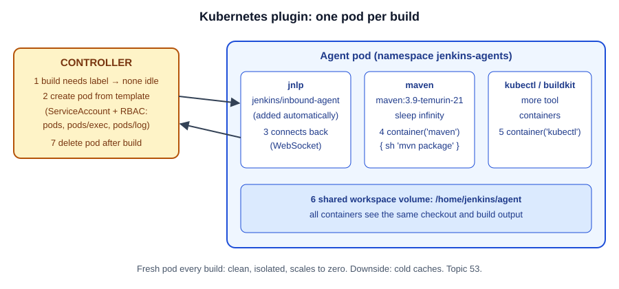

# 53 · Kubernetes and Cloud Agents

> **Level:** ★★★ advanced · **Status:** 🆕 new topic (expands the Day 03 "Kubernetes plugin" mention)
>
> **You will learn:** how the **Kubernetes plugin** creates a fresh **pod per build** as an ephemeral agent (pod templates, the `jnlp` container, extra tool containers, `container('x') { }`), how to define pods in the Jenkinsfile, a hands-on lab on **kind**, and the other cloud agent options (EC2 Fleet, Docker cloud).
>
> **You need:** topics 40, 50, 52. Kubernetes basics: [your Kubernetes notes 18 pods](../../CKA-Certification-Course-2025/notes/18-pods.md), [23 multi-container pods](../../CKA-Certification-Course-2025/notes/23-multi-container-pods.md), [55 ServiceAccounts](../../CKA-Certification-Course-2025/notes/55-serviceaccounts-and-tokens.md), [11 kind](../../CKA-Certification-Course-2025/notes/11-lab-setup-kind-and-minikube.md).
>
> **From your original notes:** Day 03 › *Kubernetes (Jenkins on K8s)*: "Spin up ephemeral agent Pods per build via the Kubernetes plugin; scale to zero idle agents"; Day 02 › "Controller + ephemeral agents (Kubernetes or cloud VMs)".

---

## What it is

A **cloud** in Jenkins is a configuration that can **create agents on demand** and destroy them afterwards. The **Kubernetes plugin** is the most popular: for each build (or stage) that asks for it, Jenkins creates a **pod**, which runs:
- a **`jnlp` container** (image `jenkins/inbound-agent`): the actual agent process, connecting back to the controller (topic 52);
- any **tool containers** you add (maven, node, kubectl, buildkit…), sharing the same **workspace volume**.

When the build ends, the pod is deleted. Nothing is left behind.

---

## Why it exists

- **Isolation:** every build starts from clean images; no leftovers, no cross-build contamination.
- **Elastic scale:** 0 pods when idle, 100 during a release rush, limited only by the cluster.
- **Toolchains as images:** each stage uses the image with the exact tools it needs.
- **Cost:** you pay for build capacity only while builds run (with cluster autoscaling).

---

## Analogy

Instead of permanent workshops, a **pop-up tent** is assembled for each job with exactly the tools listed on the order (pod template), and folded away when the job is done.

---

## How it works inside




1. A pipeline with `agent { kubernetes { … } }` needs an executor. The plugin sees **no idle agent** matching the generated label and **provisions** one.
2. It calls the Kubernetes API (using a **ServiceAccount** token or kubeconfig credential) to create a pod from the **pod template** (YAML).
3. The pod's `jnlp` container starts and connects **inbound** to the controller (`JENKINS_URL`, plus the tunnel/WebSocket settings), using a secret injected as an environment variable.
4. The build runs. Steps run in the `jnlp` container by default; `container('maven') { sh '…' }` runs them in another container of the same pod via `kubectl exec`-style calls. All containers mount the same `/home/jenkins/agent` workspace.
5. When the build (or the `agent` block) ends, the plugin deletes the pod.

Requirements: the controller must be reachable from pods (an in-cluster Service URL, or a public URL), and the ServiceAccount needs RBAC to create/watch/delete pods in the agent namespace.

---

## Config / Jenkinsfile / commands

### Configure the cloud

**Manage Jenkins → Clouds → New cloud → Kubernetes**:
- **Kubernetes URL** (empty when Jenkins runs inside the cluster) / credential (a kubeconfig **Secret file**, or the in-cluster ServiceAccount)
- **Kubernetes Namespace:** `jenkins-agents`
- **Jenkins URL:** how pods reach the controller, e.g. `http://jenkins.ci.svc.cluster.local:8080` (in-cluster) or `https://ci.example.com`
- **WebSocket:** ✅ (so pods only need the HTTP URL)
- **Container cap / pod retention:** max concurrent pods; *Never* keep pods (default)

RBAC for the agent namespace (applied by a cluster admin):
```yaml
apiVersion: rbac.authorization.k8s.io/v1
kind: Role
metadata: { name: jenkins-agents, namespace: jenkins-agents }
rules:
- apiGroups: [""]
  resources: ["pods", "pods/exec"]
  verbs: ["create", "delete", "get", "list", "patch", "update", "watch"]
- apiGroups: [""]
  resources: ["pods/log"]
  verbs: ["get", "list", "watch"]
- apiGroups: [""]
  resources: ["events"]
  verbs: ["watch"]
- apiGroups: [""]
  resources: ["secrets"]
  verbs: ["get"]
```
This matches the example `service-account.yml` in the Kubernetes plugin's repository (`src/main/kubernetes/`). `pods/exec` is needed for `container('x') { sh … }`, and `pods/log` and `events` let Jenkins show why a pod failed to start. Add `persistentvolumeclaims` (create/delete/get/list/watch) only if your pod templates create PVC workspaces.
(Bound with a RoleBinding to the controller's ServiceAccount, Kubernetes notes topic 57.)

### Pod template in the Jenkinsfile

```groovy
pipeline {
  agent {
    kubernetes {
      yaml '''
        apiVersion: v1
        kind: Pod
        spec:
          containers:
          - name: maven
            image: maven:3.9-eclipse-temurin-21
            command: ["sleep"]
            args: ["infinity"]
            resources: { requests: { cpu: "500m", memory: "1Gi" }, limits: { memory: "2Gi" } }
          - name: kubectl
            image: alpine/k8s:1.34.1          # kubectl + a shell; ⚠️ bitnami/kubectl's versioned tags moved out of Bitnami's free catalog in 2025. Pin the tag (or digest) you verified exists.
            command: ["sleep"]
            args: ["infinity"]
      '''
      defaultContainer 'maven'
    }
  }
  stages {
    stage('Build') { steps { sh 'mvn -B -q package' } }                 // runs in "maven"
    stage('Deploy') {
      when { branch 'main' }
      steps { container('kubectl') { sh 'kubectl version --client' } }  // runs in "kubectl"
    }
  }
}
```
- The `jnlp` container is added automatically; you only list tool containers.
- `command: sleep infinity` keeps tool containers alive so steps can run in them.
- **Requests/limits** matter: CI pods compete with each other and with apps (Kubernetes notes topic 41).

Console (shape):
```
Created Pod: kubernetes jenkins-agents/app-main-12-x7k2q-0p4lm
Agent app-main-12-x7k2q-0p4lm is provisioned from template app_main_12-x7k2q
Running on app-main-12-x7k2q-0p4lm in /home/jenkins/agent/workspace/app_main
[Pipeline] container
+ mvn -B -q package
...
Deleting pod jenkins-agents/app-main-12-x7k2q-0p4lm
```

Reusable templates can also be defined in **Clouds → Kubernetes → Pod Templates** (with a label like `maven`) or in JCasC, and referenced by `agent { label 'maven' }`, or shipped as YAML files in a shared library (`yamlFile 'ci/pod.yaml'`).

### Caches in ephemeral pods

Every pod starts empty, so Maven/npm re-download everything. Options: a PVC mounted at `~/.m2` (shared read/write cache), a dependency proxy (Nexus/Artifactory, the best option), or BuildKit's remote cache for images (topic 26).

### Other clouds

- **Amazon EC2 / EC2 Fleet plugin:** launches EC2 instances (Spot for cheap) from an AMI as agents, terminates them when idle.
- **Docker plugin (Docker cloud):** starts agent containers on a Docker host per build.
- **Azure VM Agents, Google Compute Engine** plugins: the same idea on other clouds.

---

## Hands-on lab (kind)

1. Create a kind cluster (your Kubernetes notes topic 11) and connect it to the Jenkins Docker network so pods can reach the controller:
   ```bash
   kind create cluster --name ci
   docker network connect jenkins-net ci-control-plane
   kubectl create namespace jenkins-agents
   kubectl -n jenkins-agents create serviceaccount jenkins
   kubectl -n jenkins-agents create rolebinding jenkins --clusterrole=edit --serviceaccount=jenkins-agents:jenkins
   kubectl -n jenkins-agents create token jenkins --duration=24h   # copy the token
   ```
   (`edit` is broad; fine for a lab, use the Role above in production.)
2. Install the **Kubernetes** plugin. Add a credential **Secret text** = the token. Configure the cloud: URL `https://ci-control-plane:6443`, tick *Disable https certificate check* (lab only), namespace `jenkins-agents`, the token credential, Jenkins URL `http://jenkins:8080`, WebSocket on. **Test Connection** → `Connected to Kubernetes v1.3x`.
3. Run the Jenkinsfile above (use a small Maven project, or replace the build with `sh 'mvn -v'`). Watch the pods: `kubectl -n jenkins-agents get pods -w`.

---

## Where you'll use it

Kubernetes-based CI platforms (very common), Jenkins on EKS/GKE/AKS, cost-optimised Spot agents.

---

## When it breaks

| Symptom | Cause | Fix |
|---|---|---|
| Pod `Pending` forever; build waits | No cluster capacity / requests too big | Smaller requests; node autoscaling |
| Pod starts, `jnlp` container exits: `Connection refused` / `Unknown host` | Pods can't reach the Jenkins URL | Correct in-cluster Service URL; WebSocket |
| `pods is forbidden: User "system:serviceaccount:…" cannot create resource "pods"` | Missing RBAC | Role/RoleBinding for the ServiceAccount |
| `ErrImagePull` on a tool container | Wrong image name / private registry | Fix the image; `imagePullSecrets` |
| `container 'maven' not found` | Container name mismatch | Same name in YAML and `container('…')` |
| Builds slow: every dependency re-downloaded | Empty pods | Dependency proxy or a PVC cache |

---

## Quick recap

- The Kubernetes plugin creates a **pod per build**: an auto-added `jnlp` inbound-agent container + your tool containers sharing a workspace.
- Define pods in the Jenkinsfile (`agent { kubernetes { yaml … } }`), switch with `container('x')`.
- Needs RBAC to manage pods and a Jenkins URL reachable from pods (WebSocket recommended).
- Solve caching with proxies/PVCs; other clouds: EC2 Fleet, Docker, Azure, GCE.

**Interview questions**

1. **Q: How do Kubernetes agents work in Jenkins?**
   A: For each build the Kubernetes plugin creates a pod from a template; its `jnlp` container connects back to the controller as an inbound agent, steps run in that or other containers in the pod, and the pod is deleted afterwards.

2. **Q: What's the `jnlp` container?**
   A: The container in each agent pod that runs the Jenkins inbound agent (`jenkins/inbound-agent`); the name is historical.

3. **Q: Main drawback of ephemeral agents, and the fix?**
   A: No warm caches, so builds re-download dependencies and image layers. Fix it with a dependency proxy (Nexus/Artifactory), shared cache volumes, or remote build caches.
