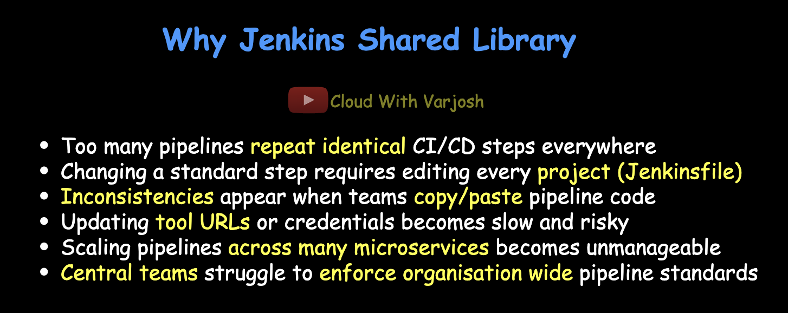
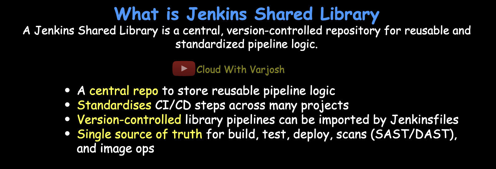
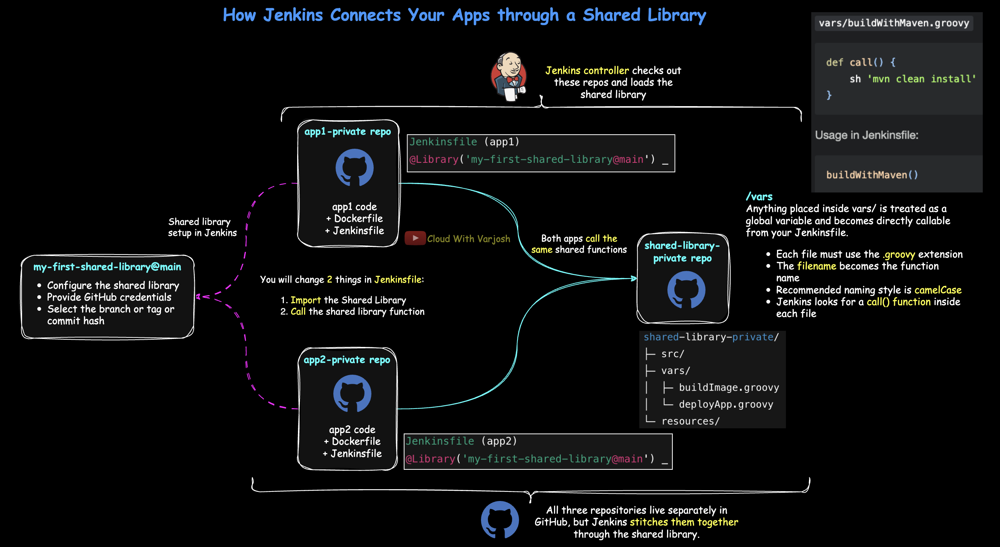

# 55 · Shared Libraries: Why and How

> **Level:** ★★ intermediate · **Status:** ✅ rewritten from your notes
>
> **You will learn:** the duplication problem shared libraries solve, how a Jenkinsfile imports and calls a library (`@Library`), the library's directory structure (`vars/`, `src/`, `resources/`), and every option in **Global Pipeline Libraries**.
>
> **You need:** topics 30 (Groovy), 31, 42.
>
> **From your original notes:** shared-library › *Introduction*, *Why Jenkins Shared Library?*, *Challenges With the Traditional Approach* (1–4), *Enter Jenkins Shared Library*, *Why This Is Powerful*, *Using a Shared Library in Jenkins*, *Shared Library Directory Structure* (1 `vars/`, 2 `src/`, 3 `resources/`), Demo 1 *Step 2* option explanations.
>
> 🎥 Original video: [Jenkins Shared Library Tutorial: Real World CI/CD with Reusable Pipeline Steps](https://www.youtube.com/watch?v=Eql35HIXS4A&ab_channel=CloudWithVarJosh)

---

## What it is

A **Jenkins Shared Library** is a **separate Git repository of Groovy code** (custom steps, helper classes, templates) that any Jenkinsfile can load and call. You **centralise all common pipeline logic in one dedicated repository** and call it from every Jenkinsfile.

Modern organisations rarely have a single application. Most teams manage **many repositories**, each doing the **same build, test, security and deployment steps** in its Jenkinsfile. Even though these steps look identical, every team ends up **copy-pasting the same pipeline logic**, which leads to duplication and drift. Shared libraries were created to solve exactly this.

---

## Why it exists

Before we even use the term, understand the **problem landscape**:



With many projects, a large portion of every CI/CD pipeline is **repetitive**:
- logging in to your container registry (ECR, Docker Hub, Artifactory)
- static code analysis (SonarQube)
- security scanners (Trivy, Snyk)
- building with the same tool (Maven, Gradle, npm)
- running test suites
- sending notifications (Slack, Teams, email)

None of these is unique to one microservice. Now imagine **20 Java microservices**: each repo has its own **Jenkinsfile**, and that creates a challenge.

### Challenges with the traditional approach

Without shared libraries, each Jenkinsfile contains **duplicate logic**: the SonarQube step 20 times, Maven/Gradle steps 20 times, the Trivy scan 20 times, the registry login 20 times, notifications 20 times. This leads to:

1. **Massive duplication.** Every project maintains its own copy. 20 lines × 20 repos = 400 lines to maintain.
2. **Inconsistent pipelines.** Small copy-paste differences creep in: one repo uses the latest scanner flags, another outdated ones.
3. **High maintenance overhead.** If something changes (the SonarQube URL, a credentials ID, new Trivy arguments, a new compliance step), you must edit **20 separate Jenkinsfiles**: slow, error-prone, not scalable.
4. **Difficult onboarding.** New developers/DevOps engineers struggle to understand why every project looks different when the logic is the same.

### Enter the shared library



A shared library solves all of the above by **centralising common pipeline code** in a separate Git repository. Instead of repeating logic across 20 Jenkinsfiles, you:
1. move the common logic into the shared library,
2. reference it from each Jenkinsfile,
3. call reusable functions wherever needed.

All 20 projects now share the same behaviour, and any future change is made in **one place**.

### Why this is powerful

- **Write once, use everywhere:** define common logic once; call it from every Jenkinsfile.
- **Update in one location:** if SonarQube, Trivy or any step changes, update the library once and every pipeline benefits immediately.
- **Cleaner Jenkinsfiles:** they focus only on project-specific logic; reusable steps become simple function calls.
- **Programming analogy:** like defining functions in a programming language: write once, call many times across codebases.

---

## Analogy

A company **style guide and template library** for documents: instead of every team designing their own letterhead (and getting it slightly wrong), everyone uses `letterhead()` from the shared template folder. Change the logo once, and every new letter has it.

---

## How it works inside

### Using a shared library: two changes to a Jenkinsfile

**1. Import the library**
```groovy
@Library('my-shared-library') _
```
**2. Call its functions**
```groovy
buildWithMaven()
runSonarAnalysis()
performTrivyScan()
```
This keeps the Jenkinsfile short, readable and maintainable.

What `@Library('name@version') _` does: before the pipeline runs, Jenkins checks out the library repo at that **version** (branch, tag or commit) into `<workspace>@libs/<hash>/`, adds `src/` to the classpath, and registers each `vars/*.groovy` file as a global step. The trailing `_` is a placeholder: Groovy annotations must annotate *something*, and `_` is a dummy.

### Directory structure



A shared library has a predictable structure at the root of its repository. It tells Jenkins **where to look** for global steps, helper classes and supporting files:
```
.
|__ src/
|__ vars/
|__ resources/
```
For Demo 2 (topic 57) the library looks like this:
```
shared-library-private/
├─ src/
├─ vars/
│  ├─ buildImage.groovy
│  └─ deployApp.groovy
└─ resources/
```
This layout lets both `app1` and `app2` share the same build and deploy logic simply by importing the library.

#### 1. `vars/` (the most important directory)

Anything in `vars/` becomes a **global variable**, directly callable from your Jenkinsfile.
- Files must end with `.groovy`.
- **The file name becomes the step name.**
- Jenkins looks for a **`call()`** method inside each file.
- Recommended naming style: **camelCase**.
- Most DevOps teams rely heavily on this folder because it makes steps easy to use.

Diagram connection: this is where `buildImage.groovy` and `deployApp.groovy` live, and both apps call those same functions.

Example `vars/buildWithMaven.groovy`:
```groovy
def call() {
    sh 'mvn clean install'
}
```
Usage in a Jenkinsfile:
```groovy
buildWithMaven()
```
A file can also define **other methods**, called as `buildWithMaven.otherMethod()`, and an optional `vars/buildWithMaven.txt` (or `.md`) appears as help text in the Global Variables reference.

#### 2. `src/`

Behaves like a normal Groovy/Java **package** structure. Use it when:
- logic gets too complex for a simple `vars/*.groovy` file,
- you want reusable **helper classes**,
- you prefer organising code in packages.

Example: `src/org/devops/util/EmailHelper.groovy`.
These classes are **not** exposed automatically like `vars/` steps. They're **imported into `vars/*.groovy` files** (or Jenkinsfiles) or used internally:
```groovy
import org.devops.util.EmailHelper
```
Demo 2 uses only `vars/`; `src/` is for advanced cases (topic 58).

#### 3. `resources/`

For non-Groovy files: JSON templates, YAML manifests, config files, shell scripts, any static text. Load them with:
```groovy
def text = libraryResource 'path/to/file'
```
This keeps long templates out of Groovy code. Demo 2 doesn't use it.

### Global Pipeline Libraries: every option (Manage Jenkins → System)

| Option | Meaning | Demo setting |
|---|---|---|
| **Name** | The identifier used in `@Library('…')` | `my-first-shared-library` |
| **Default version** | Branch, tag or commit used when a Jenkinsfile doesn't ask for a specific one | `main` |
| **Load implicitly** | Load the library into **every** pipeline without `@Library` | ❌ unchecked: pipelines should declare which libraries they use (clearer for readers) |
| **Allow default version to be overridden** | Let a Jenkinsfile pin another version with `@Library('name@v1.2')` | ✅ checked |
| **Include @Library changes in job recent changes** | Library commits appear in builds' changesets/changelogs. Override per pipeline with `@Library(value="name@version", changelog=true\|false)` | ✅ checked |
| **Cache fetched versions on controller for quick retrieval** | Cache library checkouts on the controller | ❌ off for demos; on in production for speed (with a refresh interval) |
| **Retrieval method** | How to fetch it: **Modern SCM** → Git/GitHub (repo URL + credentials) | `https://github.com/…/shared-library-demo.git` |

Libraries defined here are **trusted**: their code runs **outside the Groovy sandbox** (they can call any API). That's why only admins can add them, and why the library repo needs strict review/branch protection (topic 58). **Folder-level libraries** (configured on a folder) are untrusted/sandboxed unless an admin marks them otherwise.

---

## Config / Jenkinsfile / commands

Import variations:
```groovy
@Library('my-shared-library') _                       // default version
@Library('my-shared-library@v1.4.0') _                // pinned tag
@Library(['lib-a@main', 'lib-b@v2']) _                // several
library 'my-shared-library@main'                      // dynamic (step form), e.g. inside script
```
Console at the start of a build:
```
Loading library my-shared-library@main
Attempting to resolve main from remote references...
 > git ls-remote -h -- https://github.com/acme/shared-library.git # timeout=10
Found match: refs/heads/main revision 5c1d9e2…
Checking out Revision 5c1d9e2… (main)
```

---

## Hands-on lab

Read through topics 56–57 and do the demos. Before that, sketch which 3–5 steps of *your* pipelines (topics 36, 47) you'd move into a library, and what parameters each needs.

---

## Where you'll use it

Every organisation with more than a handful of pipelines. Platform teams own the library; app teams call it.

---

## When it breaks

| Error | Cause | Fix |
|---|---|---|
| `ERROR: Could not find any definition of libraries [x]` | Name mismatch with Global Pipeline Libraries | Use the exact configured name |
| `No such DSL method 'buildImage'` | File not in `vars/`, wrong name/extension, or the library didn't load | `vars/buildImage.groovy` on the loaded version |
| `Version override not permitted for library` | "Allow default version to be overridden" unchecked | Enable it, or drop `@version` |
| Library changes not picked up | Caching on | Clear the cache / lower the refresh time |

---

## Quick recap

- A shared library = a Git repo of reusable pipeline code, loaded with `@Library('name@version') _`.
- `vars/x.groovy` with `def call()` → step `x()`; `src/` = classes; `resources/` = files via `libraryResource`.
- Configure it in Global Pipeline Libraries (default version, override, implicit loading, caching, retrieval).
- Global libraries are trusted (not sandboxed), so protect the repo.

**Interview questions**

1. **Q: What problem do shared libraries solve?**
   A: Duplicated pipeline logic across many repos: inconsistency, drift and high maintenance. Common steps live in one versioned repo, so a fix is made once.

2. **Q: How does a file in `vars/` become a step?**
   A: Jenkins registers each `vars/<name>.groovy` as a global variable named `<name>`; calling `<name>()` invokes its `call()` method.

3. **Q: What's the difference between `vars/` and `src/`?**
   A: `vars/` holds global steps callable directly from Jenkinsfiles. `src/` holds Groovy classes in packages, which must be imported and are used for more complex logic.
