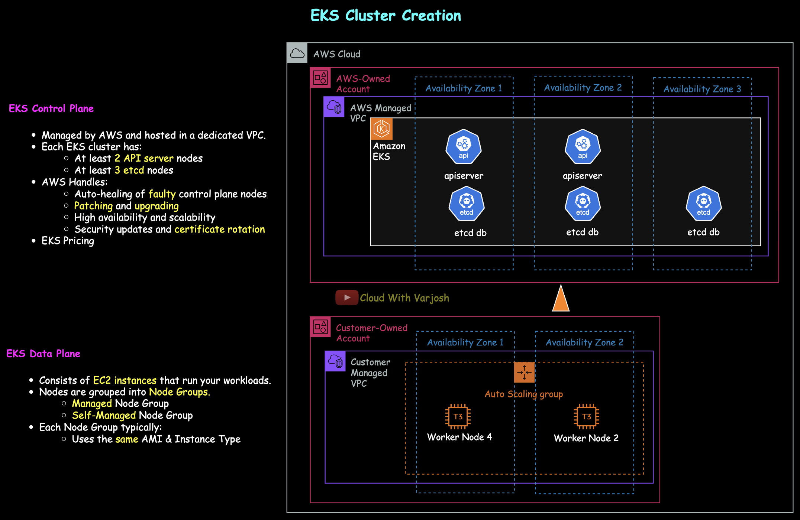

# 63 · Project 4, Part 2: Deploy to EKS

> **Level:** ★★★ advanced · **Status:** ✅➕ rewritten from your notes (access entries added; several fixes)
>
> **You will learn:** stages 8–9: the Kubernetes manifests (Deployment with topology spread + NodePort Service), updating the image tag with `sed`, creating the EKS cluster with eksctl, installing `kubectl` on the agent, the IAM permission for kubeconfig, giving the Jenkins role cluster access (**access entries**, and the legacy `aws-auth` way), least-privilege RBAC, the deploy script line by line with automatic rollback, verification, `post` actions, and push triggers.
>
> **You need:** topics 35, 41, 61, 62.
>
> **From your original notes:** Project 01 › *Stage 8* (objective, Deployment, Service, topologySpreadConstraints explanation, pipeline snippet, `sed` step-by-step, commit), *Stage 9* (objective, snippet, what it does, pre-steps, eksctl config + tools, create cluster, verify AZs, install kubectl, inline policy, aws-auth sections, add role, verify mapping, RBAC, line-by-line explanation, verification, gotchas), *Post Actions*, *Trigger pipeline on Git push*, *Conclusion* · files `project_files/*`.

---

## What it is

The final two stages: write the Kubernetes manifests, point them at the image built in this run, and deploy to a Multi-AZ EKS cluster with **least-privilege** access and an **automatic rollback** if the rollout fails.

---

## Why it exists

Deploying is where pipelines get dangerous: wrong permissions give CI cluster-admin; a bad image takes the service down. This stage shows how to deploy with minimal rights and a safety net.

---

## Analogy

Delivering furniture to a secure building: you're on the visitor list (access entry), you may only enter the rooms on your pass (RBAC), and if the new sofa doesn't fit, you take it away and put the old one back (rollout undo).

---

## How it works inside

```
agent: sed image→$IMAGE_REPO:$BUILD_NUMBER in deploy-svc.yaml
     → aws eks update-kubeconfig  (IAM: eks:DescribeCluster)
     → kubectl apply  ──token──▶ EKS API: IAM role → access entry → user "jenkins-agent-role" → RBAC ClusterRole
     → kubectl rollout status (60s) ── fail? → kubectl rollout undo + exit 1
```

---

## Config / Jenkinsfile / commands

## Stage 8: Create Kubernetes manifests (Deployment + Service)

*(Reference: "Create manifest" box.)*
**Objective:** a Deployment with **2 replicas** and a NodePort Service, with `topologySpreadConstraints` so pods spread across Availability Zones; committed to the repo so the pipeline can update them.

**Deployment (`deploy-svc.yaml`):**
```yaml
apiVersion: apps/v1
kind: Deployment
metadata:
  name: cwvj-devsecops-demo
  namespace: cwvj-devsecops
  labels:
    app: cwvj-devsecops-demo
spec:
  replicas: 2
  selector:
    matchLabels:
      app: cwvj-devsecops-demo
  template:
    metadata:
      labels:
        app: cwvj-devsecops-demo
    spec:
      topologySpreadConstraints:
        - maxSkew: 1
          topologyKey: topology.kubernetes.io/zone
          whenUnsatisfiable: DoNotSchedule
          labelSelector:
            matchLabels:
              app: cwvj-devsecops-demo
      containers:
        - name: cwvj-devsecops-demo
          image: 386275436648.dkr.ecr.ap-south-1.amazonaws.com/cwvj-devsecops-demo:latest
          ports:
            - containerPort: 8080
```
**Service (same file, after a `---` separator, or a separate file):**
```yaml
apiVersion: v1
kind: Service
metadata:
  name: cwvj-devsecops-demo-svc
  namespace: cwvj-devsecops
  labels:
    app: cwvj-devsecops-demo
spec:
  type: NodePort
  selector:
    app: cwvj-devsecops-demo
  ports:
    - port: 80
      targetPort: 8080
      protocol: TCP
      nodePort: 31000
```
Reading it (Kubernetes notes topics 25, 31): the Deployment keeps 2 pods with label `app: cwvj-devsecops-demo`; the Service selects pods with that label and exposes them on **port 31000 of every node** (`nodePort`), forwarding to the container's 8080. `port: 80` is the Service's in-cluster port.

**topologySpreadConstraints, explained:**
- Purpose: spread pods evenly across a topology domain (here **AZs**, Availability Zones = separate data centres in a region) to improve availability and reduce the blast radius.
- `maxSkew: 1`: the maximum allowed difference in pod counts between domains. With 2 replicas, it forces a 1–1 spread.
- `topologyKey: topology.kubernetes.io/zone`: the **node label** used as the axis; the scheduler spreads across AZs.
- `whenUnsatisfiable: DoNotSchedule`: if placing a pod would break the rule, the scheduler won't place it (strict separation; the pod stays Pending).
- `labelSelector.matchLabels`: limits the rule to pods with `app: cwvj-devsecops-demo`, so other workloads are unaffected.

(Production additions you'd make: `resources` requests/limits, `readinessProbe`/`livenessProbe` on port 8080 so `rollout status` waits for a really healthy app, and `securityContext` with `runAsNonRoot: true`.)

**Pipeline snippet (Update Deployment):**
```groovy
stage('Update Deployment') {
  steps {
    sh 'sed -i "s|image:.*|image: $IMAGE_REPO:$BUILD_NUMBER|g" deploy-svc.yaml'
  }
}
```
**`sed`, step by step** (Linux notes topic 018):
```bash
sed -i "s|image:.*|image: $IMAGE_REPO:$BUILD_NUMBER|g" deploy-svc.yaml
```
1. `sed -i`: edit the file **in place**, writing changes directly to `deploy-svc.yaml`.
2. `s|image:.*|image: $IMAGE_REPO:$BUILD_NUMBER|g`:
   - `s`: the substitute command.
   - `|`: the delimiter, chosen to avoid escaping the slashes in the image URL.
   - `image:.*`: a regex matching `image:` and everything after it on that line.
   - `image: $IMAGE_REPO:$BUILD_NUMBER`: the replacement; the **shell** expands `$IMAGE_REPO` and `$BUILD_NUMBER` before `sed` runs (the inner double quotes are shell quotes inside a single-quoted Groovy string).
   - `g`: replace every match on each line. (Each `image:` line is replaced anyway; `g` only matters for several matches on *one* line.)
3. `deploy-svc.yaml`: the target manifest.

**Net effect:** every `image:` line becomes the exact image of this run, `${IMAGE_REPO}:${BUILD_NUMBER}`, so Kubernetes pulls what this pipeline built and scanned. The indentation before `image:` is kept, because the regex starts matching at `image:`. The edit only exists in the **workspace**; it isn't committed back (GitOps would commit it to a config repo instead, topic 72). Stronger still: deploy by **digest** (topic 64).

**Commit the manifests:**
```bash
git add .
git commit -m "uploaded deployment and svc manifest"
git push private-repo main
```

## Stage 9: Deploy to Kubernetes (create the cluster, grant access, deploy)

*(Reference: "Deploy to Kubernetes" box.)*
**Objective:** provision an EKS cluster (if not already there), give the agent the minimum IAM + Kubernetes RBAC it needs, install `kubectl` on the agent, and deploy `deploy-svc.yaml` into the `cwvj-devsecops` namespace. Careful sequencing: **cluster → node distribution → agent tools → IAM permission → cluster access mapping → RBAC → deployment.**

> Reminder: **git push** your manifests before clicking Build Now, so the pipeline has the latest files.

**The original pipeline snippet:**
```groovy
stage('Deploy to Kubernetes') {
  steps {
    sh '''#!/bin/bash -l
aws eks update-kubeconfig \
  --region ap-south-1 \
  --name cwvj-devsecops-eks \
  --kubeconfig /home/jenkins/.kube/config

kubectl create ns cwvj-devsecops
kubectl apply -f deploy-svc.yaml

kubectl rollout status -n cwvj-devsecops deployment/cwvj-devsecops-demo --timeout=60s || {
  kubectl rollout undo -n cwvj-devsecops deployment/cwvj-devsecops-demo || true
  exit 1
}
'''
  }
}
```
**What this stage does (high level):**
- Ensures the agent can talk to the EKS cluster through an updated kubeconfig.
- Creates the demo namespace and applies the Deployment + Service.
- Waits for the rollout; on failure it **undoes** the rollout and fails the stage.
- Enforces least privilege: the agent gets only the RBAC verbs it needs (deployments, replicasets, pods, services, namespaces).

**Pre-steps (the sequence):**
1. **Create the EKS cluster** with `eksctl` and the config file.
2. **Verify node AZ distribution** with `kubectl get nodes --show-labels`.
3. **Install `kubectl` on the agent** (version matching the EKS control plane).
4. **Attach an inline `eks:DescribeCluster` policy** to `jenkins-agent-role`.
5. **Give the role cluster access** (access entry, or the legacy aws-auth edit) mapped to a Kubernetes username.
6. **Create the ClusterRole and ClusterRoleBinding** granting limited permissions.
7. **Commit and push** `deploy-svc.yaml` and the RBAC manifests.

### 1) Create the EKS cluster



**Install the required tools** on your local machine or a cloud jump host: the [AWS CLI](https://docs.aws.amazon.com/cli/latest/userguide/getting-started-install.html) and [eksctl](https://eksctl.io/installation/).

`eks-config.yaml`, with a one-line comment per field:
```yaml
apiVersion: eksctl.io/v1alpha5            # eksctl cluster config API version
kind: ClusterConfig                      # resource kind for eksctl
metadata:                                # cluster metadata block
  name: cwvj-devsecops-eks               # EKS cluster name
  region: ap-south-1                     # AWS region for the cluster
  version: "1.36"                        # Kubernetes control plane version
  tags:                                  # tags to help identify resources
    owner: cloudwithvarjosh              # tag owner
    environment: training                # tag environment
    project: cwvj-devsecops-demo         # tag project
    purpose: youtube-labs                # tag purpose
accessConfig:                            # (added) use EKS access entries
  authenticationMode: API_AND_CONFIG_MAP # API = access entries; CONFIG_MAP kept for the legacy demo
availabilityZones:                       # AZs for node placement
  - ap-south-1a                          # AZ 1
  - ap-south-1b                          # AZ 2
iam:                                     # IAM/OIDC settings
  withOIDC: true                         # enable the IAM OIDC provider for IRSA
managedNodeGroups:                       # defines managed node groups
  - name: cwvj-ng-public                 # node group name
    instanceType: t3.small               # EC2 instance type for workers
    minSize: 2                           # minimum nodes in the node group
    maxSize: 2                           # maximum nodes in the node group
    desiredCapacity: 2                   # desired node count at creation
    volumeSize: 20                       # root disk size (GiB)
    privateNetworking: false             # nodes get public networking
    ssh:                                 # SSH configuration
      allow: true                        # allow SSH access to nodes
      publicKeyName: cwvj-sj-mumbai      # EC2 key pair name for SSH (use yours)
    iam:                                 # per-node-group IAM settings
      withAddonPolicies:                 # enable addon policies
        autoScaler: true                 # allow cluster autoscaler usage
        ebs: true                        # allow EBS volume usage
        albIngress: true                 # allow the ALB ingress addon
        externalDNS: true                # allow the ExternalDNS addon
        certManager: false               # (in the project file) no cert-manager policy
        cloudWatch: false                # (in the project file) no CloudWatch policy
    labels:                              # node labels for scheduling
      owner: cloudwithvarjosh            # node label owner
      app: devsecops-demo                # node label app
    tags:                                # node-level tags
      node-type: public-worker           # custom tag
      managed-by: eksctl                 # managed by eksctl
```
> ⚠️ **Corrected (three things):**
> 1. **`desiredCapacity: 1`** in the README version with **`minSize: 2`** is invalid (desired can't be below min; eksctl rejects it), and with one node the `DoNotSchedule` spread rule would leave the second pod **Pending**. Now **2**, as in your committed `eks-config.yaml`.
> 2. **`version: "1.32"`** is past EKS standard support (14 months), so it would be billed at the higher **extended-support** rate (about 6×). Now **"1.36"**, a version in standard support at the time of writing (EKS added 1.36 in June 2026). Check the current list with `aws eks describe-cluster-versions` before creating a cluster, and match your `kubectl` version to it.
> 3. Added **`accessConfig.authenticationMode`** so the cluster supports **access entries** (the current way to grant access; `aws-auth` is deprecated, topic 61).
>
> **IRSA** (`withOIDC: true`) = IAM Roles for Service Accounts: lets *pods* assume IAM roles. Not used by this pipeline, but needed by add-ons like the ALB controller.

Create the cluster (15–20 minutes):
```bash
eksctl create cluster -f eks-config.yaml
```
Verify the nodes' AZ distribution:
```bash
kubectl get nodes --show-labels | grep topology.kubernetes.io/zone
# or, more readable:
kubectl get nodes -L topology.kubernetes.io/zone
```
```
NAME                                           STATUS   ROLES    AGE   VERSION   ZONE
ip-192-168-12-34.ap-south-1.compute.internal   Ready    <none>   5m    v1.36.x   ap-south-1a
ip-192-168-56-78.ap-south-1.compute.internal   Ready    <none>   5m    v1.36.x   ap-south-1b
```

### 2) Install kubectl on the agent

```bash
# download the kubectl binary matching the EKS version (1.36.x)
curl -LO "https://dl.k8s.io/release/$(curl -Ls https://dl.k8s.io/release/stable-1.36.txt)/bin/linux/amd64/kubectl"

# make it executable
chmod +x kubectl

# move it to /usr/local/bin so ALL users have it in PATH
sudo mv kubectl /usr/local/bin/
```
Verify:
```bash
kubectl version --client
sudo -u jenkins kubectl version --client
```
(The original downloads `v1.32.0`. kubectl supports ±1 minor version of the server, so keep it matched to the cluster.)

### 3) Allow `jenkins-agent-role` to update kubeconfig

Attach an inline policy to `jenkins-agent-role` permitting `eks:DescribeCluster` on the cluster (file `project_files/aws-kube-config-policy`):
```json
{
  "Version": "2012-10-17",
  "Statement": [
    {
      "Effect": "Allow",
      "Action": [
        "eks:DescribeCluster"
      ],
      "Resource": "arn:aws:eks:ap-south-1:386275436648:cluster/cwvj-devsecops-eks"
    }
  ]
}
```
Apply it in the IAM console: **Roles → jenkins-agent-role → Add permissions → Create inline policy** (JSON). This only lets the agent *read the cluster's endpoint and CA*; what it may do *inside* the cluster is decided by RBAC.

### 4a) Give the Jenkins role cluster access: EKS access entries (current way)

```bash
aws eks create-access-entry \
  --cluster-name cwvj-devsecops-eks --region ap-south-1 \
  --principal-arn arn:aws:iam::386275436648:role/jenkins-agent-role \
  --username jenkins-agent-role
aws eks list-access-entries --cluster-name cwvj-devsecops-eks --region ap-south-1
```
- `--principal-arn`: the IAM role to let in.
- `--username jenkins-agent-role`: the Kubernetes username it maps to, which the RBAC binding below refers to.
- **No access policy is attached**, so the role is authenticated but has **no permissions** until RBAC grants them, the same least-privilege idea as `system:authenticated` below. (Alternatively, attach an AWS-managed access policy scoped to one namespace: `aws eks associate-access-policy --policy-arn arn:aws:eks::aws:cluster-access-policy/AmazonEKSEditPolicy --access-scope type=namespace,namespaces=cwvj-devsecops …`.)

### 4b) The legacy way: edit the `aws-auth` ConfigMap (original notes)

> ⚠️ **Corrected (deprecated):** the steps below were the original method. AWS has **deprecated** the `aws-auth` ConfigMap in favour of access entries (4a). It still works when the auth mode includes `CONFIG_MAP`, and you'll meet it in existing clusters and in interviews, so understand it, but use 4a for new work. A typo in this ConfigMap can lock everyone (even admins) out of the cluster; access entries can't.

The **aws-auth ConfigMap** controls how AWS IAM roles are mapped to Kubernetes users and groups. EKS uses this mapping to decide **who can authenticate** before RBAC decides **what they can do**.

The existing ConfigMap created by eksctl:
```yaml
apiVersion: v1
data:
  mapRoles: |
    - rolearn: arn:aws:iam::386275436648:role/eksctl-cwvj-devsecops-eks-nodegrou-NodeInstanceRole-J3Szf4uMWv1R
      groups:
      - system:bootstrappers
      - system:nodes
      username: system:node:{{EC2PrivateDNSName}}
kind: ConfigMap
metadata:
  name: aws-auth
  namespace: kube-system
```
That entry is the **node instance role** (`system:bootstrappers`, `system:nodes`), meant **only for nodes**; why Jenkins must never get those groups or `system:masters`, and why we use only `system:authenticated`, is explained in topic 61.

**Add the Jenkins IAM role** (file `project_files/aws-auth-edit`) to `mapRoles`:
```yaml
mapRoles: |
  - rolearn: arn:aws:iam::386275436648:role/jenkins-agent-role
    username: jenkins-agent-role
    groups:
      - system:authenticated
```
Edit the ConfigMap (from the admin machine):
```bash
kubectl -n kube-system edit configmap aws-auth
```
**Verify the mapping:**
```bash
kubectl describe configmap aws-auth -n kube-system
```
You should see **two entries**: the NodeInstanceRole (bootstrappers + nodes) and `jenkins-agent-role` (`system:authenticated`).

### 5) Grant precise RBAC (least privilege)

A ClusterRole and ClusterRoleBinding so the mapped username `jenkins-agent-role` can manage deployments, replicasets, services, pods and namespaces, **nothing more** (`project_files/clusterrole-binding.yaml`):
```yaml
apiVersion: rbac.authorization.k8s.io/v1
kind: ClusterRole
metadata:
  name: jenkins-deployer-role
rules:

  # Deployments + ReplicaSets
  - apiGroups: ["apps"]
    resources: ["deployments", "replicasets"]
    verbs: ["get", "list", "watch", "create", "update", "patch", "delete"]

  # Pods
  - apiGroups: [""]
    resources: ["pods"]
    verbs: ["get", "list", "watch", "delete"]

  # Services
  - apiGroups: [""]
    resources: ["services"]
    verbs: ["get", "list", "watch", "create", "update", "patch", "delete"]

  # Namespaces (allow create + management)
  - apiGroups: [""]
    resources: ["namespaces"]
    verbs: ["get", "list", "watch", "create", "delete", "patch", "update"]

---

apiVersion: rbac.authorization.k8s.io/v1
kind: ClusterRoleBinding
metadata:
  name: jenkins-deployer-binding
subjects:
  - kind: User
    name: jenkins-agent-role     # must match the username in the access entry / aws-auth
    apiGroup: rbac.authorization.k8s.io
roleRef:
  kind: ClusterRole
  name: jenkins-deployer-role
  apiGroup: rbac.authorization.k8s.io
```
- `apiGroups: ["apps"]` = Deployments/ReplicaSets live in the `apps` API group; `""` = the core group (pods, services, namespaces).
- `verbs` = allowed actions. `watch` is needed by `kubectl rollout status`; `rollout undo` needs `get`/`patch` on deployments and `list` on replicasets.
- A **ClusterRole** + **ClusterRoleBinding** grants these **in every namespace**. Tighter: a namespace-scoped **Role/RoleBinding** in `cwvj-devsecops` (with the namespace created by an admin), so a compromised pipeline can't touch other namespaces. Deleting namespaces is a powerful verb too; drop it if not needed.

Apply (from the admin machine):
```bash
kubectl apply -f clusterrole-binding.yaml
```
**Verify:** from the agent, pods/deployments/services/namespaces commands should work, and listing nodes should fail:
```bash
sudo -u jenkins kubectl get deploy -A        # works
sudo -u jenkins kubectl get nodes            # Error from server (Forbidden): nodes is forbidden: User "jenkins-agent-role" cannot list resource "nodes"
```

### 6) The deploy script, line by line

```bash
#!/bin/bash -l
aws eks update-kubeconfig \
  --region ap-south-1 \
  --name cwvj-devsecops-eks \
  --kubeconfig /home/jenkins/.kube/config

kubectl create ns cwvj-devsecops
kubectl apply -f deploy-svc.yaml

kubectl rollout status -n cwvj-devsecops deployment/cwvj-devsecops-demo --timeout=60s || {
  kubectl rollout undo -n cwvj-devsecops deployment/cwvj-devsecops-demo || true
  exit 1
}
```
0. `#!/bin/bash -l` (added explanation): a **shebang** as the first line makes Jenkins run the script with that interpreter: bash, as a login shell (`-l`, which loads `/etc/profile`, so the PATH includes `/usr/local/bin`). **Side effect:** without a shebang Jenkins runs `sh -xe` (print commands, stop at the first error); **with** one, neither `-x` nor `-e` is applied, so failing commands **don't stop the script** and commands aren't echoed.
1. `aws eks update-kubeconfig \` starts the AWS CLI command that writes a kubeconfig entry for the EKS cluster, so `kubectl` can talk to it using IAM-based auth.
2. `--region ap-south-1 \`: the cluster's region.
3. `--name cwvj-devsecops-eks \`: the cluster whose kubeconfig is generated/updated.
4. `--kubeconfig /home/jenkins/.kube/config`: writes it to the jenkins user's kubeconfig path, so later `kubectl` commands (run as jenkins) use it. (That's also kubectl's default path for that user.)
5. `kubectl create ns cwvj-devsecops` creates the namespace.
   > ⚠️ **Corrected:** the original says this is "simple and idempotent". It's **not idempotent**: the second run fails with `Error from server (AlreadyExists): namespaces "cwvj-devsecops" already exists`. The pipeline only kept going because the `#!/bin/bash -l` shebang disabled `-e` (point 0), which also means **any** failing command in this script (even `kubectl apply`) would be silently ignored until the rollout check. Now: `kubectl create namespace cwvj-devsecops --dry-run=client -o yaml | kubectl apply -f -` (truly idempotent), or a `Namespace` object at the top of `deploy-svc.yaml`, plus `set -euo pipefail` at the top of the script so real errors stop it.
6. `kubectl apply -f deploy-svc.yaml` applies the Deployment + Service in the current kubeconfig context: creates or updates them.
7. `kubectl rollout status -n cwvj-devsecops deployment/cwvj-devsecops-demo --timeout=60s` waits up to 60 seconds for the rollout to finish, and succeeds when the Deployment reaches the desired state (all new pods ready).
8. `|| {`: if `rollout status` fails (timeout or unhealthy pods), run the commands inside the braces as a recovery block.
9. `kubectl rollout undo … || true` rolls back to the previous Deployment revision; `|| true` lets the script continue to the next line even if the rollback itself fails (e.g. on the very first deploy there's no previous revision).
10. `exit 1` exits non-zero so Jenkins marks the stage as **failed**. A bad deployment is never reported as success.
11. `}` closes the recovery block.

The corrected stage (in `Jenkinsfile.corrected`):
```groovy
stage('Deploy to Kubernetes') {
  steps {
    sh '''#!/bin/bash -l
set -euo pipefail
aws eks update-kubeconfig --region ap-south-1 --name cwvj-devsecops-eks
kubectl create namespace cwvj-devsecops --dry-run=client -o yaml | kubectl apply -f -
kubectl apply -f deploy-svc.yaml
if ! kubectl rollout status -n cwvj-devsecops deployment/cwvj-devsecops-demo --timeout=120s; then
  kubectl rollout undo -n cwvj-devsecops deployment/cwvj-devsecops-demo || true
  exit 1
fi
'''
  }
}
```
`set -euo pipefail`: `-e` stop on errors, `-u` error on unset variables, `-o pipefail` a pipeline fails if any part fails (Linux notes topic 014). The `if !` form is needed because `-e` doesn't trigger inside an `if` condition, so the rollback still runs.

### Verification

After the pipeline runs (or manually):
- `kubectl get ns` → `cwvj-devsecops` exists.
- `kubectl get deploy -n cwvj-devsecops` → the deployment is there.
- `kubectl rollout status -n cwvj-devsecops deployment/cwvj-devsecops-demo` → stable rollout.
- `kubectl get pods -n cwvj-devsecops -o wide` → pods spread across nodes/AZs.
- Service access:
  > ⚠️ **Corrected:** the original runs `kubectl get svc cwvj-devsecops-svc -n cwvj-devsecops`, but the Service is named **`cwvj-devsecops-demo-svc`**; the original name returns `NotFound`.
  ```bash
  kubectl get svc cwvj-devsecops-demo-svc -n cwvj-devsecops
  curl http://<any-node-public-ip>:31000
  ```
  (Open TCP 31000 in the nodes' security group from your IP. The response is the app's `Cloud With VarJosh` HTML page.)
- `kubectl get deploy cwvj-devsecops-demo -n cwvj-devsecops -o jsonpath='{.spec.template.spec.containers[0].image}'` shows `…:<BUILD_NUMBER>`.

### Notes, gotchas & best practices

- Make sure the agent has the AWS CLI and `kubectl` on the PATH (the login shell helps).
- `aws eks update-kubeconfig` needs `eks:DescribeCluster` on the role.
- Access entry / aws-auth gives **authentication**; the RBAC binding gives **authorization**. Keep bindings minimal.
- The rollout timeout may need tuning for cold starts or slow image pulls (60 s is tight; add readiness probes so "ready" means "really serving").
- For production, use IRSA/Pod Identity, scoped access policies, or kubeconfigs stored as secrets, and avoid broad permissions.
- Always `git push` manifests before triggering the pipeline.

## Post actions

At the end of the Jenkinsfile, a `post` block runs **after the whole pipeline**, whatever happened in the stages. It sits **outside `stages {}`** (topic 35 has the full explanation, the correct structure and the real-world uses per outcome):
```groovy
post {
  success { echo "Build ${env.BUILD_NUMBER} succeeded" }
  failure { echo "Build ${env.BUILD_NUMBER} failed" }
  always  { echo "Build ${env.BUILD_NUMBER} finished" }
}
```

## Trigger the pipeline on Git push

Recommended: a **Multibranch Pipeline + GitHub webhook**; alternative: Poll SCM `H/5 * * * *`; with webhook secrets and least-privilege tokens. The full steps from your notes are in topic 21; the multibranch setup in topics 43–46.

## The full original Jenkinsfile (`project_files/Jenkinsfile`)

```groovy
pipeline {
    agent { label 'docker-maven-trivy' }
    tools {
        maven 'maven3'
    }
    environment {
        SONAR_IP = '172.31.37.48'
        ECR_REGISTRY = '386275436648.dkr.ecr.ap-south-1.amazonaws.com'
        IMAGE_REPO = "${ECR_REGISTRY}/cwvj-devsecops-demo"
    }
    stages {
        stage('Trivy FS Scan') {
            steps {
                sh 'trivy fs --exit-code 1 --severity HIGH,CRITICAL .'
            }
        }
        stage('Build & Sonar') {
            steps {
                withCredentials([string(credentialsId: 'sonarqube-token', variable: 'SONAR_TOKEN')]) {
              sh 'mvn clean verify sonar:sonar \
  -Dsonar.projectKey=cwvj-devsecops-demo \
  -Dsonar.host.url="http://${SONAR_IP}:9000" \
  -Dsonar.token="${SONAR_TOKEN}" \
  -Dsonar.qualitygate.wait=true'
}
            }
        }
        stage('ECR Login') {
            steps {
                sh 'aws ecr get-login-password --region ap-south-1 | docker login --username AWS --password-stdin $ECR_REGISTRY'
            }
        }
        stage('Build Image') {
            steps {
                 sh 'export DOCKER_BUILDKIT=0 && docker build --platform linux/amd64 -t "$IMAGE_REPO:$BUILD_NUMBER" -t "$IMAGE_REPO:latest" .'
            }
        }
        stage('Trivy Image Scan') {
            steps {
               sh 'trivy image --exit-code 1 --severity HIGH,CRITICAL "$IMAGE_REPO:$BUILD_NUMBER"'
            }
        }
        stage('Push to ECR') {
  steps {
    sh 'docker push "$IMAGE_REPO:$BUILD_NUMBER"'
    sh 'docker push "$IMAGE_REPO:latest"'
  }
}

stage('Update Deployment') {
    steps {
        sh 'sed -i "s|image:.*|image: $IMAGE_REPO:$BUILD_NUMBER|g" deploy-svc.yaml'
    }
}
stage('Deploy to Kubernetes') {
    steps {
        sh '''#!/bin/bash -l
aws eks update-kubeconfig \
  --region ap-south-1 \
  --name cwvj-devsecops-eks \
  --kubeconfig /home/jenkins/.kube/config

kubectl create ns cwvj-devsecops
kubectl apply -f deploy-svc.yaml

kubectl rollout status -n cwvj-devsecops deployment/cwvj-devsecops-demo --timeout=60s || {
  kubectl rollout undo -n cwvj-devsecops deployment/cwvj-devsecops-demo || true
  exit 1
}
'''
    }
}
    }
      post {
    success { echo "Build ${env.BUILD_NUMBER} succeeded" }
    failure { echo "Build ${env.BUILD_NUMBER} failed" }
    always  { echo "Build ${env.BUILD_NUMBER} finished" }
}
}
```
(Note `SONAR_IP` is `172.31.37.48` in the final file vs `172.31.21.44` in the stage snippets: the SonarQube VM's private IP changed between recordings, exactly why topic 34 says to use DNS names.) The corrected version is `project_files/Jenkinsfile.corrected`.

---

## Hands-on lab

1. With an AWS account: create the cluster, do pre-steps 2–5 (access entries, 4a), run the full pipeline, verify on port 31000.
2. Break the image on purpose (e.g. change `ENTRYPOINT` to a missing jar), push, and watch `rollout status` time out and `rollout undo` restore the previous revision; the build is FAILURE.
3. Check least privilege: `kubectl auth can-i --list --as jenkins-agent-role`.
4. **Clean up to stop charges:** `eksctl delete cluster -f eks-config.yaml`; delete the ECR images, the EC2 VMs and the IAM role.

No AWS? Run stages 8–9 against kind: skip `update-kubeconfig`, give the agent a kubeconfig **Secret file** credential (`withCredentials([file(credentialsId: 'kind-kubeconfig', variable: 'KUBECONFIG')])`), and use RBAC exactly as above.

---

## Where you'll use it

Deploying from Jenkins to Kubernetes on any cloud; least-privilege reviews; interview whiteboards.

---

## When it breaks

| Error | Cause | Fix |
|---|---|---|
| `error: You must be logged in to the server (Unauthorized)` | No access entry / aws-auth mapping for the role | Create the access entry (4a) |
| `AccessDeniedException … eks:DescribeCluster` | Inline policy missing | Step 3 |
| `Forbidden … cannot create resource "deployments"` | RBAC missing or username mismatch | Apply the ClusterRoleBinding; same username as the access entry |
| `AlreadyExists: namespaces "cwvj-devsecops"` (log noise) | `kubectl create ns` isn't idempotent | `--dry-run=client -o yaml \| kubectl apply -f -` |
| Pod `Pending`: `didn't match pod topology spread constraints` | One node/AZ only | 2 nodes in 2 AZs (`desiredCapacity: 2`) |
| `ImagePullBackOff` | Node role can't pull from ECR / wrong tag | Node role has ECR read (eksctl adds it); check the `sed` result |
| `kubectl: command not found` | Not in the PATH for a non-login shell | `/usr/local/bin`, login shell, or full path |
| `rollout status` times out on a healthy app | Slow start, no probes | Longer timeout; readiness probe |

---

## Quick recap

- Manifests: Deployment (2 replicas, AZ topology spread) + NodePort Service; `sed` injects this run's image tag.
- Cluster: eksctl config with 2 nodes in 2 AZs, a supported Kubernetes version, access entries enabled.
- Access: `eks:DescribeCluster` on the role → **access entry** (or legacy aws-auth, `system:authenticated`) → **minimal RBAC**.
- Deploy: idempotent namespace, `apply`, `rollout status` with automatic `rollout undo` and `exit 1`; use `set -euo pipefail` with a shebang.

**Interview questions**

1. **Q: How does your pipeline roll back a bad Kubernetes deployment?**
   A: After `kubectl apply`, it runs `kubectl rollout status` with a timeout; if the rollout doesn't become ready, it runs `kubectl rollout undo` to the previous ReplicaSet and exits non-zero so the build fails.

2. **Q: How did you give Jenkins least-privilege access to EKS?**
   A: An IAM role on the agent with only `eks:DescribeCluster`, an EKS access entry mapping it to the username `jenkins-agent-role` with no admin policy, and RBAC granting only the verbs needed on deployments, replicasets, pods, services and namespaces. Never `system:masters`.

3. **Q: Why is `kubectl create ns` a problem in a pipeline, and why didn't it fail the build?**
   A: It errors when the namespace already exists, so it isn't idempotent. It didn't fail because the `#!/bin/bash -l` shebang meant Jenkins didn't add `-e`, which also hides other errors. Use an idempotent create-via-apply and `set -euo pipefail`.

---

*Project 01 conclusion, kept:* we implemented a complete DevSecOps pipeline that enforces **security at every layer**: source-level security with SonarQube SAST and unit-test coverage; dependency and filesystem scanning with Trivy FS; container image scanning with Trivy Image; immutable, versioned image storage in Amazon ECR; least-privilege EKS access for Jenkins through IAM + RBAC; topology-aware Kubernetes deployments with clean rollouts and automated rollback; and pipeline-level post actions for success, failure and always-run tasks. It shows how real teams balance automation, security and reliability: instead of only building and shipping containers, **every artifact is scanned, validated and deployed in a controlled, secure and observable way**. You now have a reproducible template that mirrors production DevSecOps patterns and can be extended with admission controllers, GitOps, multi-stage environments and progressive delivery (topic 64).

---

## References (from your original Project 01 notes)

**Jenkins**
* Declarative Pipeline Syntax: [https://www.jenkins.io/doc/book/pipeline/syntax/](https://www.jenkins.io/doc/book/pipeline/syntax/)
* Post actions documentation: [https://www.jenkins.io/doc/book/pipeline/syntax/#post](https://www.jenkins.io/doc/book/pipeline/syntax/#post)

**SonarQube**
* SonarQube Scanner for Maven: [https://docs.sonarsource.com/sonarqube](https://docs.sonarsource.com/sonarqube)
* Quality Gates: [https://docs.sonarsource.com/sonarqube/latest/user-guide/quality-gates/](https://docs.sonarsource.com/sonarqube/latest/user-guide/quality-gates/)

**Trivy**
* Official Trivy Documentation: [https://aquasecurity.github.io/trivy](https://aquasecurity.github.io/trivy)
* Installation & Usage: [https://trivy.dev](https://trivy.dev)

**Amazon ECR**
* Amazon ECR Authentication: [https://docs.aws.amazon.com/AmazonECR/latest/userguide/ECR_Authorization.html](https://docs.aws.amazon.com/AmazonECR/latest/userguide/ECR_Authorization.html)

**Amazon EKS**
* aws-auth ConfigMap: [https://docs.aws.amazon.com/eks/latest/userguide/add-user-role.html](https://docs.aws.amazon.com/eks/latest/userguide/add-user-role.html)
* IAM for EKS access: [https://docs.aws.amazon.com/eks/latest/userguide/security-iam.html](https://docs.aws.amazon.com/eks/latest/userguide/security-iam.html)
* EKSCTL cluster creation: [https://eksctl.io/usage/creating-and-managing-clusters/](https://eksctl.io/usage/creating-and-managing-clusters/)
* (added) EKS access entries: [https://docs.aws.amazon.com/eks/latest/userguide/access-entries.html](https://docs.aws.amazon.com/eks/latest/userguide/access-entries.html)

**Kubernetes**
* Topology Spread Constraints: [https://kubernetes.io/docs/concepts/workloads/pods/pod-topology-spread-constraints/](https://kubernetes.io/docs/concepts/workloads/pods/pod-topology-spread-constraints/)
* RBAC Authorization: [https://kubernetes.io/docs/reference/access-authn-authz/rbac/](https://kubernetes.io/docs/reference/access-authn-authz/rbac/)
* Deployments: [https://kubernetes.io/docs/concepts/workloads/controllers/deployment/](https://kubernetes.io/docs/concepts/workloads/controllers/deployment/)
