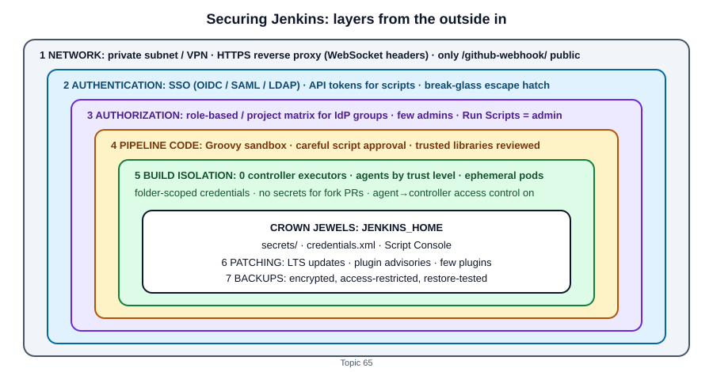

# 65 · Securing Jenkins

> **Level:** ★★★ advanced · **Status:** 🆕 new topic (expands one-line mentions of RBAC/SSO in Day 02/03)
>
> **You will learn:** how to lock down a Jenkins controller: authentication (**security realm**: local users, LDAP, SSO via OIDC/SAML), authorization (matrix, project-based, **role-based**), API tokens, CSRF crumbs, script approval and the sandbox, agent → controller rules, builds off the controller, TLS behind a reverse proxy, security advisories, and a hardening checklist.
>
> **You need:** topics 11, 16, 23–24, 30, 50.
>
> **From your original notes:** Day 03 › *Jenkins Administrators: security (RBAC/SSO)*; *Credentials and policies*; Day 03 Kubernetes notes ("lock down with NetworkPolicies; run agents as non-root"); shared-library lab notes ("Restrict port 8080 to your IP or a VPN").

---

## What it is

Jenkins holds the keys to everything (source code, registries, clouds, production), so it's a prime target. Securing it has layers:

| Layer | Question | Where |
|---|---|---|
| **Authentication** (security realm) | Who are you? | Manage Jenkins → Security → Security Realm |
| **Authorization** (strategy) | What may you do? | Manage Jenkins → Security → Authorization |
| **Pipeline code security** | What may pipeline code call? | Sandbox + In-process Script Approval |
| **Build isolation** | Can a build harm the controller or other builds? | 0 controller executors, agents, folders |
| **Network** | Who can reach it? | Reverse proxy + TLS, firewalls, private networks |
| **Patching** | Known vulnerabilities? | LTS updates, plugin updates, advisories |

---

## Why it exists

A real-world pattern: a Jenkins exposed to the internet with weak authentication, or a Script Console reachable by too many people, leads to stolen cloud credentials and crypto-miners. Jenkins publishes **security advisories** for core and plugins almost every month.

---

## Analogy

A bank vault: ID check at the door (authentication), different keys for tellers and managers (authorization), cameras on the vault room (audit), the vault in a back room without street windows (network), and regular lock upgrades (patching).

---

## How it works inside




### Authentication: security realms

- **Jenkins' own user database:** fine for labs and small teams.
- **LDAP / Active Directory:** company directory accounts and groups.
- **SSO:** **OIDC** (OpenID Connect; *OpenId Connect Authentication* plugin, works with Okta, Entra ID, Keycloak, Google), **SAML** (*SAML* plugin), or **GitHub OAuth** (*GitHub Authentication* plugin). Users log in with the company identity provider, and group memberships come along.

### Authorization strategies

| Strategy | Use |
|---|---|
| *Anyone can do anything* / *Legacy mode* | Never |
| *Logged-in users can do anything* | Labs only |
| **Matrix-based security** | A grid of users/groups × permissions (Overall/Read, Job/Build, Job/Configure, Credentials/View…) |
| **Project-based Matrix** | Matrix + per-job/per-folder permissions: teams own their folders |
| **Role-Based Strategy** (plugin) | Global, item (regex on job names) and agent **roles** assigned to groups: easier at scale |

Grant permissions to **groups from your IdP**, not to individuals. Keep **Overall/Administer** to a small platform team; **Run Scripts** (Script Console) is effectively admin.

### API tokens and CSRF crumbs

- **API tokens** (user menu → Security → API Token): for scripts and the REST API/CLI, instead of passwords. Revocable, per use.
- **CSRF protection** (Cross-Site Request Forgery: a malicious website tricking your logged-in browser into making requests) is always on: browser-style POSTs need a **crumb** token from `/crumbIssuer/api/json`. Requests authenticated with an **API token** don't need a crumb (topic 70).

### Pipeline code: the sandbox and script approval

- All pipelines run in the **Groovy sandbox** (topics 30–31): only allow-listed methods.
- Calls outside the list wait in **Manage Jenkins → In-process Script Approval**. **Approve methods carefully**: approving e.g. `java.lang.Runtime exec` or `jenkins.model.Jenkins getInstance` hands pipeline authors admin power.
- **Global shared libraries are trusted** (not sandboxed): protect their repos (topic 58).
- The **Script Console** (`/script`) runs arbitrary Groovy as the controller: it can decrypt every credential. Admins only; audit its use.

### Build isolation

- **0 executors on the built-in node** (topic 50).
- Agents per trust level; ephemeral agents; untrusted fork PRs without credentials (topic 44).
- **Folder-scoped credentials** so team A's pipelines can't use team B's secrets (topic 23).
- **Authorize Project** plugin: run builds *as* the user/system identity that triggered them, limiting what a build can trigger or read.
- Agent → controller access control is on (don't disable it).

### Network: reverse proxy + TLS

Run Jenkins on `127.0.0.1:8080` (or a private network) behind **Nginx/Apache/a cloud load balancer** that terminates **HTTPS**. Set the **Jenkins URL** to the `https://` address. Nginx essentials:
```nginx
server {
  listen 443 ssl;
  server_name ci.example.com;
  ssl_certificate     /etc/ssl/ci.crt;
  ssl_certificate_key /etc/ssl/ci.key;
  location / {
    proxy_pass         http://127.0.0.1:8080;
    proxy_set_header   Host $host;
    proxy_set_header   X-Forwarded-Proto https;
    proxy_set_header   X-Forwarded-For $proxy_add_x_forwarded_for;
    proxy_http_version 1.1;
    proxy_set_header   Upgrade $http_upgrade;        # WebSocket agents
    proxy_set_header   Connection "upgrade";
    proxy_read_timeout 300;
    proxy_request_buffering off;                     # large uploads / CLI
  }
}
```
If you see **"It appears that your reverse proxy set up is broken"** on Manage Jenkins, the `Host`/`X-Forwarded-*` headers or the Jenkins URL don't match.

Expose only `/github-webhook/` publicly if you must (path-restricted at the proxy/WAF), keep the UI on VPN/SSO.

### Patching and advisories

- Subscribe to **jenkins.io/security/advisories** (and the mailing list). **Manage Jenkins** shows a warning banner when installed versions have known vulnerabilities.
- Upgrade LTS point releases promptly; update or remove vulnerable plugins (topic 66).

---

## Config / Jenkinsfile / commands

Security as code (JCasC, topic 67):
```yaml
jenkins:
  numExecutors: 0
  securityRealm:
    oic:                                   # OpenId Connect Authentication plugin
      serverConfiguration:
        wellKnown:
          wellKnownOpenIDConfigurationUrl: https://login.example.com/.well-known/openid-configuration
      clientId: jenkins
      clientSecret: "${OIDC_CLIENT_SECRET}"
      userNameField: preferred_username    # default is "sub"
      groupsFieldName: groups
      properties:
        - escapeHatch:                     # break-glass local login if the IdP is down
            username: breakglass
            secret: "${OIDC_ESCAPE_HATCH_SECRET}"
            group: platform-admins
  authorizationStrategy:
    roleBased:
      roles:
        global:
          - name: admin
            permissions: ["Overall/Administer"]
            entries: [{ group: "platform-admins" }]
          - name: reader
            permissions: ["Overall/Read", "Job/Read"]
            entries: [{ group: "engineering" }]
        items:
          - name: team-a
            pattern: "team-a/.*"
            permissions: ["Job/Build", "Job/Read", "Job/Cancel", "Job/Workspace"]
            entries: [{ group: "team-a-devs" }]
  crumbIssuer: standard
security:
  scriptApproval:
    approvedSignatures: []                 # keep empty; review every request
```
(Exact YAML keys depend on plugin versions; export your live config with **Manage Jenkins → Configuration as Code → View Configuration** to get the right shape.)

Check who can do what:
```bash
curl -s -u alice:$TOKEN 'https://ci.example.com/whoAmI/api/json?pretty=true'
```
```json
{ "name": "alice", "authenticated": true, "authorities": ["authenticated", "team-a-devs"] }
```

---

## Deeper dive

### Threat model: how Jenkins actually gets attacked

| Attacker / path | What they do | Main defence |
|---|---|---|
| Internet scanner finds an exposed Jenkins | Exploits an unpatched core/plugin CVE, or logs in with weak/anonymous access | Private network/VPN, SSO, prompt patching |
| Malicious PR (especially from a fork) | Changes build scripts or tests to steal secrets available to that build | Trust policies, no credentials in PR stages, separate untrusted agents (topic 44) |
| Insider with **Job/Configure** | Edits a job/Jenkinsfile to print or send its credentials | Least privilege; Jenkinsfile review; folder-scoped credentials |
| Stolen API token | Triggers jobs, reads logs, changes configs | Short-lived/rotated tokens, per-purpose service accounts, audit logs |
| Compromised agent | Reads other builds' workspaces, tampers with artifacts | Ephemeral agents, separate pools per trust level, agent → controller restrictions |
| Malicious/abandoned plugin | Arbitrary code inside the controller | Few, well-maintained plugins; review advisories |

The key insight: **anyone who can change what a job runs can use every credential that job can use.** Masking (topic 24) doesn't change that. So permissions to *configure* jobs (or merge Jenkinsfiles) must match the sensitivity of the credentials those jobs hold.

### Permissions that matter most

| Permission | Why it's powerful |
|---|---|
| **Overall/Administer** | Everything, including the Script Console |
| **Overall/RunScripts** (inherited from Administer) | Arbitrary Groovy on the controller: decrypts all credentials |
| **Job/Configure** | Change the steps a job runs, so it can exfiltrate that job's credentials |
| **Credentials/View / Update** | See or replace credentials metadata/values in a store |
| **Agent/Connect, Agent/Configure** | Attach rogue agents, or change where builds run |
| **Run/Replay** | Run edited pipeline code without review |
| **Job/Build** | Fine for most users, but combined with parameters it can still deploy to prod; restrict prod jobs |

### Audit

- The *Audit Trail* plugin logs who changed what (job configs, credentials, logins) to a file or syslog.
- *Job Configuration History* keeps diffs of every job/system config change.
- With JCasC + Git (topic 67), most system changes are already reviewed commits.

### Hardening checklist (in priority order)

1. Not reachable from the internet (VPN/private network); HTTPS via a reverse proxy.
2. SSO authentication; no anonymous read; no sign-up.
3. Role/folder authorization for IdP groups; ≤ 5 admins.
4. 0 executors on the built-in node.
5. Folder-scoped credentials; cloud identity instead of static keys.
6. Untrusted PRs: no credentials, separate agents.
7. Minimal plugins; LTS + plugin updates within days of advisories.
8. Careful script approval; protected trusted-library repos.
9. Audit trail + config history; encrypted, access-controlled backups.
10. Configuration as code, so drift and manual "temporary" changes are visible.

### When you lock yourself out

```bash
# VM install: stop Jenkins, back up config.xml, disable security, start, fix, re-enable
sudo systemctl stop jenkins
sudo cp /var/lib/jenkins/config.xml /var/lib/jenkins/config.xml.bak
sudo sed -i 's#<useSecurity>true</useSecurity>#<useSecurity>false</useSecurity>#' /var/lib/jenkins/config.xml
sudo systemctl start jenkins      # log in, fix realm/authorization, then turn security back on
```
With JCasC, fix the YAML and restart instead. With the OIDC plugin, the **escape hatch** user (shown in the JCasC example above) is the planned way in when the identity provider is down.

---

## Hands-on lab

1. In your lab Jenkins: **Security → Authorization → Matrix-based security**. Give `authenticated` Overall/Read + Job/Read/Build; keep your admin user as Administer.
2. Create a second user `dev1`; log in as them and confirm they can't see **Manage Jenkins** or configure jobs.
3. In a pipeline, call `new File('/etc/passwd').text` and go to **In-process Script Approval**: see the pending signature. **Deny** it.
4. Put Nginx in front of the Docker Jenkins with a self-signed certificate (`openssl req -x509 -newkey rsa:2048 -nodes -keyout ci.key -out ci.crt -subj /CN=localhost -days 7`), set the Jenkins URL to `https://localhost/`, and connect an inbound agent with `-webSocket` through it.

---

## Where you'll use it

Every non-lab Jenkins; security reviews; compliance audits (SOC 2, ISO 27001 expect SSO, least privilege and patching).

---

## When it breaks

| Symptom | Cause | Fix |
|---|---|---|
| Locked out after changing the realm/strategy | Mis-configured security | Edit `config.xml`: set `<useSecurity>false</useSecurity>` (or fix via JCasC), restart, fix, re-enable |
| `403 No valid crumb was included in the request` | POST without a crumb/token | Use an API token, or fetch a crumb (topic 70) |
| "reverse proxy set up is broken" | Wrong proxy headers / Jenkins URL | Fix `Host`, `X-Forwarded-Proto`, Jenkins URL |
| Pipeline `RejectedAccessException: Scripts not permitted to use …` | Sandbox | Use a step, or review and approve carefully |
| Users see others' credentials | Global credentials for everything | Folder-scoped credentials + project matrix/roles |

---

## Quick recap

- **Authenticate** with SSO/LDAP; **authorize** groups via project matrix or role-based strategy.
- API tokens for scripts; CSRF crumbs for browser-style POSTs.
- Sandbox + careful script approval; trusted libraries and the Script Console = admin power.
- No builds on the controller; folder credentials; agents by trust level.
- HTTPS reverse proxy (WebSocket-aware), private network; patch LTS and plugins from advisories.

**Interview questions**

1. **Q: How would you secure a Jenkins controller?**
   A: SSO authentication, role/folder-based authorization for groups, 0 controller executors with isolated agents, folder-scoped credentials, sandboxed pipelines with careful script approval, HTTPS behind a reverse proxy on a private network, and prompt LTS/plugin patching based on advisories.

2. **Q: Why is the Script Console dangerous?**
   A: It runs arbitrary Groovy with the controller's full privileges, so it can read files and decrypt every stored credential.

3. **Q: What's a CSRF crumb in Jenkins?**
   A: An anti-CSRF token that browser-session POST requests must include; API-token-authenticated requests don't need one.
