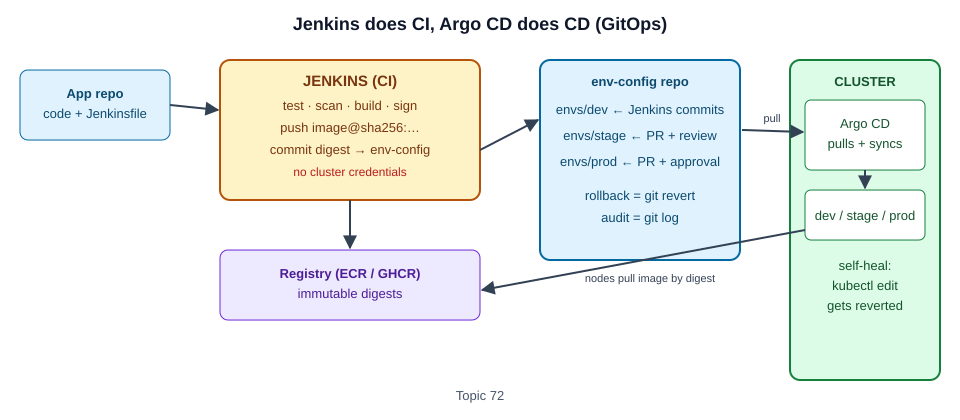

# 72 · Jenkins + GitOps with Argo CD

> **Level:** ★★★ advanced · **Status:** 🆕 new topic (expands Day 02's GitOps mentions and Project 01 improvement #3)
>
> **You will learn:** the modern split: **Jenkins does CI** (build, test, scan, push, sign) and **Argo CD does CD** (syncs the cluster from Git). How Jenkins hands over by committing the new image **digest** to an environment-config repo, how promotion between environments becomes a PR, and how rollback becomes a Git revert.
>
> **You need:** topics 07, 08, 09, 24, 46, 63, 64. [Kubernetes notes 68 GitOps](../../CKA-Certification-Course-2025/notes/68-gitops.md), [64 Kustomize](../../CKA-Certification-Course-2025/notes/64-kustomize.md).
>
> **From your original notes:** Day 02 › trunk-based promotion "via pipeline stages **or** GitOps PRs in an env-config repo", "Argo CD/Flux excel at GitOps promotions (Jenkins can open the PRs they sync)", "open GitOps PR" as a shared-library step · Project 01 › *3. GitOps with ArgoCD (True production pattern)*.

---

## What it is

**GitOps:** each environment's desired state (manifests/Helm values with image digests) lives in a **Git repo**; a controller in the cluster (**Argo CD** or **Flux**) continuously **pulls** that repo and makes the cluster match it.

```
app repo ──▶ Jenkins CI: test, scan, build, push image@sha256:…, sign
                 └─ commit/PR: env-config repo  envs/dev/kustomization.yaml  (newTag/digest)
env-config repo ──▶ Argo CD (in cluster) ──sync──▶ Kubernetes (dev, then stage, prod via PRs)
```

---

## Why it exists

From Project 01: Argo CD implements a **pull-based deployment model** where Kubernetes syncs itself from Git. Git becomes the **single source of truth**, with automated sync, **drift detection** and instant rollbacks. Extra wins over `kubectl apply` from Jenkins:
- **No cluster credentials in CI** (no kubeconfig, no EKS access for Jenkins).
- **Audit trail:** every deploy is a commit (who, what, when, approved by whom).
- **Promotion = PR** between environment folders, with branch protection and reviews (topic 09).
- **Rollback = `git revert`.**

---

## Analogy

Jenkins is the **factory** that builds and inspects the product, then updates the **order sheet** (Git). Argo CD is the **warehouse robot** that keeps the shelves (cluster) exactly matching the order sheet, and puts things back if someone moves them by hand.

---

## How it works inside




1. Jenkins builds and pushes the image, then resolves the **digest** (topic 07).
2. It clones the **env-config** repo (using a credential with write access, e.g. a GitHub App or deploy key), updates the image reference for `dev` (with `kustomize edit set image`, `yq`, or Helm values), commits, and pushes (or opens a PR).
3. Argo CD notices the new commit (polling every ~3 min, or a webhook) and **syncs**: applies the change and reports health (Synced/Healthy).
4. Promotion to `stage`/`prod`: a PR copying the same digest into `envs/stage`/`envs/prod`, reviewed and merged → Argo CD syncs.
5. If someone runs `kubectl edit` in the cluster, Argo CD shows **OutOfSync** and (with self-heal) reverts it.

---

## Config / Jenkinsfile / commands

env-config repo layout (Kustomize):
```
envs/
  dev/kustomization.yaml
  stage/kustomization.yaml
  prod/kustomization.yaml
base/deployment.yaml  base/service.yaml  base/kustomization.yaml
```
`envs/dev/kustomization.yaml`:
```yaml
resources: ["../../base"]
namespace: loans-dev
images:
  - name: loans
    newName: <YOUR_ACCOUNT_ID>.dkr.ecr.ap-south-1.amazonaws.com/loans
    digest: sha256:0000…                 # Jenkins updates this line
```

Jenkins stage (on `main` only):
```groovy
stage('GitOps: update dev') {
  when { branch 'main' }
  steps {
    sshagent(credentials: ['env-config-deploy-key']) {
      sh '''
        set -euo pipefail
        rm -rf env-config
        git clone git@github.com:acme/env-config.git
        cd env-config/envs/dev
        kustomize edit set image "loans=$IMAGE_REPO@$DIGEST"
        git config user.email "jenkins@acme.example"; git config user.name "Jenkins"
        git commit -am "loans: deploy ${DIGEST} to dev (build ${BUILD_NUMBER})"
        git push origin main
      '''
    }
  }
}
```
- `kustomize edit set image name=repo@digest` rewrites the `images:` entry.
- Jenkins never touches the cluster. Argo CD does.
- For `prod`, open a **PR** instead of pushing (`gh pr create --base main --title "Promote loans ${DIGEST} to prod"`), so a human approves.

Argo CD Application (applied once by the platform team):
```yaml
apiVersion: argoproj.io/v1alpha1
kind: Application
metadata: { name: loans-dev, namespace: argocd }
spec:
  project: default
  source: { repoURL: https://github.com/acme/env-config.git, targetRevision: main, path: envs/dev }
  destination: { server: https://kubernetes.default.svc, namespace: loans-dev }
  syncPolicy: { automated: { prune: true, selfHeal: true }, syncOptions: ["CreateNamespace=true"] }
```
`automated.selfHeal: true` = revert manual drift; `prune: true` = delete resources removed from Git.

Optionally wait for the rollout from Jenkins (read-only):
```bash
argocd app wait loans-dev --health --timeout 300     # with an Argo CD API token (read/sync rights only)
```

---

## Deeper dive

### Folders per environment, not branches per environment

Two ways to model environments in the config repo:

| Model | Promotion = | Problems |
|---|---|---|
| **Folder per env** (`envs/dev`, `envs/stage`, `envs/prod` on `main`) | a PR changing the digest in the next folder | none major; easy diffs, one branch to protect |
| Branch per env (`dev`, `stage`, `prod` branches) | merging branches | branches drift; merges carry unrelated changes; hard to see what differs |

Prefer **folders** (with Kustomize overlays or Helm values per folder). It's the GitOps equivalent of trunk-based development (topic 08).

### Automating promotion PRs from Jenkins

```bash
# after dev is healthy: open a PR that copies dev's digest into stage
set -euo pipefail
DIGEST=$(yq '.images[] | select(.name=="loans") | .digest' envs/dev/kustomization.yaml)
git switch -c "promote/loans-stage-${BUILD_NUMBER}"
(cd envs/stage && kustomize edit set image "loans=${IMAGE_REPO}@${DIGEST}")
git commit -am "Promote loans ${DIGEST} to stage"
git push -u origin HEAD
gh pr create --base main --title "Promote loans to stage" --body "Digest: ${DIGEST}\nFrom build: ${BUILD_URL}"
```
Branch protection on the config repo (required reviewers, CODEOWNERS per `envs/prod/`) becomes your **change approval** process, with a perfect audit trail.

### Avoiding push races

Two pipelines updating the config repo at the same time → `! [rejected] main -> main (fetch first)`. Fix it with a retry loop:
```bash
for i in 1 2 3; do
  git pull --rebase origin main && git push origin HEAD:main && break
  sleep $((i * 5))
done
```
Or serialise with `lock('env-config')` (topic 38), or have each change go through a PR (no direct pushes at all).

### Alternatives to Jenkins committing

- **Argo CD Image Updater** watches the registry and updates the image in Git (or in the Application) by itself. Jenkins then only pushes the image, and the updater does the rest. Less pipeline code, but less explicit control.
- **Flux** has the same idea built in (image automation controllers).
- Many teams still prefer Jenkins (or CI) doing the commit, because the commit message can carry the build URL, test results and approver.

### Secrets in a GitOps world

Never commit plain Kubernetes Secrets to the config repo. Common patterns:
- **External Secrets Operator**: Git contains an `ExternalSecret` pointing at Vault/AWS Secrets Manager; the operator creates the real Secret in the cluster.
- **Sealed Secrets**: Git contains an encrypted `SealedSecret` that only the in-cluster controller can decrypt.
- **SOPS**: encrypted YAML values, decrypted by Argo CD/Flux plugins at sync time.

### Reporting deploy status back to the pipeline

- `argocd app wait <app> --health --sync --timeout 300` from Jenkins (with a read-only Argo CD token) makes the build wait for the rollout and fail if it doesn't become healthy.
- Or let **Argo CD Notifications** post to Slack / set a GitHub commit status when a sync succeeds or fails, so Jenkins doesn't wait at all.
- With **Argo Rollouts**, canary analysis (metrics-based) decides promotion inside the cluster; Jenkins just records which digest was requested.

---

## Hands-on lab (kind)

1. Install Argo CD into kind (`kubectl create ns argocd && kubectl apply -n argocd -f https://raw.githubusercontent.com/argoproj/argo-cd/stable/manifests/install.yaml`).
2. Create an `env-config` repo with the layout above (use the Flask image from topic 36, by digest).
3. Create the `loans-dev` Application; check it's Synced/Healthy (`kubectl -n argocd port-forward svc/argocd-server 8443:443`).
4. Add the GitOps stage to your Jenkinsfile with a deploy key; push app code and watch Jenkins commit and Argo CD sync.
5. `kubectl -n loans-dev scale deploy/loans --replicas=5` and watch Argo CD put it back. Then `git revert` the last env-config commit: rollback.

---

## Where you'll use it

Most Kubernetes shops in 2026: Jenkins (or another CI) for building, Argo CD/Flux for deploying.

---

## When it breaks

| Symptom | Cause | Fix |
|---|---|---|
| Jenkins push rejected: `protected branch` | env-config `main` requires PRs | Open a PR (or a bot bypass for dev only) |
| `nothing to commit` fails the stage | Same digest as already deployed | `git diff --quiet \|\| git commit …` |
| Argo CD `OutOfSync` forever | Jenkins (or a human) still runs `kubectl apply` too | One writer: GitOps only |
| Two builds race to push | Concurrent main builds | `lock('env-config')` / `disableConcurrentBuilds()` (topic 38) |
| App Synced but Degraded | Bad image/config | Argo CD health details; revert the commit |

---

## Quick recap

- Jenkins = CI (build, scan, push, sign) + **commit the digest** to the env-config repo; Argo CD = CD (pull and sync).
- Promotion = PR between environment folders; rollback = `git revert`; drift is auto-corrected.
- CI no longer needs cluster credentials.

**Interview questions**

1. **Q: How do Jenkins and Argo CD work together?**
   A: Jenkins builds, tests, scans and pushes the image, then updates the image digest in an environment-config Git repo (commit or PR). Argo CD watches that repo and syncs the cluster to match.

2. **Q: Push vs pull deployment?**
   A: Push: CI applies changes to the cluster with cluster credentials. Pull (GitOps): an agent in the cluster pulls the desired state from Git; CI only changes Git, so it needs no cluster access and drift is detected.

3. **Q: How do you roll back with GitOps?**
   A: Revert the commit that changed the image digest in the env-config repo; Argo CD syncs the previous version.
